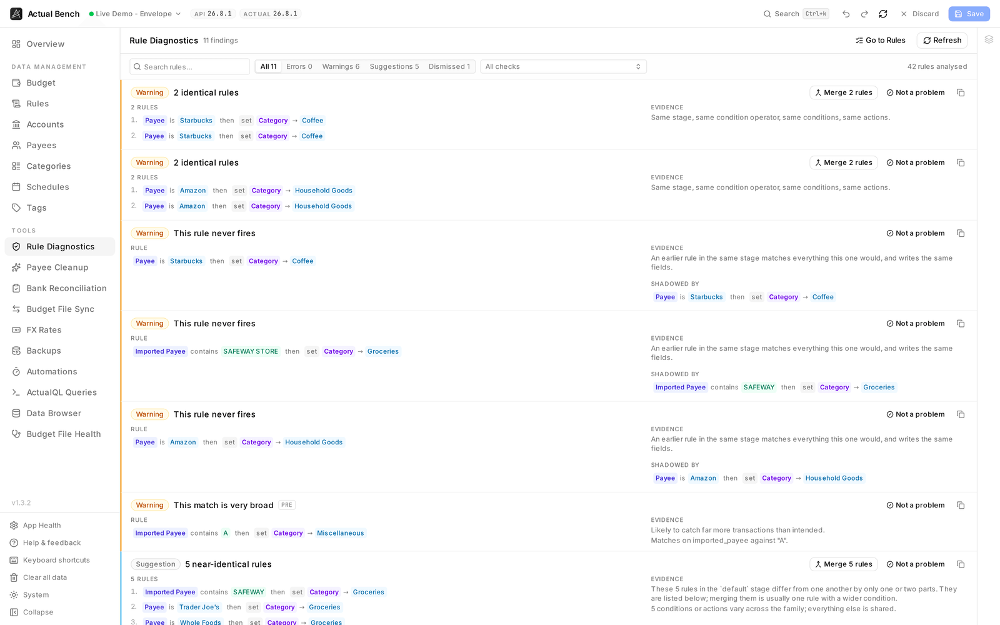
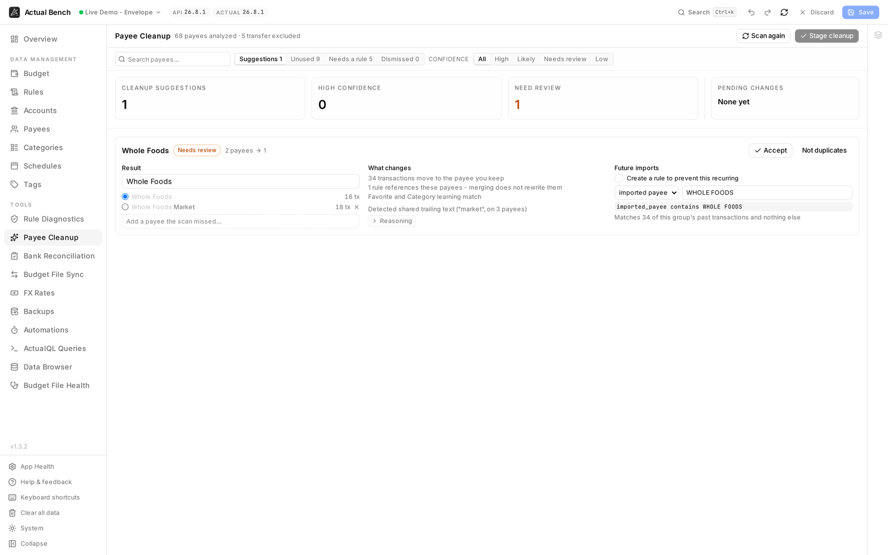
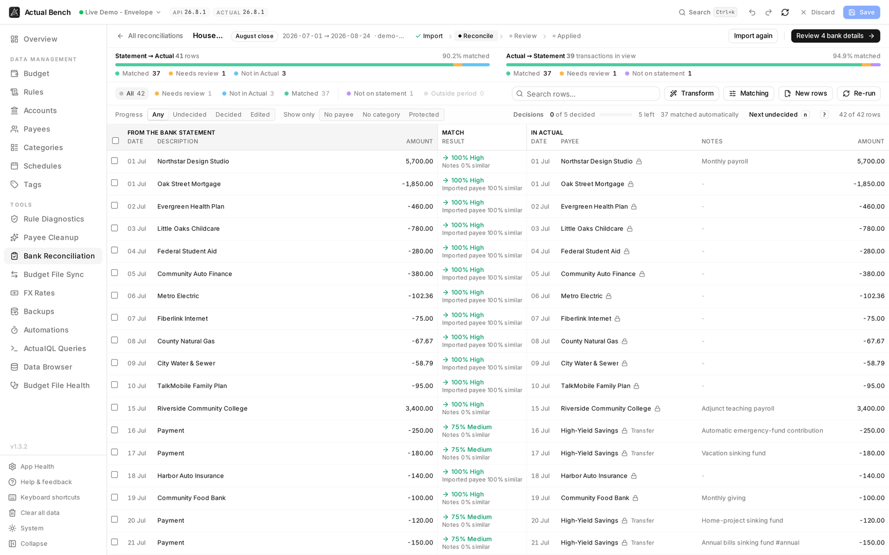
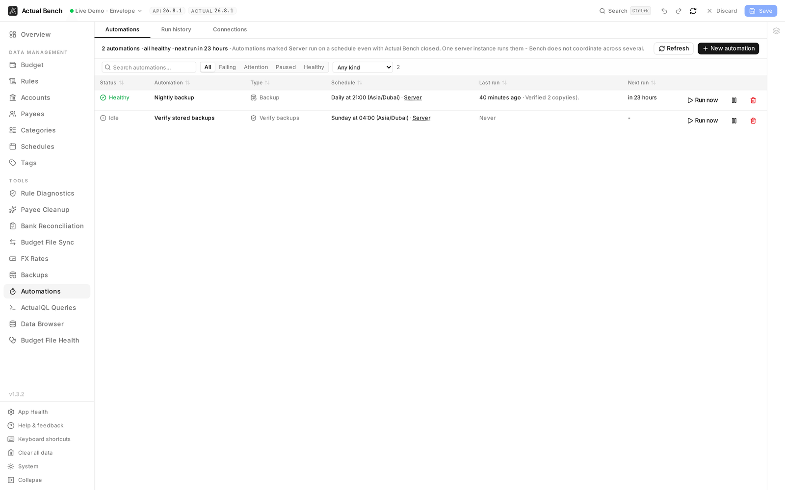

<div align="center">


# Actual Bench

**A companion app for Actual Budget.**

Full-year planning, bulk data management, reconciliation, financial tools, sync, backups and
diagnostics for your Actual Budget.

**[Try the demo](https://actual-bench-demo.vercel.app) · [Install Actual Bench](#quick-start) · [Read the docs](https://x-rous.github.io/actual-bench/)**

[](https://github.com/x-rous/actual-bench/releases)
[](https://github.com/x-rous/actual-bench/actions/workflows/ci.yml)
[](https://hub.docker.com/r/xrous/actual-bench)
[](LICENSE)

[](https://x-rous.github.io/actual-bench/)
[](https://actual-bench-demo.vercel.app)
[](CHANGELOG.md)
[](SECURITY.md)


</div>

---

## What is Actual Bench?

Actual Bench is a web app that connects to your [Actual Budget](https://github.com/actualbudget/actual)
server and gives you a workbench for planning, managing and understanding your budgets. Use it when
you want to see more at once, make changes in bulk, or investigate the details. Actual Budget remains
your home for day-to-day transaction entry.

**[Try the live demo →](https://actual-bench-demo.vercel.app)**
No setup, no account: explore sample household Envelope and Tracking budgets. This is a shared
sandbox, so use sample data only; other visitors may see your changes. The demo resets when its
backend restarts.

## What it does

**Advanced data management**

Manage [accounts](https://x-rous.github.io/actual-bench/user-guide/accounts/),
[categories](https://x-rous.github.io/actual-bench/user-guide/categories/),
[payees](https://x-rous.github.io/actual-bench/user-guide/payees/),
[tags](https://x-rous.github.io/actual-bench/user-guide/tags/),
[rules](https://x-rous.github.io/actual-bench/user-guide/rules/) and
[schedules](https://x-rous.github.io/actual-bench/user-guide/schedules/) in one place. Search and
filter your data, edit rows, work in bulk, and import or export CSV files. Check dependencies before
deleting, merge duplicate payees and rules, and build rules with splits, templates and formulas.
Review your changes together before saving.

Move a budget's whole structure in one ZIP with **[Bundle export / import](https://x-rous.github.io/actual-bench/getting-started/bundle-export-import/)**:
build a reusable template, seed a new budget, or keep a snapshot before a cleanup.

**Financial management**

- **[Budget Cockpit](https://x-rous.github.io/actual-bench/user-guide/budget-management/)** - see twelve months of budget, actuals or balances in one grid. Edit across months with spreadsheet-style selection, copy/paste and fill. The details panel follows your selection, showing the story behind a month, group or category; explore the drivers behind a variance and open the underlying transactions without leaving the workspace.
- **[Bank Reconciliation](https://x-rous.github.io/actual-bench/user-guide/bank-reconciliation/)** - compare a bank statement with an Actual account to find missing, duplicate or incorrect transactions. Import CSV, TSV, OFX, QFX, QIF or text-based PDF statements, review suggested matches and decide how to resolve differences. Your session is saved so you can return later, and you review the planned changes before applying them.
- **[Credit Cards](https://x-rous.github.io/actual-bench/user-guide/credit-cards/)** *(Experimental)* - see what you owe, what is due and how much credit is available across your cards. Check bank statements against your Actual transactions, follow payments and interest, and track instalment plans alongside your card history. Bench saves your card settings and review decisions without changing Actual transactions.
- **[Assets](https://x-rous.github.io/actual-bench/user-guide/asset-registry/)** *(Experimental)* - bring property, investments, vehicles and other assets into one view, using your Actual accounts as the ledger. Follow value, capital invested, income, expenses and returns over time; account for shared ownership and depreciation; and link loans to see your equity. Explore the transactions behind the figures and review financial changes before confirming them.
- **[Loans & Debt](https://x-rous.github.io/actual-bench/user-guide/assets-debt/)** *(Experimental)* - explore your loan before making a decision: model rate changes, extra payments, offsets and fees, and see how they affect interest and payoff in the chart and repayment schedule. Link the loan to Actual to compare the forecast with real payments, review principal and interest splits, and see the equity in linked assets. Start with the calculator and connect it to your budget when you're ready.

**Clean up and audit**

- **[Payee Cleanup](https://x-rous.github.io/actual-bench/user-guide/payee-cleanup/)** - reviews possible duplicate payees, finds payees whose bank text needs an assignment rule, and lets you remove unused payees through a staged cleanup plan.
- **[Rule Diagnostics](https://x-rous.github.io/actual-bench/user-guide/rule-diagnostics/)** - reads your rules as a set: what shadows what, what can never fire, what duplicates what. Analysis does not change your budget; fixes you explicitly start use the normal staged Save.
- **[Budget File Health](https://x-rous.github.io/actual-bench/user-guide/budget-file-health/)** and **[Data Browser](https://x-rous.github.io/actual-bench/user-guide/data-browser/)** - open a budget snapshot in your browser, run health checks, and browse its tables directly.
- **[ActualQL](https://x-rous.github.io/actual-bench/user-guide/actualql/)** - a query console with saved queries, plain-English explain, and table, JSON, scalar and tree result views.

**Sync, backups and automation**

- **[Bank sync](https://x-rous.github.io/actual-bench/user-guide/bank-sync/)** - schedule Actual's SimpleFIN or GoCardless sync to run automatically in the background, even when your browser is closed. See the result for each linked account when you return.
- **[Budget File Sync](https://x-rous.github.io/actual-bench/user-guide/budget-sync/)** *(Experimental)* - copy transactions, payees or categories between budget files, with a preview and duplicate protection. Convert currencies using [locked FX rates](https://x-rous.github.io/actual-bench/user-guide/fx-rates/).
- **[Backups](https://x-rous.github.io/actual-bench/user-guide/backups/)** - take checked copies on demand or on a schedule, to destinations you choose.
- **[Automations](https://x-rous.github.io/actual-bench/user-guide/automations/)** *(Experimental)* - schedule backups and syncs, and see what ran and whether it succeeded, even with Bench closed.

## Quick start

You need Docker and a running [Actual Budget](https://github.com/actualbudget/actual) server. No
environment variables are required for a basic setup.

```yaml
# docker-compose.yml
services:
  actual-bench:
    image: xrous/actual-bench:latest
    container_name: actual-bench
    ports:
      - "3000:3000"
    volumes:
      - actual-bench-data:/data
    restart: unless-stopped

volumes:
  actual-bench-data:
```

```bash
docker compose up -d
```

Or without a compose file:

```bash
docker run -d --name actual-bench --restart unless-stopped \
  -p 3000:3000 -v actual-bench-data:/data xrous/actual-bench:latest
```

Open `http://localhost:3000` and connect. Keep the `/data` volume: it holds Bench's own settings,
backup history and sync state - not a copy of your budget. Credentials stay in memory unless you opt
in: remembering a server seals them behind a passphrase you choose, and credentials enrolled
for automations are sealed with a vault key Bench generates on first start and keeps in
`/data/secrets/vault.key`. No environment variables are required.

Running behind a reverse proxy, want the edge build, or need to change a setting? See
**[Installation](https://x-rous.github.io/actual-bench/getting-started/installation/)** and
**[Configuration](https://x-rous.github.io/actual-bench/administration/configuration/)**.

### Hosted deployment

Prefer not to run your own Docker host?

- **Fly.io** - deploy your own instance with the included `fly.toml` template: see [Deploy on Fly.io](https://x-rous.github.io/actual-bench/administration/fly-io/) for step-by-step instructions. It keeps a single always-on Machine with persistent storage, since Actual Bench's automation scheduler needs one running instance.

See **[Deployment](https://x-rous.github.io/actual-bench/administration/deployment/)** for more options.

### Connecting

Bench talks to Actual two ways, and you pick one on the connection screen:

- **Direct Actual Server** - your browser talks to Actual directly, using Actual's own browser API. This is the target architecture.
- **HTTP API Server** - through [actual-http-api](https://github.com/jhonderson/actual-http-api), for installations that use the HTTP API bridge.

Both modes support unattended server-side work after you enrol the budget for automation.

<p align="center">
  
</p>

**[How to connect →](https://x-rous.github.io/actual-bench/getting-started/connecting/)**

## You're in control

Review your work before it changes your Actual budget. Most edits are staged in your browser until
you choose **Save**; workflows such as reconciliation and budget file sync let you review changes
before you **Apply** them. Scheduled changes run only when you opt into an automation.

## Screenshots

| Rules audited as a set | Duplicate payees, with the evidence |
|:---:|:---:|
|  |  |

| A statement reconciled row by row | Work that runs with the app closed |
|:---:|:---:|
|  |  |

## Documentation

Full documentation is at **[x-rous.github.io/actual-bench](https://x-rous.github.io/actual-bench/)**.

| | |
|---|---|
| [Getting started](https://x-rous.github.io/actual-bench/getting-started/introduction/) | Install, connect, and the ideas the app is built on |
| [User guide](https://x-rous.github.io/actual-bench/user-guide/budget-management/) | Every feature, page by page |
| [Administration](https://x-rous.github.io/actual-bench/administration/deployment/) | Deployment, configuration, upgrades and backups |
| [Troubleshooting](https://x-rous.github.io/actual-bench/help/troubleshooting/) | When something does not work |
| [Known limitations](https://x-rous.github.io/actual-bench/help/known-limitations/) | What it deliberately does not do |

## Contributing

Contributions are welcome. Keep pull requests focused, user-facing, and aligned with the staged
editing model. See **[CONTRIBUTING.md](CONTRIBUTING.md)** for the workflow, and
**[FEATURES.md](FEATURES.md)** for the complete feature reference.

- **Bugs and feature requests:** [Issues](https://github.com/x-rous/actual-bench/issues)
- **Releases:** [Changelog](CHANGELOG.md) · [Releases](https://github.com/x-rous/actual-bench/releases)

## License

[MIT](LICENSE) © Manaf
