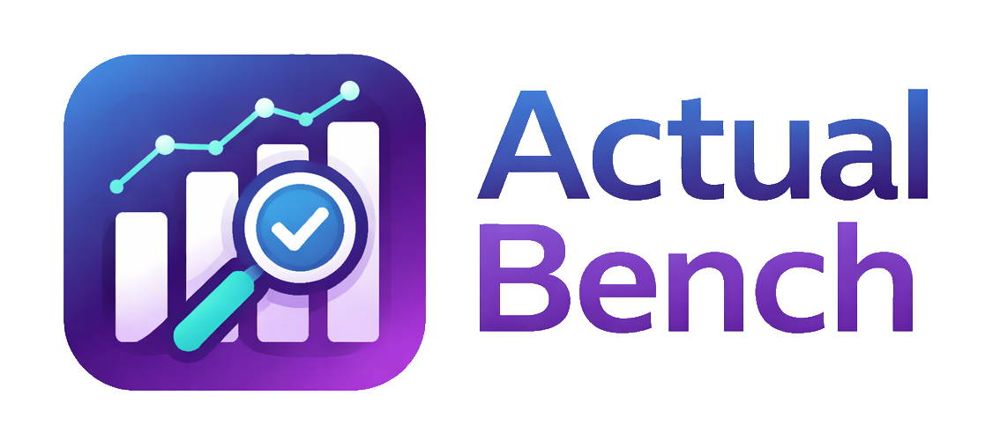
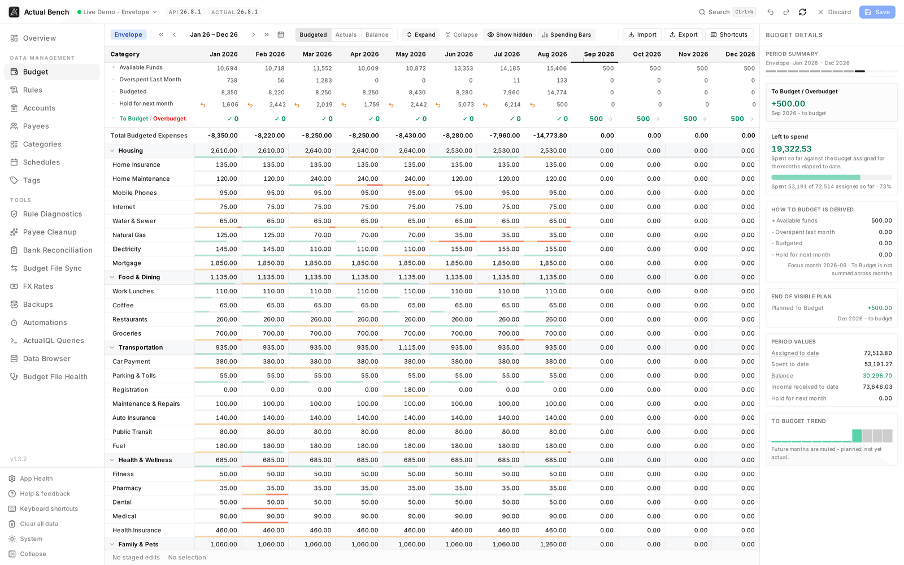
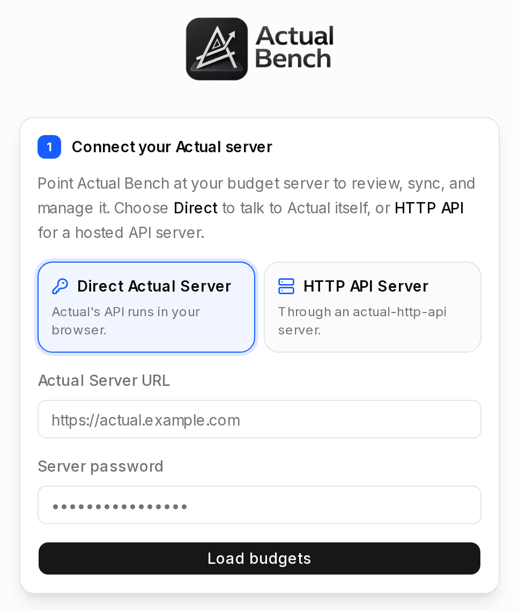

<div align="center">



# Actual Bench

**A companion app for Actual Budget.**

Full-year planning, bulk data management, reconciliation, assets, credit cards, loans, automatic sync & backups,
and diagnostics for your Actual Budget.

**[Try the demo](https://actual-bench-demo.vercel.app) · [Install Actual Bench](#quick-start) · [Read the docs](https://x-rous.github.io/actual-bench/)**

<p>
  <a href="https://github.com/x-rous/actual-bench/releases"></a>
  <a href="https://github.com/x-rous/actual-bench/actions/workflows/ci.yml"></a>
  <a href="https://hub.docker.com/r/xrous/actual-bench"></a>
  <a href="LICENSE"></a>
</p>
<p>
  <a href="https://x-rous.github.io/actual-bench/"></a>
  <a href="https://actual-bench-demo.vercel.app"></a>
  <a href="CHANGELOG.md"></a>
  <a href="SECURITY.md"></a>
</p>



</div>

---

## What is Actual Bench?

Actual Bench is a web app that connects to your [Actual Budget](https://github.com/actualbudget/actual)
server. It gives you a workbench to see more at once, explore your finances, make changes in bulk and
investigate the details. Actual Budget remains your home for day-to-day transaction entry.

**[Try the live demo →](https://actual-bench-demo.vercel.app)**
No setup, no account: explore sample household Envelope and Tracking budgets. This is a shared
sandbox, so use sample data only; other visitors may see your changes. The demo resets when its
backend restarts. Vercel serves the interface and analytics; its demo API requests use the
Hugging Face backend, where the shared sample data lives.

## What Actual Bench adds to Actual Budget

**Advanced budget data management**

- Manage [accounts](https://x-rous.github.io/actual-bench/user-guide/accounts/),
[categories](https://x-rous.github.io/actual-bench/user-guide/categories/),
[payees](https://x-rous.github.io/actual-bench/user-guide/payees/),
[tags](https://x-rous.github.io/actual-bench/user-guide/tags/),
[rules](https://x-rous.github.io/actual-bench/user-guide/rules/) and
[schedules](https://x-rous.github.io/actual-bench/user-guide/schedules/) in one place. Search and
filter your data, edit rows, work in bulk, and import or export CSV files. Check dependencies before
deleting, merge duplicate payees and rules, and build rules with splits, templates and formulas.
Review your changes together before saving.

- Export a budget's structure to a ZIP file and import it into another budget with **[Bundle export / import](https://x-rous.github.io/actual-bench/getting-started/bundle-export-import/)**.
Use it to create a reusable template, set up a new budget, or keep a snapshot before a cleanup.

**Financial management tools**

- **[Budget Cockpit](https://x-rous.github.io/actual-bench/user-guide/budget-management/)** - see twelve months of budget, actuals or balances in one grid, and edit across months with spreadsheet-style selection, copy/paste and fill. Explore details and variances, and open the underlying transactions without leaving the workspace.
- **[Bank Reconciliation](https://x-rous.github.io/actual-bench/user-guide/bank-reconciliation/)** - compare a bank statement with an Actual account to find missing, duplicate or incorrect transactions. Import CSV, TSV, OFX, QFX, QIF or text-based PDF statements, review suggested matches and decide how to resolve differences. Your session is saved so you can return later, and you review the planned changes before applying them.
- **[Credit Cards](https://x-rous.github.io/actual-bench/user-guide/credit-cards/)** *(Experimental)* - see what you owe, what is due and how much credit is available across your cards. Check bank statements against your Actual transactions, follow payments and interest, and track instalment plans alongside your card history. Bench saves your card settings and review decisions without changing Actual transactions.
- **[Assets](https://x-rous.github.io/actual-bench/user-guide/asset-registry/)** *(Experimental)* - bring property, investments, vehicles and other assets into one view, using your Actual accounts as the ledger. Follow value, capital invested, income, expenses and returns over time; account for shared ownership and depreciation; and link loans to see your equity. Explore the transactions behind the figures and review financial changes before confirming them.
- **[Loans](https://x-rous.github.io/actual-bench/user-guide/assets-debt/)** *(Experimental)* - model rate changes, extra payments, offsets and fees, and see how they affect interest and payoff. Link the loan to Actual to compare the forecast with real payments, review principal and interest splits, and see the equity in linked assets.

**Clean up and audit**

- **[Payee Cleanup](https://x-rous.github.io/actual-bench/user-guide/payee-cleanup/)** - reviews possible duplicate payees, finds payees whose bank text needs an assignment rule, and lets you remove unused payees through a staged cleanup plan.
- **[Rule Diagnostics](https://x-rous.github.io/actual-bench/user-guide/rule-diagnostics/)** - reads your rules as a set: what shadows what, what can never fire, what duplicates what. Analysis does not change your budget; fixes you explicitly start use the normal staged Save.
- **[ActualQL](https://x-rous.github.io/actual-bench/user-guide/actualql/)** - run read-only JSON queries against your open budget, starting from built-in examples or writing your own. Explain queries in plain English, inspect results as tables, raw JSON, scalar values or trees, and save useful queries to reuse.
- **[Budget File Health](https://x-rous.github.io/actual-bench/user-guide/budget-file-health/)** and **[Data Browser](https://x-rous.github.io/actual-bench/user-guide/data-browser/)** - open a budget snapshot in your browser, run health checks, and browse its tables directly.

**Sync, backups and automation**

- **[Bank sync](https://x-rous.github.io/actual-bench/user-guide/bank-sync/)** - schedule Actual's existing bank sync to run automatically in the background, even when your browser is closed. See the result for each linked account when you return.
- **[Cross Budget Sync](https://x-rous.github.io/actual-bench/user-guide/budget-sync/)** *(Experimental)* - create reusable flows to copy selected transactions, payees or categories between budget files. Filter and map data, convert currencies using rates managed in [Exchange Rates](https://x-rous.github.io/actual-bench/user-guide/fx-rates/), and preview changes with duplicate protection before applying them. Schedule safe-only syncs and review anything that needs a decision.
- **[Backups](https://x-rous.github.io/actual-bench/user-guide/backups/)** - protect Actual budgets and Bench settings with on-demand or scheduled copies to server folders and S3-compatible storage. Check verification and destination health, set retention, and optionally encrypt backups.
- **[Automations](https://x-rous.github.io/actual-bench/user-guide/automations/)** *(Experimental)* - schedule backups and syncs, and see what ran and whether it succeeded, even with Bench closed.

## Quick start

You need Docker and a running [Actual Budget](https://github.com/actualbudget/actual) server. No
environment variables are required for a basic setup.

```yaml
# docker-compose.yml
services:
  actual-bench:
    image: xrous/actual-bench:latest
    container_name: actual-bench
    ports:
      - "3000:3000"
    volumes:
      - actual-bench-data:/data
    restart: unless-stopped

volumes:
  actual-bench-data:
```

```bash
docker compose up -d
```

Or without a compose file:

```bash
docker run -d --name actual-bench --restart unless-stopped \
  -p 3000:3000 -v actual-bench-data:/data xrous/actual-bench:latest
```

Open `http://localhost:3000`. On a new installation, set an Actual Bench sign-in password, then connect
to your Actual server using its separate credentials. Keep the `/data` volume: it holds Bench's own
settings, backup history and sync state - not a copy of your budget.

You can save encrypted connection credentials for later; **Remember this budget** is selected by
default when saving is available, and you can untick it. Saved connections are encrypted with your
Actual Bench password. Credentials enrolled for automations are encrypted separately with a vault key
Bench generates on first start and keeps in `/data/secrets/vault.key`.

Running behind a reverse proxy, want the edge build, or need to change a setting? See
**[Installation](https://x-rous.github.io/actual-bench/getting-started/installation/)** and
**[Configuration](https://x-rous.github.io/actual-bench/administration/configuration/)**.

### Hosted deployment

Prefer not to run your own Docker host?

- **Fly.io** - deploy your own instance with the included `fly.toml` template: see [Deploy on Fly.io](https://x-rous.github.io/actual-bench/administration/fly-io/) for step-by-step instructions. It keeps a single always-on Machine with persistent storage, since Actual Bench's automation scheduler needs one running instance.

See **[Deployment](https://x-rous.github.io/actual-bench/administration/deployment/)** for more options.

### Connecting

Bench talks to Actual two ways, and you pick one on the connection screen:

- **Direct Actual Server** - recommended for most installations. Your browser talks to Actual directly using Actual's own browser API, so it must be able to reach your Actual Server.
- **HTTP API Server** - through [actual-http-api](https://github.com/jhonderson/actual-http-api), for installations that use the HTTP API bridge.

Both modes support unattended server-side work after you enrol the budget for automation.

**[How to connect →](https://x-rous.github.io/actual-bench/getting-started/connecting/)**

<p align="center">
  
</p>

## You're in control

Review your work before it changes your Actual budget. Most edits are staged in your browser until
you choose **Save**; workflows such as reconciliation and Cross Budget Sync let you review changes
before you **Apply** them. Scheduled changes run only when you opt into an automation.

## Documentation

Full documentation is at **[x-rous.github.io/actual-bench](https://x-rous.github.io/actual-bench/)**.

| Guide | What it covers |
|---|---|
| [Getting started](https://x-rous.github.io/actual-bench/getting-started/introduction/) | Install, connect, and the ideas the app is built on |
| [User guide](https://x-rous.github.io/actual-bench/user-guide/budget-management/) | Every feature, page by page |
| [Administration](https://x-rous.github.io/actual-bench/administration/deployment/) | Deployment, configuration, upgrades and backups |
| [Troubleshooting](https://x-rous.github.io/actual-bench/help/troubleshooting/) | When something does not work |
| [Known limitations](https://x-rous.github.io/actual-bench/help/known-limitations/) | What it deliberately does not do |

## Contributing

Contributions are welcome. Keep pull requests focused, user-facing, and aligned with the staged
editing model. See **[CONTRIBUTING.md](CONTRIBUTING.md)** for the workflow, and
**[FEATURES.md](FEATURES.md)** for the complete feature reference.

- **Bugs and feature requests:** [Issues](https://github.com/x-rous/actual-bench/issues)
- **Releases:** [Changelog](CHANGELOG.md) · [Releases](https://github.com/x-rous/actual-bench/releases)

## License

[MIT](LICENSE)
