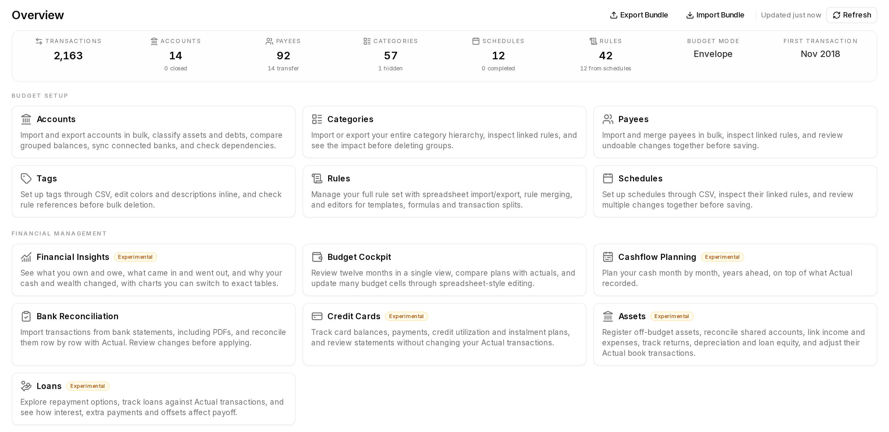

Overview is the first page you see after connecting. It shows a snapshot of the budget you are in,
so you can confirm it is the right one, and a card for every workspace. Open it any time from
**Overview** at the top of the sidebar.

*The snapshot row answers "am I in the right budget?" Everything below it is the way into the rest
of Actual Bench.*

## The snapshot

- **Counts** of transactions, accounts, payees, categories, schedules and rules, as saved in Actual.
  A small line under each count says what it includes (closed accounts, hidden categories, the
  transfer payee Actual keeps for each account), and hovering explains the rest.
- **Budget Mode** (`Envelope` or `Tracking`) and **First transaction**, the month your history
  starts.
- **Refresh** re-reads the budget. The old figures stay on screen, dimmed, until the new ones arrive.

The snapshot shows saved data only. A draft you left on another page appears here once you save it.

## The feature directory

Cards are grouped the same way as the sidebar:

| Group | Features |
|---|---|
| Budget Setup | Accounts, Categories, Payees, Tags, Rules, Schedules |
| Financial Management | Financial Insights, Budget Cockpit, Cashflow Planning, Bank Reconciliation, Credit Cards, Assets, Loans |
| Sync & Automations | Cross Budget Sync, Backups, Automations, Exchange Rates |
| Analyze & Cleanup | ActualQL Queries, Payee Cleanup, Rule Diagnostics, Budget File Health, Data Browser |

Select a card to open the workspace. Point at it for **Docs** and **Feedback** links. Newer
features carry an **Experimental** badge: Financial Insights, Cashflow Planning, Credit Cards,
Assets, Loans, Cross Budget Sync and Automations. Experimental means the feature is still being
shaped by feedback, so details may change between releases.

Inside any feature, the **About** button in the top bar shows what it can change in your budget,
with links to its docs and feedback thread.

## Export or import the whole budget structure

**Export** and **Import** in the page header open
[Bundle Export / Import](../bundle-export-import/), which moves accounts, payees, categories, tags,
schedules and rules in or out as one ZIP.

## Related pages

- [Connect to a budget](../connecting/) - how you get here
- [Work safely](../core-concepts/) - what each workspace can change
