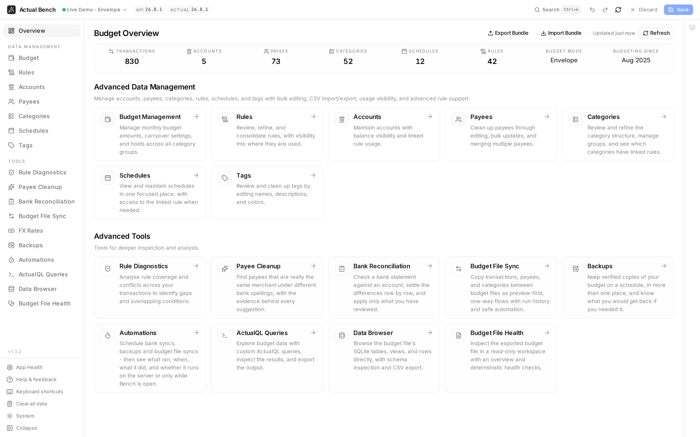

After connecting, Overview shows a saved-data snapshot of the active budget and links to every
workspace. Use it to confirm that the active budget is the one you expect.

Open it from **Overview**, at the top of the sidebar (`/overview`).

Overview and the sidebar use the same overlay scrollbars as Budget Cockpit: hidden when idle,
visible on hover or while scrolling. Scrolling still works with the mouse wheel, trackpad and keyboard.

Overview does not modify budget data. Its counts show saved server data, not staged changes. Bundle
Import is a separate workflow launched from this page.

*The snapshot row answers "am I in the right budget?" - counts, budget mode, and how long you have
been budgeting - and everything below it is the way through to the rest.*

## What the Overview shows

- **A live snapshot row** with saved-state counts for **transactions, accounts, payees, categories,
  schedules, and rules**.
- **Derived context** - the **Budget Mode** (`Envelope`, `Tracking`, or `Unidentified`) and
  **Budgeting since**, inferred from your oldest transaction date.
- **A manual Refresh** with a loading state and a last-refreshed indicator. Snapshot values switch to
  loading placeholders immediately when you switch budgets or refresh.

:::note[Overview reflects saved data]
The snapshot reads the server. A draft you left staged on another page does not show up here until you
Save it.
:::

## Feature directory

The directory lists all 19 implemented features in the same fixed groups as the sidebar:

| Group | Features |
|---|---|
| Budget Setup | Accounts, Categories, Payees, Tags, Rules, Schedules |
| Financial Management | Budget Cockpit, Credit Cards, Loans & Debt, Bank Reconciliation |
| Sync & Automations | Budget File Sync, Backups, Automations, FX Rates |
| Analyze & Cleanup | ActualQL Queries, Payee Cleanup, Rule Diagnostics, Budget File Health, Data Browser |

The directory follows four full-width, borderless sections. Each section uses the same small uppercase header style as the sidebar, without a section description,
and has three equal-width feature tiles per row on wide desktops (1600px and above), with two
columns on narrower desktop screens. Incomplete rows keep the same tile width; tiles
never span columns. Cards size to their content and align to equal heights within each row. Each tile shows its name, description, Experimental label where applicable,
and direct **Docs** and configured **Feedback** links. Click the card to open the workspace. **Docs** and **Feedback** have icons and sit at the
top right as independent links, visible when you hover over the card or focus a link with the keyboard. Cards show hover feedback and a keyboard focus outline. Descriptions are displayed in full; there is no feature search or
information popup on Overview. Accounts, Categories, Payees, Tags and Schedules share one
feedback thread. Budget File Health has Docs only.

**Experimental** features carry a small badge at the top right beside the feature name in the directory. The sidebar names
and top bar have no maturity icons or badges.
These are Credit Cards, Loans & Debt, Budget File Sync and Automations. Other features are Stable and do not carry a badge. Overview and
App Health are application pages and have no maturity label. Unfinished Assets is not listed.

On a feature page, use the **About [feature]** information button in the top bar
for its maturity, description, data-access summary, documentation and feedback. It does not
change the feature's own panels or workflow.

The **Changes** panel header contains **Save**, **Discard**, **Undo** and **Redo** for entity drafts.
Budget Cockpit has the same controls in its **Budget** panel header. Headers keep all controls
on a single toolbar-aligned row, with a numeric badge beside the title. The controls use the
existing save and review workflows. Select **Minimize panel** to tuck the panel into a narrow rail
on the right; its restore button and pending count remain visible. The minimized preference is
remembered across pages and reloads in this browser. Minimizing never saves or discards drafts.

Bank Reconciliation, Credit Cards and Loans & Debt require global drafts to be saved or discarded
before opening. Their entry screen temporarily opens the relevant changes panel, even when it is
minimized or normally hidden. After resolving the draft, the remembered panel preference resumes. If Quick Create or Redo adds a global draft after entry, the editor stays open and the relevant panel
appears so you can resolve it without losing local work. Re-entering a page or switching budgets
checks drafts again. Keyboard Undo/Redo follow the same draft owner as the panel controls;
text-input undo and shortcuts already handled by the budget grid stay local. Feature-local
Save/Apply actions are unchanged.

## Whole-budget export and import

**Export** and **Import** in the page header run [Bundle Export / Import](../bundle-export-import/):
all of a budget's master data - accounts, payees, category groups and categories, tags, schedules,
rules - in or out as one ZIP. The Overview deliberately preloads nothing, so the export dialog fetches on demand and always
reflects what the server holds right now.

## Related pages

- [Connect to Actual Budget](../connecting/) - how you get here
- [Bundle Export / Import](../bundle-export-import/)
- [Budget File Health](../../user-guide/budget-file-health/) · [Data Browser](../../user-guide/data-browser/)
