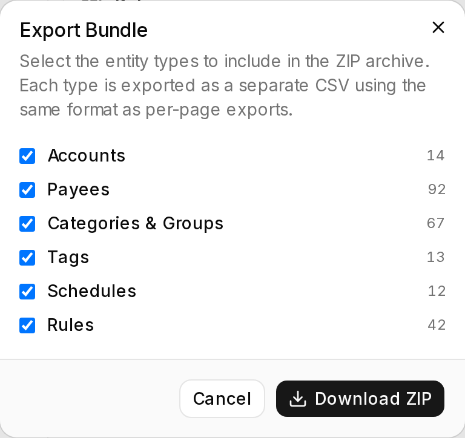

A bundle is your budget's structure in one ZIP: accounts, payees, categories, tags, schedules and
rules. Export one as a template or a safety copy before a big cleanup, or import one to set up a new
budget in a single step.

Open it from **Export** and **Import** in the [Overview](../budget-overview/) page header. Export only
reads. Import stages everything for review, and nothing reaches Actual until you **Save**.



*The dialog says exactly what goes into the ZIP before you download it.*

## Export a bundle

1. On the Overview, select **Export**.
2. Untick any types you don't want. Each shows its current count.
3. Select **Download ZIP** to save `budget-bundle-<label>-<date>.zip`.

If you export rules or schedules without the payees, categories or accounts they name, the dialog
warns you: the bundle will only import cleanly into a budget that already has those names.

The ZIP holds one CSV per type, in the same format as each page's own export:

```
budget-bundle-<label>-<date>.zip
  ├── accounts.csv
  ├── payees.csv
  ├── category-groups-and-categories.csv
  ├── tags.csv
  ├── schedules.csv
  └── rules.csv
```

## Import a bundle

1. On the Overview, select **Import** and choose a bundle ZIP. A bundle with only some of the files
   is fine.
2. Check the preview: each type it found, with its row count.
3. Confirm. Bench stages categories, accounts, payees and tags first, then schedules and rules, so
   that everything a rule refers to already exists.
4. Read the summary of what was staged or skipped. Its links open each page so you can look at the
   rows.
5. Select **Save** in the Changes panel. The whole import is one undo step.

:::tip[Export first]
A bundle can stage hundreds of rows at once. Export the current budget before a large import, so you
always have its structure to go back to.
:::

## Common problems

- **Rows were skipped:** the summary says why, for each type: a row that could not be read, or a
  reference to something that does not exist.
- **Nothing changed in Actual:** the import is staged. Select **Save**.

## Related pages

- [Editing, review and save](../editing-and-saving/) - CSV import and export on each page
