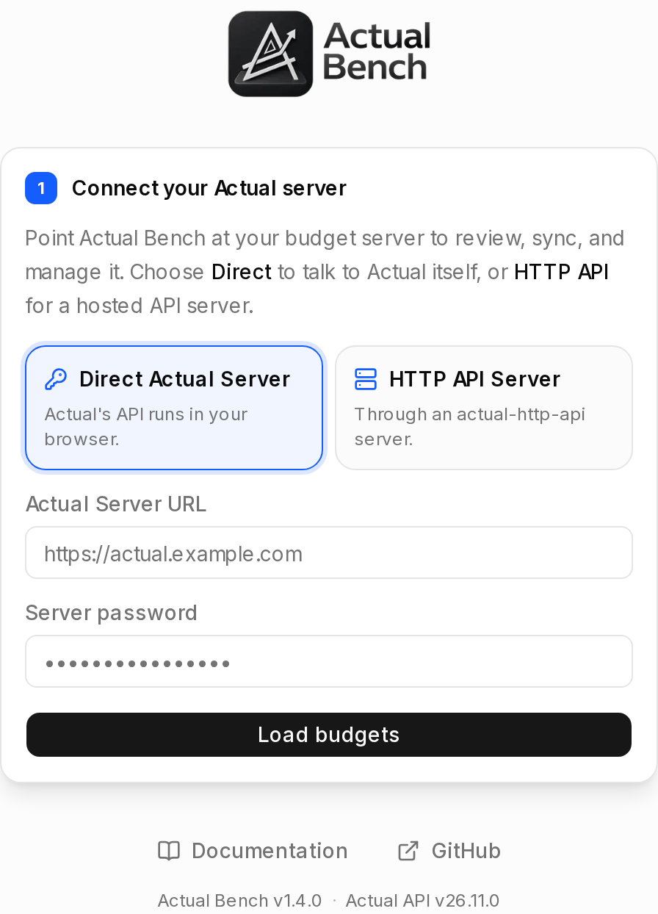

Actual Bench works on the budgets you already have on your Actual Server. Connecting takes a
minute: choose how to reach the server, sign in, and pick a budget.

:::tip[If someone else runs Actual Bench for you]
Ask them which connection mode and which address to use. The networking notes on this page are for
them, not for you.
:::

*Two ways in. **Direct** talks to your Actual Server the way Actual does. **HTTP API** goes through
an `actual-http-api` server, if your installation already has one.*

## Choose a mode

| | Direct Actual Server | HTTP API Server |
|---|---|---|
| Best for | Most installations | Installations that already run `actual-http-api` |
| You enter | Your Actual Server address and password | The HTTP API address and its API key |
| How it reaches Actual | Your browser talks to the Actual Server | Actual Bench talks to `actual-http-api` for you |

Both modes open encrypted budgets, work with every workspace and can run scheduled automations.
Where a mode makes a difference to a feature, that feature's guide says so.

## Connect

1. Choose **Direct Actual Server** or **HTTP API Server**.
2. Enter the server address and the password or API key.
3. Select **Load Budgets**.
4. Choose a budget. If it is end-to-end encrypted, also enter its **Encryption password**, which is
   separate from the server password.
5. Select **Connect**.

You land on the [Overview](../budget-overview/).

## Remember a budget

**Remember this budget** is ticked on the budget step whenever Bench can save it. With it ticked, Bench saves the
server's password or API key, encrypted with your Actual Bench password, so next time you choose the
budget and you are in. An encrypted budget's own password is saved the same way, for that budget.

Remembered budgets appear in the **Connections** list and the budget switcher, marked with a lock.
One server is stored once, however many budgets you open on it. Signing out, or restarting Actual
Bench, locks them again until you next sign in.

Untick **Remember this budget** for a budget you only want to open this once. Bench then keeps the
password in browser memory only, and forgets it when the tab closes.

If whoever runs Bench turned sign-in off, remembered budgets still need a password: you set it and
unlock them on the connect screen, which also has **Lock**, **Change password** and
**Forgot password?**.

:::caution[Your Actual Bench password cannot be recovered]
Bench never stores your password or the key made from it. If you forget it, whoever runs Bench can
set a new one (see [Sign-in](../../administration/configuration/#sign-in)). Remembered budgets were
encrypted with the old password, so they are cleared, and you connect them again. Your Actual
budgets are not touched.
:::

## Switch between budgets

Use the budget switcher in the top bar. It lists the budgets you have connected in this session and,
under **Saved**, your remembered budgets. Choosing a saved one connects and switches in one step; if
it cannot be reached, you stay where you are.

Budgets are grouped by server, and a check marks the active one. Point at a connected budget and
select **✕** to disconnect it. With many budgets, type in the filter box at the top.

Each budget keeps its own draft. Check the active budget before you select **Save** or **Apply**.

## How your credentials are kept

- Without **Remember this budget**, passwords and API keys stay in browser memory and are gone when
  the tab closes.
- Bench never shows a password or API key back to you, not even hidden in a field. The form says
  **Password saved for this server** instead, with an option to use a different one.
- Credentials for scheduled work (backups, bank sync, sync flows) are a separate opt-in. See
  [Automations](../../user-guide/automations/#unattended-access).

[Work safely](../core-concepts/#where-data-and-credentials-are-stored) has the full list of what is
stored where.

## If budgets do not load

**Direct mode**

- Open the Actual Server address in the same browser. If that fails, Bench cannot reach it either.
- Outside your own computer, both Actual Bench and the Actual Server need HTTPS. If you open Bench at
  an `http://` address, ask whoever runs it to turn on
  [built-in HTTPS](../../administration/configuration/#built-in-https).
- The server may need CORS allowed, or to sit behind the same reverse proxy as Bench. That is a job
  for whoever runs the server: see [Deployment](../../administration/deployment/#direct-mode).

**HTTP API mode**

- Check the address and that the API key matches `ACTUAL_API_KEY` on the API server.
- If both apps run in containers, `localhost` means Actual Bench itself. Use the API's service name
  instead.

[Troubleshooting](../../help/troubleshooting/) has more.
