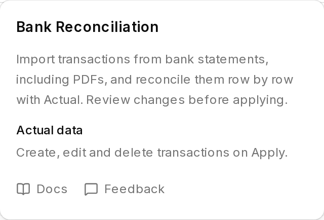

Most of Actual Bench only reads your budget. Where it does change something, you see the change
first and confirm it yourself. This page is the one place that lists what changes Actual and when,
so the feature guides can stay short.

## What changes Actual, and when

| Where you work | What happens in Actual |
|---|---|
| Budget Setup pages (Accounts, Categories, Payees, Tags, Rules, Schedules), Budget Cockpit, Payee Cleanup, Bundle Import | Your edits collect as a draft in **Changes**. Nothing is written until you select **Save**. |
| Notes, and the carryover toggle in Budget Cockpit | Saved the moment you confirm them. See [below](#changes-that-save-immediately). |
| Bank Reconciliation | Your decisions are kept in a session. Actual changes only when you select **Apply**. |
| Cross Budget Sync | A preview first. Actual changes on **Apply**, or on a schedule you opted in to, which applies only items it can prove are safe. |
| Loans | Only when you select **Apply**, **Undo split**, **Edit split** or **Save Notes**. |
| Assets | Only when you confirm an action such as **Update value**, an entry, a sale or **Post selected** depreciation months. |
| Financial Insights, Cashflow Planning, Credit Cards | Never. They read your budget and keep their own records in Bench. |
| Account classes, access and report settings | Never. They are saved in Bench, not in Actual. |
| ActualQL, Rule Diagnostics, Budget File Health, Data Browser | Never. They only read. |
| Bank sync (the **Sync banks** button, or a schedule) | Actual pulls new transactions from your banks, as it does in Actual itself. |

Before you select **Save** or **Apply**, check two things: that the active budget in the top bar is
the one you mean, and that the listed changes are the ones you expect.

Each page says the same for itself: the **About** button (ⓘ) in the top bar describes the page, and its
**Actual data** line says what it can change.

## Drafts, undo and discard

New, edited and deleted rows are marked as you go, and the **Changes** panel counts what is waiting.

- **Save** writes the draft to Actual. If some items fail, they stay in the draft, marked, so you can
  retry them. Only what Actual accepted leaves the draft.
- **Discard** throws the draft away and re-reads the budget.
- **Undo** and **Redo** work on the draft. Once something is saved, undo cannot reach it.

A draft belongs to one budget. If you have several budgets open, each keeps its own.

### Changes that save immediately

Two kinds of edit skip the draft, so **Discard** cannot take them back:

- **Notes** on accounts, categories, category groups and budget months save when you confirm the
  note editor.
- **Carryover** (rollover) in Budget Cockpit writes as soon as you change it, and tells you what it
  changed.

### Workspaces that need a clean draft

Financial Insights, Budget Cockpit, Cashflow Planning, Credit Cards, Assets, Loans and Bank
Reconciliation read your saved budget. If you have unsaved edits from another page, the workspace
first shows them in the **Changes** panel and asks you to **Save** or **Discard** them. It opens as
soon as the draft is resolved. If you start a new draft while you are inside (with Quick Create, for
example), the panel appears again without closing what you are working on.

## Automations

Scheduled bank syncs and opted-in safe syncs change your budget without a review each time. That is
what you asked them to do, and they only run once you set them up. See
[Automations](../../user-guide/automations/) and
[Cross Budget Sync](../../user-guide/budget-sync/#automation).

## Where data and credentials are stored

| Information | Where it lives | How long it lasts |
|---|---|---|
| Your budget | Your Actual Server | Managed by Actual |
| Drafts and open connections | Browser memory | Until you refresh or close the tab |
| Working copy of the open budget, in Direct mode | This site's browser storage, kept by Actual's own browser software | Until you clear this site's data in the browser |
| Recent connection details (no secrets) | Browser session storage | Until the tab closes |
| Bench's own records: flows, sessions, cards, plans, loans, assets, saved queries | Bench's database, `/data/actual-bench.sqlite` | Across restarts, when `/data` is kept |
| Remembered server passwords and API keys, if you choose to remember a budget | Bench's database, encrypted with your Actual Bench password | Until you forget them, or the password is reset |
| Credentials for scheduled work, if you enrol a budget | Bench's database, encrypted with the vault key | Until you withdraw them |

Passwords and API keys you do not save stay in browser memory and are gone when the tab closes.
**Remember this budget** is ticked by default when saving is available, and you can untick it.
Enrolling a budget for scheduled work is opt-in. The two use separate keys. See
[Connect to a budget](../connecting/#remember-a-budget) and
[Configuration](../../administration/configuration/#the-credential-vault).
[Privacy & your data](../../privacy/) covers everything Bench stores and every outside service it
contacts.

## App-wide controls

- **Search** (`Ctrl/Cmd+K`) finds any account, payee, category, rule, schedule or tag.
- **Quick Create** (`N`, or `Ctrl/Cmd+Shift+N`) adds a payee, category, account or tag without
  leaving the page.
- **Help & feedback**, beside the account menu in the top bar, has these docs, the changelog and the
  keyboard shortcuts. The theme button beside it switches between **System**, **Light** and **Dark**.
- **About** (the information button in a feature's top bar) shows what that feature can change and
  whether it is experimental.
- **App Health**, in the sidebar footer, checks Bench's own storage. See
  [App Health](../../administration/app-health/).
