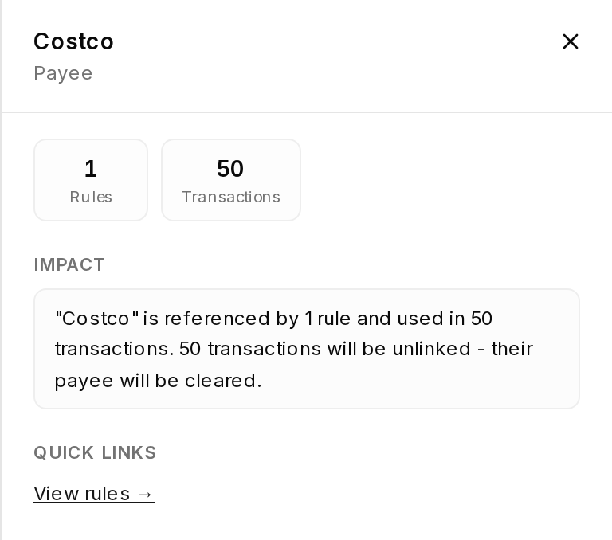
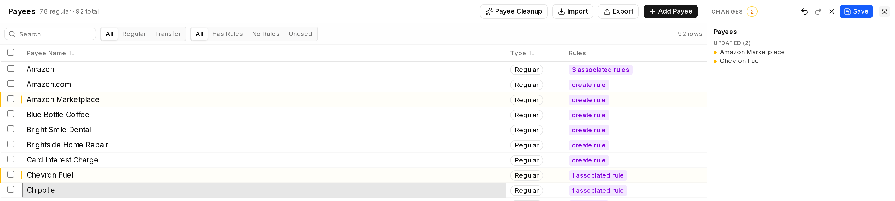

Accounts, Categories, Payees, Tags, Rules and Schedules all work the same way, so you only have to
learn it once. You edit like a spreadsheet, see what depends on a record before you change it, and
read the whole batch before you **Save**.

## A typical cleanup pass

1. Open the page for what you want to change, for example **Payees**.
2. Filter or search until the rows you care about are on screen.
3. Select **Info** on a row to see what depends on it before you delete or merge anything.
4. Make your edits, or select rows and choose a bulk action.
5. Read the **Changes** panel, then select **Save**.

Moving a whole budget structure? Use [Bundle Export / Import](../bundle-export-import/) instead of
repeating this on six pages. Cleaning up payees that your bank imports keep duplicating? Start at
[Payee Cleanup](../../user-guide/payee-cleanup/), which finds the groups for you.

## Edit rows

- **Edit a cell:** double-click it, press `Enter` or `F2`, or start typing. `Escape` cancels.
- **Add many at once:** use **+ Add row** (or the row count beside it) at the bottom of the table, or paste rows straight from a spreadsheet.
- **Select several:** tick the checkboxes, then choose an action such as delete, merge, close or
  hide. Rows that Actual manages itself (transfer payees, schedule rules) have a disabled checkbox,
  with a tooltip saying why.
- **Filter and search:** each page keeps its filters while you work. They reset when you switch
  budgets.
- **Duplicate names:** a warning appears as you type a name that already exists.

New, edited and deleted rows stay marked until you save.

## See what depends on a record

Select **Info** on any row to open the Usage Inspector. It shows how many rules and transactions
point at the record, its balance for an account, and its categories for a group, and what deleting
it would affect. Select a rule count to open [Rules](../../user-guide/rules/) filtered to that
record. Opening the inspector never starts a delete.

Deletes and merges show the same numbers in their confirmation, so you always know what you are
about to touch.

## Quick Create and Search

- **Quick Create:** press `N` (or `Ctrl/Cmd+Shift+N` from anywhere) to add a payee, category,
  account or tag without leaving the page. It is staged like any other edit.
- **Search:** press `Ctrl/Cmd+K`, or select **Search** in the top bar, to jump to any account, payee,
  category, rule, schedule or tag.

## CSV import and export

Every Budget Setup page exports and imports CSV:

- Exports are UTF-8, so they open cleanly in Excel and Google Sheets.
- Imports (up to 5 MB) are checked row by row and staged, so you read everything before you **Save**.

Each page lists its columns. The repository has sample files under `public/sample-csv/` if you want
something to try on a test budget.

## The Changes panel

Everything you stage collects in the **Changes** panel on the right, with **Save**, **Discard**,
**Undo** and **Redo** in its header.

*Edited rows are marked in the table, and the panel lists every staged change until you save or discard it.*

- **Save** writes the whole batch. Anything that fails stays marked, ready to retry.
- **Discard** throws the draft away and goes back to what Actual holds.
- `Ctrl/Cmd+Z` and `Ctrl/Cmd+Shift+Z` undo and redo, a whole bulk action or import at a time.
- **Minimize panel** tucks it into a narrow rail when you need room. The rail still shows how many
  changes are waiting.

Notes are the exception: they save as soon as you confirm them. See
[Work safely](../core-concepts/#changes-that-save-immediately).

## Related pages

- [Work safely](../core-concepts/) - what changes Actual, and when
- [Accounts](../../user-guide/accounts/) · [Categories](../../user-guide/categories/) · [Payees](../../user-guide/payees/) · [Tags](../../user-guide/tags/) · [Rules](../../user-guide/rules/) · [Schedules](../../user-guide/schedules/)
