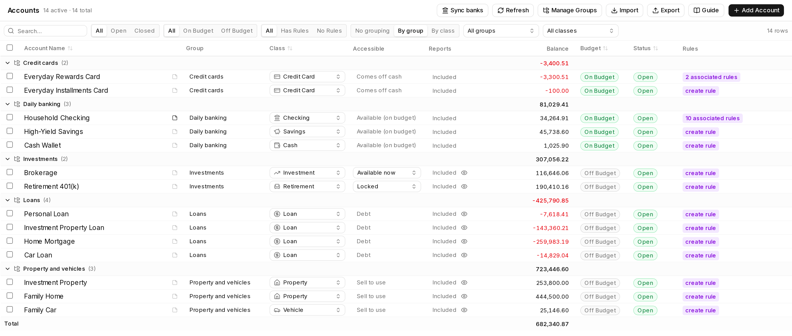

Use Accounts to create, rename, close, reopen, import, export, and delete accounts. Review balances,
transactions, and rule references before you remove an account.

Open it from **Budget Setup → Accounts** (`/accounts`).

**Budget impact:** Account changes remain staged for review until you **Save**. Account notes save immediately.

*Balance, budget treatment, status and rule references on one row - so the question "what depends on
this account?" is answered before you touch it.*

It shares the [editing model](../../getting-started/editing-and-saving/) every Budget Setup page
uses.

## What you get beyond Actual Budget

- **Create in bulk** - paste tab-separated rows straight from a spreadsheet, or import a CSV.
- **Set a starting balance as you create it.** The Balance column stays editable while the row is
  staged.
- **Bulk close, reopen, and delete** with a single action across selected accounts.
- **Organise accounts into groups** and move several accounts between them at once.
- **See which rules reference an account** and jump straight to them.
- **Impact-aware deletion** - every close and delete shows the balance, the transaction count and the
  rule references first. A non-zero balance gets its own warning.

## Create an account

1. Select **Add Account** to open the form drawer.
2. Enter a **Name**.
3. Optionally set an **Initial Balance** (seeds the account's starting balance on creation).
4. Choose **on-budget** or **off-budget** with the toggle.
5. Optionally choose an **Account Group**, where supported, including groups you have staged but not saved. Groups with an off-budget-only class are unavailable for on-budget accounts.
6. Choose an **Account Class**, or leave it **Unclassified**. If the selected group has a class, the account inherits it. Off-budget-only classes are disabled for on-budget accounts.
7. For an off-budget account, optionally change **Accessible** from the class default, and tick **Leave out of reports**.
8. Select **Add Account** to stage the account, group assignment, class and these choices.
9. Select the page’s **Save** to create it in Actual. Its class and choices are then saved in Bench against the returned account id; if only they fail, **Save** retries them without creating the account again.

To create several at once, use the bottom **Add Rows** / paste flow - the **Balance** column is
editable there so you can set each new account's initial balance inline.

:::caution[Budget type is fixed after creation]
Actual Budget will not let an account change between on-budget and off-budget once it exists. Bench
shows it as a read-only badge afterwards. Get it right the first time.
:::

## Balances, closing, and deleting

- **Current balance** is live - aggregated through ActualQL, refreshed roughly every 60 seconds or
  when you press **Refresh**. Negative balances go red.
- Open and close accounts individually or in bulk (close, reopen).
- Deleting or closing always confirms first, with the balance, the transaction count and the rule
  count in front of you.
- Closing a saved account that still holds money offers **Move the balance to** another open account,
  as Actual's own close does. Moving money from an on-budget account to an off-budget one leaves the
  budget, so a category is required then. Leave it empty (or close in bulk) and the account closes with
  its balance where it is. The balance cannot go to an account the same Save closes or deletes.

## Account classes

Each account can be given a class, so Bench features know what kind of account it is. The Class dropdown lists them under six headings:

- **Everyday money:** Checking (checking, current, everyday and offset accounts), Cash.
- **Savings:** Savings (savings, high-yield, money market and notice accounts), Fixed Deposit (term deposits, CDs, restricted or pledged deposits).
- **Credit:** Credit Card.
- **Investments:** Investment, Retirement (retirement accounts, pension funds and superannuation).
- **Things you own:** Property, Vehicle, Other Fixed Asset (gold, collectibles, jewellery, equipment: things you value in [Assets](/user-guide/asset-registry/)), Other Asset (money owed to you, rental bonds, prepaid balances).
- **Debts:** Loan (mortgages, personal, auto and student loans, lines of credit), Other Liability.

There are thirteen classes. An account you want Financial Insights to ignore is not a class: leave it out of reports instead (see below).

Fixed Deposit, Investment, Retirement, Property, Vehicle, Other Fixed Asset and Loan require an **off-budget** account: locked money cannot be money you assign, and the Assets module accepts only off-budget accounts. For an on-budget account these choices remain visible but gray and unselectable under an **Off-budget accounts only** heading, and Financial Insights does not unlock while one is on budget. **Credit Card requires an on-budget account**, so its purchases count as spending: for an off-budget account it is gray under an **On-budget accounts only** heading. Checking, Cash, Savings, Other Asset and Other Liability allow either placement.

Click an account's **Class** cell and choose a class, or **Unclassified** to clear it. A class is a label
only. It is separate from the type and subtype Actual keeps on its own accounts, it never changes balances,
transactions, budget mode or transfers, and it is never written to Actual. Classes on existing accounts are saved in Bench for the
open budget straight away, so they do not wait for **Save** and are not part of **Undo**. A new account’s
class stays with its draft, participates in undo/discard, and saves only after Actual returns its permanent
id. If creation fails, the draft and chosen class remain. If only the class save fails, its selection and
error stay on the real account; **Save** retries the class without creating the account again.

**Set a class on a group.** In the **Manage Groups** dialog, choose a class for the group. Its accounts then show
that class as **Inherited** and cannot change it; change the group instead. If some of those accounts already
have their own class, Bench lists them and asks you to confirm, because the group class replaces theirs.
Moving an account out of the group does not bring a cleared class back.

A group containing any live on-budget account cannot be given an off-budget-only class, and a group containing any live off-budget account cannot be given Credit Card.
An empty group can take any class. Groups with one of these restricted classes are visible but
unselectable when moving on-budget accounts, including a mixed bulk selection. A new account
inheriting a restricted class cannot be switched on-budget. CSV imports that would put an on-budget
account into a restricted group are rejected before any accounts are staged; adjust the CSV and retry.

Each class has an icon next to its name. New account classes can be edited in the drawer or staged table
before **Save**; new groups must be saved before they can be given a class. Use the **Class** filter, including **Unclassified**, to find accounts that still need one.

**Classify several at once.** Select the accounts and choose **Set class…** in the selection bar. Accounts that
inherit a group class are left unchanged; Bench tells you how many. New accounts’ choices stay staged
until creation succeeds; existing-account choices save immediately to Bench. If any
selected live account is on-budget, the off-budget-only choices are disabled for the selection, and Credit Card is disabled when any selected account is off-budget.

Click the **Class** header to sort in the order of the class list, then unclassified accounts.

## The guide

The **Guide** button at the top of the page opens a guide inside Bench: what each class means and whether you can use its money now, why it matters (the same balance reads differently as cash, savings, a locked deposit, an investment or a debt), where Bench uses them (Financial Insights, Assets, Cashflow Planning, Credit Cards and Bank Reconciliation), and how to get every account ready quickly with groups.

## Accessible

The **Accessible** column answers one question: could you use this account's money now if you needed it? It drives what counts as cash in [Financial Insights](/user-guide/financial-insights/) and [Cashflow Planning](/user-guide/cashflow-planning/).

- **On budget**, an account is always **Available (on budget)**: Actual lets you assign its money.
- **Off budget**, each class has a default you can change with the dropdown: Checking, Cash and Savings are **Available now**; Fixed Deposit, Investment, Retirement and Other Asset are **Locked**. Mark a notice account **Locked**, or a no-penalty CD or money market fund **Available now**.
- Credit cards, things you own and debts have no access: a card's owed amount comes off cash, a thing you own is used by selling it, and a debt is not money you hold.

| Rung | Accounts | Where it counts |
| --- | --- | --- |
| Cash | Checking and Cash you can use now | Cash in every view |
| Savings you can use | Savings and Fixed Deposits you can use now | Cash in **Cash + savings** (the default); Statements' cash |
| Other money you can reach | Investment, Retirement and Other Asset set to Available now | The cash buffer's second figure |
| Locked money | Any of the above, locked | Net worth only |

**Nothing here is required.** Financial Insights unlocks when every account has a class and a placement that class accepts. In an off-budget **Savings** or **Fixed Deposit** account, money in with no category (interest, in practice) counts as income, in its own row "Interest & income in off-budget savings"; money out stays an unidentified movement.

## Reports

The **Reports** column says whether the account counts in reports. For an off-budget account, the button beside **Included** leaves it out of every figure in Financial Insights and out of Cashflow's automatic roles; it then needs no class. On a group, the same setting is in **Manage Groups** for groups whose accounts are all off budget; an account left out by its group says so and is changed on the group. An account that takes its group's class follows the group's setting. If a left-out account is on budget, Financial Insights blocks until you include it again, which the button still offers. A **left out of reports** shortcut beside the class filter counts these accounts and filters to them.

**Several at once.** Select accounts and use **Set access…** in the selection bar: **Available now**, **Locked**, **Leave out of reports** or **Include in reports**. Accounts the choice cannot apply to (on budget, a class without access, or a group that decides) are left unchanged, and Bench says how many. A new account’s choices are staged with it and saved once it exists.

**An own class the group overrides.** When an account has its own class but sits in a group with a different class, the group’s class applies. A notice at the top of the table names such accounts (this can happen after the upgrade below, or when an account is moved into a group): **Keep the group’s class** clears their own class, and **Dismiss** hides the notice in this browser until the list changes.

A saved choice counts only while it can apply. If you change an account's class or placement so a choice no longer fits, Bench keeps it but ignores it until it fits again. A new account’s choices are staged with it and saved once it exists. A closed account with no transactions and a zero balance needs nothing.

Choices are saved in Bench, per budget, and apply at once. They are never written to Actual and do not change balances, transactions, budget placement or transfers.

## Upgrading from earlier versions

The app database upgrade (schema 68) carries every earlier choice over: a Bank account marked **Fixed / restricted deposit** becomes a **Fixed Deposit**, an Other Asset marked **Fixed asset** becomes an **Other Fixed Asset**, and an off-budget Cash or Bank account set to count uncategorized money in as income becomes **Savings**. "Accessible money" carries over as **Available now**. A choice saved on an account whose class came from its group gives the account its own class, which the group still overrides; the notice above points these out.

## Grouped view

Use the **No grouping / By group / By class** toggle in the toolbar to cluster the table by **account group** or by **class**. Each
cluster has a heading with its name, how many accounts it holds, and the total of their balances under the
**Balance** column. A **Total** row closes the table.

- Select a heading to collapse or expand it. Collapsed accounts are left out of **select all**, paste, and
  keyboard navigation, so a bulk action never touches rows you cannot see. A new, unsaved account is always
  shown.
- Groups are listed by name. Classes follow the class list: assets first, then liabilities. Accounts with no
  group or class come last.
- Filters and sorting still apply inside each cluster, and totals add only the accounts that match.
- Debts are negative, so a heading that contains loans or cards can show a negative total. The balances come
  from Actual and are added exactly, in minor units.

Choose **No grouping** to return to the flat table. The choice is a display preference.

## Account groups

Account groups are named collections that Actual shows together in its sidebar. Bench supports them
on Actual 26.9 or later; on an older server the Group column and controls do not appear.

- **Assign an account:** click its **Group** cell and choose a group, **No group**, or **New group…**.
- **Move several at once:** select the accounts, then use **Move to group…** in the selection bar.
- **Manage groups:** select **Manage Groups** in the page toolbar to create, rename, or delete groups. Names
  must be unique, ignoring case.
- **Deleting a group** keeps its accounts - they become ungrouped. The dialog says how many are
  affected first.

Like every other account edit, group changes are drafted and written only when you **Save**, and
**Undo** reverses them. New groups are created first, then accounts, and deleted groups last.

Groups cannot be reordered from Bench: Actual's API does not allow it. Reorder them in Actual itself.

:::note[HTTP API mode]
In HTTP API mode your `actual-http-api` must expose the `/accountgroups` endpoints (the release for
Actual 26.9 or later does).
:::

## Filter and sort

Filter by name, status, budget type, whether any rules reference the account, and group. Sort by name,
status, budget type, group or class. Staged rows ignore the sort and stay at the top until you Save.

## Notes

Every row has a note button beside the name. Notes render as Markdown, edit inline, and **save
immediately** - nothing to do with your staged edits.

## Import and export

Export accounts to CSV or import them (staged before saving). CSV columns:

- `name` (required), `offBudget`, `closed`.
- `group` (optional, account groups only) - the group's name. A name that matches no existing group
  stages a new one. On a server without account groups the column is ignored.

Exported files include the `group` column when the server supports groups, and a trailing `class` column once
account classes have loaded (an inherited class is exported too). Import treats the `class` column as informational and does not stage class changes.
Set classes on imported drafts in the table before **Save**, or on saved accounts afterward.

## Common problems

- **"Can't change the account type"** - correct. It is fixed at creation.
- **A delete warns you** - read the dialog. Money left in the account affects budget consistency.
- **A new row stays highlighted** - it is staged, not saved. Press **Save**.

## Related pages

- [Editing, review and save](../../getting-started/editing-and-saving/) - the shared editing model
- [Rules](../rules/) - how rules reference accounts
