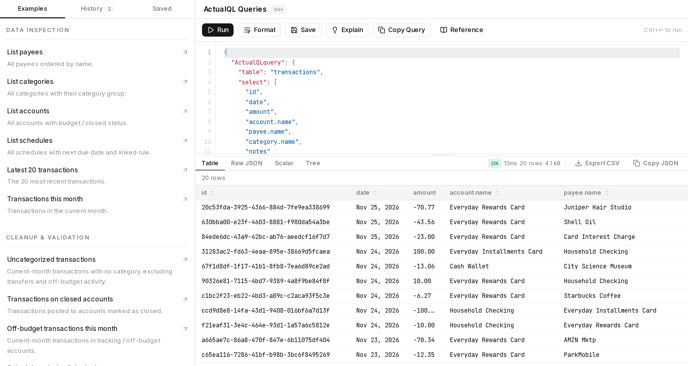

ActualQL is Actual Budget's own query language. This workspace lets you ask your budget any
question its screens don't answer ("what did we spend at each supermarket last year?") and see
the answer as a table, a single number or a tree. You don't need to know ActualQL to start: pick an
example and change it.

Open it from **Analyze & Cleanup → ActualQL Queries**. Queries only read. Results show what is saved
in Actual, not unsaved drafts.

*Examples on the left, the query in the middle, the answer underneath, with how long it took and how
much came back.*

## Get an answer

1. Open **Examples** and choose the closest question.
2. Change its table, fields, filters or dates.
3. Select **Explain** to read back what it will do, without running it.
4. Select **Run** (or press `Ctrl/Cmd+Enter`).
5. Choose **Table**, **Raw JSON**, **Scalar** or **Tree**, then save the query or export the result.

## Write and check a query

Queries are JSON, not SQL. The editor highlights syntax and points at the character where the JSON
breaks. Both a bare query and the `{ "ActualQLquery": ... }` wrapper used by `actual-http-api` work.
**Format JSON** tidies it.

Warnings catch common mistakes before you run: a `transactions` query with no `limit`, `groupBy` or
`calculate`; an empty `$oneof`; a `groupBy` with nothing to add up. **ActualQL Reference** is a
quick guide to filters, joined fields, aggregates and copyable snippets.

## Read the results

- **Table:** one column per field, up to 500 rows. Amounts show as decimals, with the stored integer
  on hover.
- **Raw JSON:** the full result.
- **Scalar:** one large number, for `calculate` queries.
- **Tree:** a collapsible view, chosen automatically for a single object.

The bar above the result shows whether it succeeded, how long it took, and how many rows and bytes
came back.

## Save and reuse

- **Save** a query by name. Saved queries are kept in Bench and are available for every budget.
  Load, rerun, duplicate, rename, delete and pin them.
- **History** keeps the last 10 queries you ran on each budget.
- **Copy result JSON** and **Copy query JSON** copy either one. In HTTP API mode you can also copy the
  request as cURL. The sanitised version has placeholders instead of secrets. **Full cURL** includes
  your real API key, so never paste it anywhere public.

## Troubleshooting

- **Invalid JSON:** the error points at the character. Fix it and run again.
- **Empty result:** check the filters and date range.
- **The table is hard to read:** try **Tree** or **Raw JSON**.
- **Results look out of date:** they show saved data. Save your draft first.
- **No cURL option:** cURL is only offered in HTTP API mode.

## Related pages

- [Budget File Health](../budget-file-health/) · [Data Browser](../data-browser/) - the same data from an exported snapshot
- [Rules](../rules/)
