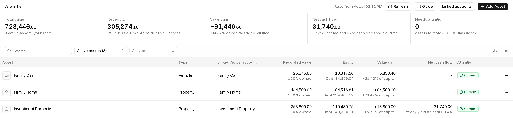
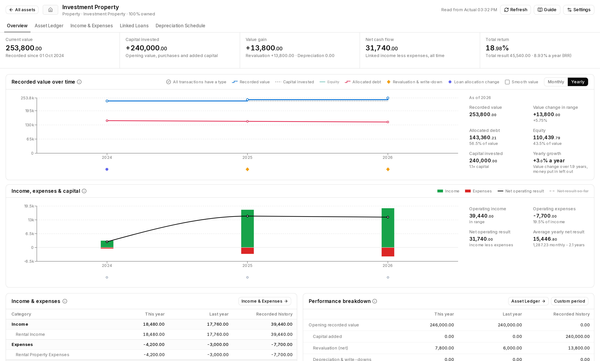
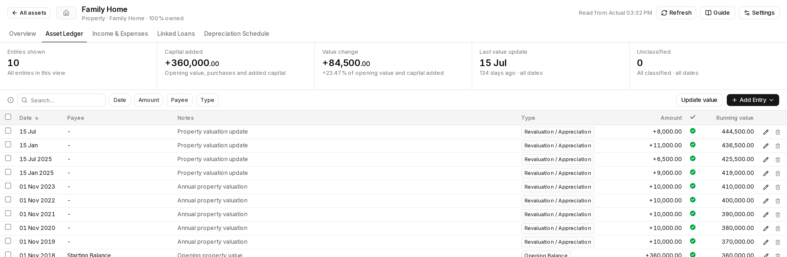
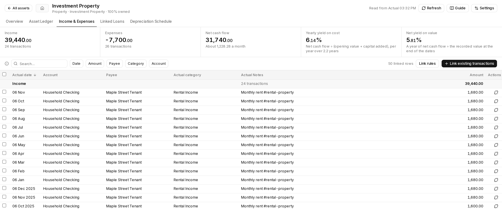
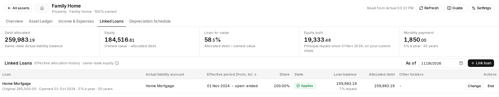

Assets keeps a record of the things you own: a home, a car, a rental property, gold, collectibles.
Each asset follows an off-budget account in Actual, so its value is the balance Actual already
holds. Bench adds what a balance alone cannot tell you: what you paid, what it earned, what you owe
against it, how it depreciates, and what it has really returned.

Open it from **Financial Management → Assets**. Actual stays the ledger. Bench never posts anything
on its own: Actual changes only when you confirm an action such as **Update value**, a payment, a
sale or a depreciation month. Everything else (types, links, schedules) is saved in Bench. It is
marked experimental while it is shaped by feedback.

## The registry

*Everything you own on one screen: value, equity, gain and cash flow for each asset.*

The tiles at the top add up all your assets: **Total value** (your share), **Net equity** (value
less the debt allocated to them), **Value gain**, **Net cash flow** (linked income less expenses) and
how many assets need attention. The table shows the same for each asset. Search and filter by
status and type. **Linked accounts** shows how each account's balance is shared between its assets.

## Add an asset

1. Select **Add Asset**.
2. Enter a name and choose a type. Say whether it pays you money (rent, dividends, interest), and
   your ownership share if you own only part of it.
3. Choose its account: an existing off-budget account of the right class, or a new account that
   Bench creates for you, named after the asset.
4. Optionally enter an **Opening value**. Bench adds it to the account in Actual as one Opening
   Balance entry.
5. Select **Create asset**.

| Asset type | Account class it needs |
|---|---|
| Property | Property |
| Vehicle | Vehicle |
| Precious Metal, Collectible / Valuable, Other Asset | Other Fixed Asset |

Every asset account is off budget. Investment and retirement accounts are not assets here:
Financial Insights reads them as your portfolio. An **Other Asset** account (money owed to you, a
deposit) is a holding rather than a thing you own, so give the account **Other Fixed Asset** if it
is one.

Adding an existing account adopts the transactions already in it. How you bought the asset is not
asked up front, because it often happens over many payments: each one appears in the Asset Ledger.

## An asset's Overview

*An investment property's whole life: what it is worth, what went in, what it earned and its total return.*

Each asset has five tabs: **Overview**, **Asset Ledger**, **Income & Expenses**, **Linked Loans** and
**Depreciation Schedule**. The Overview tells the asset's whole story:

- **Current value**, **Capital invested** (opening value, purchases and added capital), **Value
  gain** (revaluations and depreciation), **Net cash flow** and **Total return**, with its yearly
  return (IRR).
- A value chart with the debt against the asset and a dashed **Capital invested** line, so the gap
  is your gain. Purchases, revaluations and sales are marked on it.
- For an asset that earns or costs money, an income chart with operating income and expenses by
  month or year.
- Income and expenses by category, and a performance breakdown for this year, last year and the
  whole history.

Click a marker or bar to open the ledger or income list for that period. Anything that needs
attention appears in an amber strip.

## The Asset Ledger

*Every valuation and payment with its type and the running value; Update value and Add Entry are top right.*

The ledger is the asset's account in Actual, row by row, with a **type** for each entry:

| Type | Means |
|---|---|
| Opening Balance | The value you started with |
| Acquisition / Purchase | Money put into buying it (there can be many) |
| Revaluation | A change in what it is worth |
| Depreciation, Impairment | A planned or one-off fall in value |
| Disposal | It was sold or written off |
| Other Adjustment | Anything else |

Bench suggests a type for each new entry: a transfer in is a purchase, a positive change a
revaluation. A suggestion counts in the figures but is not saved until you confirm it. Click an
entry's type to change it, or select several and choose **Classify…**. Types are saved in Bench and
never change a category in Actual.

### Record a new value or entry

- **Update value** sets the asset's value on a date. Bench adds the difference to the account in
  Actual, so the asset's recorded value becomes the value you typed. In a shared account, the other
  assets' values are left as they are.
- **Add Entry → Add a payment** records a purchase, instalment or improvement (see below).
- **Add Entry → Value adjustment** types a signed amount straight into the account.
- **Add Entry → Sale or write-off** records a sale (see below).

Select an entry's pencil to edit it beside the table. Transfers, reconciled, split and scheduled
transactions are protected here: change their amounts in Actual. You can still set their type.

Each action shows the value before and after and what will change in Actual, and asks you to confirm.

## Payments and sales

**Add a payment** adds capital to the asset, and asks how it was paid:

- **Already in Actual:** pick the expense you entered (paid from another account). Bench turns it
  into a transfer into the asset, changing only its payee. Its amount, date, category and notes stay
  as they are.
- **Not in Actual yet:** Bench creates one transfer from the account you choose into the asset.

A transfer you already made in Actual needs nothing: it appears in the ledger as a suggested
purchase.

**Sale or write-off** asks three things: what happened to the money (already in one of your
accounts, moved out of the asset's account, or none), the sale itself (the payment and any selling
costs), and how much value leaves the asset. Before you confirm, **How this will be recorded** shows
exactly what changes: your deposit stays as it is, and one Disposal entry is added to the asset's
account. Bench never invents cash or pays off a loan for you.

## Income & Expenses

*Rent in, running costs out, and the yield they add up to.*

Link the transactions that belong to an asset, usually from your on-budget accounts: rent received,
insurance, repairs, council tax.

- **Link existing transactions** opens a search. Type a payee, note, category or amount, narrow it
  with chips for date, account, category, payee and tags, then tick the rows and link them.
- **Link rules** save conditions (payee contains "Letting agent", say). **Apply** opens every new
  match, ready for you to review and link.

A linked row is income when it is positive and an expense when it is negative; its category in Actual
says what it was for. Linking stores a note in Bench only, and never changes the transaction. The
tiles show **Income**, **Expenses**, **Net cash flow**, **Yearly yield on cost** and **Net yield on
value**, and follow the date chip.

How results and returns are worked out

- **Operating Result** = linked income − linked expenses. Sale proceeds, selling costs, transfers and
  loan principal are left out.
- **Total Result** = closing value − opening value − capital added + net sale proceeds + Operating
  Result.
- **Annualized return (IRR)** is the money-weighted yearly return, counting each payment, income and
  expense on its own date. It shows N/A for under about six months.
- **Yearly yield on cost** spreads the operating yield over the dates shown. **Net yield on value**
  is a year of net cash flow over the value at the end; it is negative for an asset that costs more
  than it earns.
- **Operating Yield** and **Simple Total Return** divide the two results by opening value plus
  capital added. They are not annualized.

Results only know about transactions you linked. Totals that depend on something missing, such as an
unclassified entry, are held back, while the rest stay visible.

## Linked Loans

*The mortgage against the home, and the equity built as it is paid down.*

Link a loan from [Loans](../assets-debt/) to see your equity: the asset's value less your share of
what is owed.

1. Select **Link loan** and choose the loan.
2. Bench fills in the date it opened and the share no other asset holds yet. Change them if you need
   to.
3. **What will happen** shows the share, the dates, and your equity before and after. Save it.

Use **Change** to set a new share from a date, or **End** to stop it. Earlier periods are kept, so
the history stays right. Shares on any date never add up to more than 100%. Equity uses the loan's
balance in Actual on each date, so paying down the loan grows your equity on its own.

## Depreciation Schedule

An optional monthly plan for how an asset loses value. **Set up schedule** chooses **straight-line**
(a cost, a residual value, a start date and a useful life in months) or **declining balance** (an
annual rate, never below the residual).

Saving the schedule writes nothing. Once a month has ended it is **Due**: select due months and choose
**Post selected** to add them to the account in Actual, one entry per month. A month can only be
posted once. If you delete a posted entry in Actual, the month becomes due again. These are personal
planning methods, not tax depreciation.

## Shared accounts

Usually each asset has its own account. If you keep several in one account (all your gold in one
"Valuables" account, say), choose **Shared Asset Account with Hashtag Identifier** when you add the
asset, and give it a unique tag such as `#asset_family_car`.

- A transaction whose notes carry exactly one asset tag belongs to that asset.
- You can also assign an untagged row to an asset in Bench, without changing its notes.
- A row with two asset tags, or a tag and an assignment that disagree, is shown as **Unassigned /
  Needs Review**.

The account's balance always equals its assets' values plus whatever is unassigned. **Show other
assets' entries** in the ledger includes the rest of the account.

## Settings, archive and delete

**Settings** changes the name, description and ownership share over time. Your ownership share is
for information: the account already holds your share of the value, so Bench never multiplies it
again.

Turning off **Active** archives an asset. It keeps its history and tag, and changes nothing in
Actual. To delete one, archive it first, then choose **Delete asset permanently** in Settings. This
removes everything Bench saved for it and leaves the account and its transactions in Actual exactly
as they are.

## What Bench writes in Actual

Only entries Bench creates itself (a value update, a payment it records, a sale entry, a posted
depreciation month) get a readable tag in their notes, such as `#revaluation` or `#depreciation`.
Transactions made anywhere else are never edited by setting their type.

If Actual saved an entry but Bench could not save its type, **Retry metadata only** finishes the job
without writing to Actual again. If Bench cannot tell whether a write reached Actual, the editor
locks: select **Refresh** and check the account in Actual before you try again.

## Keyboard

In the Asset Ledger, the arrow keys move between rows, `Space` selects one, `T` opens its type, and
`Tab` reaches the edit and delete buttons. The **Guide** button opens a short version of this page in
the app.

## Related pages

- [Loans](../assets-debt/) - the loans you link to assets
- [Financial Insights](../financial-insights/#property--assets) - equity and loan-to-value across everything you own
- [Accounts](../accounts/) - give asset accounts the right class
