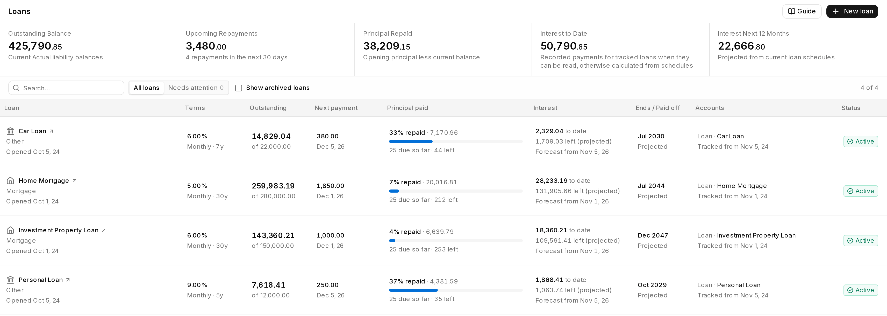
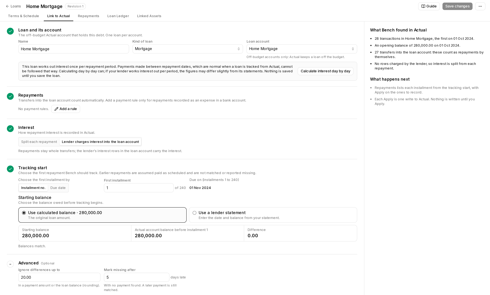
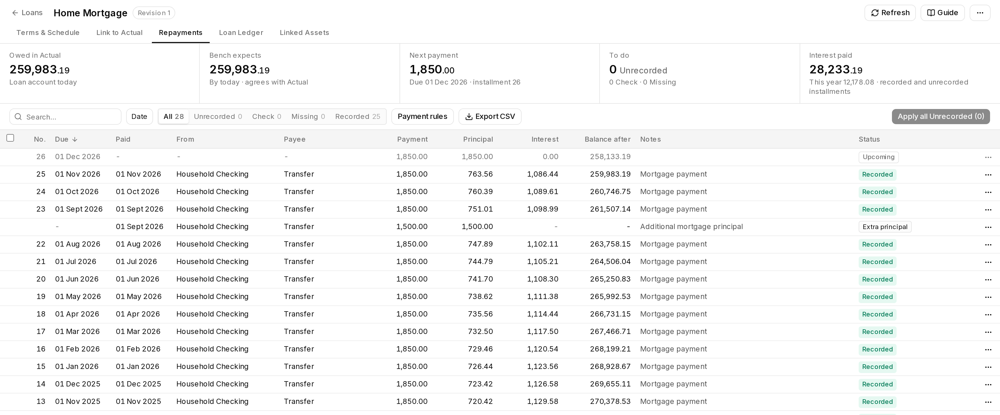
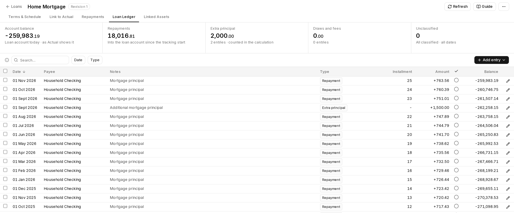
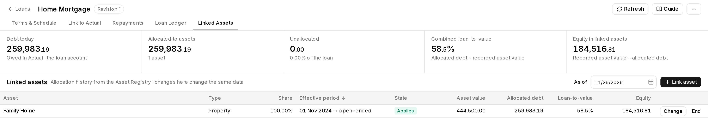

Loans works out your mortgage, car or personal loan the way your lender does: the repayment, the
payoff date, the interest still to come, and what an extra payment or a rate change would do. Link
it to its account in Actual and it becomes **tracked**: every repayment is matched to the payment
you made, and split into principal and interest with one click.

Open it from **Financial Management → Loans**. A loan stays a calculation until you link it.
Actual changes only when you select **Apply**, **Undo split**, **Edit split** or **Save Notes**.
It is marked experimental while it is shaped by feedback. The **Guide** button on every loan page
opens the same material in the app.

## Your loans

*Every loan on one row: what is left, what is next, how much is repaid and when it ends.*

The tiles add up all your loans: **Outstanding Balance** (from Actual), **Upcoming Repayments** (the
next 30 days), **Principal Repaid**, **Interest to Date** and **Interest Next 12 Months**. Each row
shows a loan's terms, balance, next payment, principal and interest paid, and payoff date.

A row says **Tracked from installment N** once it is linked to Actual, or **Not tracked in Actual**
while it is a calculation. **Needs attention** lists loans with a setting that cannot be used, or a
write to Actual that did not finish, and opens each one where it needs you.

## A loan's five tabs

| Tab | What it is for |
|---|---|
| **Terms & Schedule** | The contract and the calculation: balance chart, events and the full schedule |
| **Link to Actual** | Connects the loan to its account in Actual |
| **Repayments** | One row per installment, matched to the payment that paid it |
| **Loan Ledger** | The loan account in Actual, row by row, with what each row is |
| **Linked Assets** | The home or car this loan financed, and your equity in it |

A new loan can use the first two tabs straight away; the rest open once it is saved.

## Terms & Schedule

*The contract on the left, the calculation on the right: payoff date, total interest, the balance over time and the full schedule.*

Enter the contract on the left: the kind of loan, amount, term, start date, interest rate and how
often you repay, plus any interest-only period, balloon payment, offset account or fees. The right
side works out the rest: the repayment, total repaid and interest, the payoff date, a balance chart,
the **Events** list and the full schedule.

On a saved loan, edits wait for **Save changes**. Tick **Compare with saved** to see what an edit
would change first.

### Events and what-ifs

Events change a loan between regular repayments: **Extra payment**, **Redraw / Withdraw**, **Rate
change**, **Fee** and **Repayment change**. Extra payments, redraws and fees can repeat (weekly to
annually) until a date. The **Saves** column shows the interest and time each event saves or adds,
on top of the ones before it.

On a tracked loan, past events come from Actual (**From Actual**) and cannot be switched off. Events
after today are **What-if** rows with an **On** switch, so you can try an extra payment without
committing to it.

### A tracked loan's schedule

Once a loan is tracked, the calculation follows what really happened: the contract before tracking
started, the payments in Actual since, and a projection from today's balance.

- The chart shows **Balance in Actual** as steps, with a **Today** line.
- The schedule's **Source** column says **From Actual** up to the last payment, or **Not found in
  Actual** for an installment with no payment.
- A payment made early covers its installment, and is not shown as the next one.

### Export and explain

- **Export CSV** downloads the loan's terms, settings, events and every schedule row.
- **How this loan is calculated** explains the figures in plain words: the method, rates, events and,
  for a tracked loan, where Actual's history ends and the projection starts.
- If the figures differ from your lender's, **Copy diagnostics** copies the settings, events and
  results, with no names, payees, notes or ids, for a bug report. **Show what will be copied** lets
  you read it first.

### When your lender's figures differ

The defaults suit most loans: interest worked out daily, a level repayment and the **Actual/365
Fixed** day count. If your lender's numbers drift from Bench's:

1. Compare the interest on one recent statement with the schedule.
2. Try another **Day count method** (beside the interest rate).
3. Check the first repayment date and whether due dates move to business days.
4. Record the statement (**⋯** → **Check against lender statement**), so Bench continues from the
   lender's own balance.

Day count methods

| Day count | A year is | Common for |
|---|---|---|
| Actual/365 Fixed | 365 days, every year | Most mortgages and personal loans (the default) |
| Actual/360 | 360 days, so slightly more interest | Some bank and Islamic finance products |
| Actual/Actual (calendar year) | 365 or 366 days, by the year | Some lenders |

Every other convention (rounding, business-day due dates, how a lender statement is allocated) is
under **Set calculation method**. The in-app Guide's **Settings** section explains each field.

Progressive principal (common in France)

Some mortgages repay a principal that grows by a set percentage each instalment, with that period's
interest on top, so the repayment rises a little every month. Choose **Set calculation method →
Amortization → Progressive principal plus interest** and enter the **Principal growth per
repayment**. Don't know it? **Work it out…** takes one instalment from your lender's table (the
balance before it, the principal it repays and the instalments left) and calculates it.

- Most progressive mortgages charge interest per payment period, so Bench offers to switch
  **Interest accrues** to **Per payment period** too. The offer is turned off, with the reason, when
  the loan needs daily interest: an offset, business-day due dates, or an event between due dates.
- An extra repayment keeps the principal series, so the loan ends sooner. A rate change changes only
  the interest.
- If your lender recalculates the series (after an extra repayment, say), add a recast date under
  **Recalculate the repayment**.
- A lender's own rounding can differ by a cent or two on some rows.

Interest per payment period, and loans that cannot be calculated

With **Interest accrues: Per payment period**, each period's interest is the balance at its start
times the periodic rate. An extra repayment lowers the balance on its own date, and saves interest
from the next period. A draw or fee between due dates, a rate change part-way through a period, and
offsets all need daily interest.

When a loan cannot be calculated, Bench says why in plain words, and the reason is one of three
kinds:

| Kind | What to do |
|---|---|
| Daily interest would fix it | Select **Calculate interest day by day…** in the alert. Interest is then worked out daily and still charged with each repayment. |
| Something in the loan needs changing | Change the date, rate or repayment the message names, for example a repayment that does not cover the interest. |
| Not supported yet | For example, repayments that are not on a regular schedule. |

A tracked loan with per-period interest follows late and extra repayments on their own dates:
interest a payment did not cover is carried to the next instalment.

## Link to Actual

*Each step is checked off once it is set; the panel on the right says what Bench found in the loan account.*

First create the loan's account in Actual: **off budget**, holding only this loan. Then, on **Link
to Actual**:

1. **Loan and its account:** the name, the kind of loan and the account (and an offset account, if
   the loan has one).
2. **Repayments:** transfers into the loan account count on their own. If you record repayments as
   an expense from a bank account instead, add a **payment rule** that finds them.
3. **Interest:** **Split each repayment** (the usual choice), or **Lender charges interest** if your
   lender's own interest rows arrive in the loan account. Choose the interest category, the loan
   payment category, and what to add to each line's notes (`#interest` by default). If your lender
   charges interest on its own dates (the 1st of each month, say) rather than with each repayment,
   use **Lender charges interest**, or record each split from the lender's statement.
4. **Tracking start:** the first installment Bench tracks. Earlier ones count as paid as contracted.
5. **Starting balance:** what was owed at the tracking start, from the calculation or a lender
   statement. If it differs from Actual, **Repayments** begins with one **Opening adjustment** you
   can apply or skip.
6. **Advanced:** **Ignore differences up to** (for rounding) and **Mark missing after** (5 days late
   by default).

If your loan account starts with an opening balance part-way through the loan, Bench suggests the
first installment after it.

Tracking is for term loans you owe, in a currency with two decimal places. A line of credit or a loan
you made to someone else stays a calculation.

Both interest choices give the same figures in [Financial Insights](../financial-insights/#loans--cards):
interest and fees are spending, and the rest of each repayment is principal.

## Repayments

*Each installment next to the payment that paid it, split into principal and interest.*

Every installment from the tracking start, newest first, beside the payment that paid it. The tiles
show **Owed in Actual**, what **Bench expects**, the **Next payment** and what is **To do**.

| Status | Means | What to do |
|---|---|---|
| Recorded | Actual already holds it as principal and interest | Nothing |
| Unrecorded | Paid, but still one whole payment in Actual | **Apply** splits it |
| Check | Two payments could be it, a short payment, or Actual's balance has drifted | Open it and choose |
| Missing | Overdue, and no payment found | Pay it, or point Bench at the payment |
| Upcoming | Not due yet | Nothing |

Select a row (or press `Enter`) to see the payment, the split Bench calculated, and the loan after
**Apply**. Change the principal and the interest follows.

- **Apply** splits one payment. Tick several, or use **Apply all Unrecorded**: they run in date order
  and stop at the first that does not apply.
- **Undo split** puts a payment back exactly as it was; **Edit split** changes a split already in
  Actual.
- **Not this payment** (in the row's **⋯** menu) stops a payment being matched. **Ignored payments**
  above the table brings it back.
- **Refresh** after a bank import; new payments appear as Unrecorded.
- **Export CSV** saves the rows, with Actual's interest beside Bench's.

## Loan Ledger

*The loan account in Actual, row for row, with what each row is.*

The ledger is the loan's account in Actual, with a type for each row. Its balance is the debt Actual
shows, and the calculation follows it up to today.

| Type | What it is |
|---|---|
| Loan received / Opening balance | Where the loan starts |
| Repayment | The loan side of an installment |
| Extra principal | Money paid on top of the installments |
| Draw | Money taken out again, such as a redraw |
| Fee | A charge added to the loan |
| Interest charged | The lender's own interest row |
| Adjustment | A correction, such as the opening adjustment |
| Unclassified | Bench cannot tell; left out until you choose |

A type in *italics* is a suggestion; choose one to confirm it. Types are saved in Bench only. Make an
unclassified top-up a **Draw** and a correction an **Adjustment**, or Bench and Actual drift apart.
**Add entry** adds an adjustment or records a lender statement; the pencil edits a row's notes in
Actual.

## Linked Assets

*The home this mortgage financed, with your share of the debt and the equity left over.*

The assets this loan financed, with your share of the debt and your equity in each. Links are made
from the asset, in [Assets → Linked Loans](../asset-registry/#linked-loans).

## What Bench writes in Actual

| Action | What changes in Actual |
|---|---|
| **Apply** a split | The payment becomes a split: a principal transfer plus an interest line |
| **Apply** an opening adjustment | One row in the loan account, noted "Opening adjustment" |
| **Undo split** | The payment goes back to exactly what it was |
| **Edit split** | The split's amounts change |
| **Save Notes** (Loan Ledger) | That transaction's notes |

Saving the loan, its types, payment rules and lender statements never writes to Actual. Bench syncs
with Actual before each write, makes one change at a time, and checks each one afterwards. It never
changes a reconciled transaction: unlock it in Actual first.

If the connection drops during an Apply, a red banner names the installment and stops further
writes. Check that payment in Actual, then choose **The change is in Actual** or **It isn't**. Bench
never repeats an interrupted write on its own.

## Archive and delete

Archiving keeps a loan's history, read-only. **Delete permanently** on an archived loan removes
Bench's records after you confirm its name, and leaves its transactions in Actual as they are. If the
loan is linked to an asset, remove that link first.

Edits to a loan that is not saved yet live only in this tab, so save it to keep it.

## Related pages

- [Assets](../asset-registry/) - link a loan to the home or car it paid for
- [Financial Insights](../financial-insights/#loans--cards) - what all your debts cost
- [Cashflow Planning](../cashflow-planning/) - forecast repayments from the loan schedule
