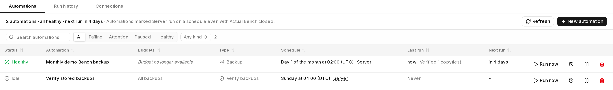

Automations runs work for you on a schedule, even with Actual Bench closed: pulling from your banks,
taking backups, and running safe syncs between budgets. Every run is recorded with its outcome,
duration and a log, so you can see at a glance what happened overnight.

Open it from **Sync & Automations → Automations**. Each automation changes only what its job does
(a bank sync imports transactions; a safe sync applies safe items), and Bench keeps the run history.
It is marked experimental while it is shaped by feedback.

*Each row shows the job, where and when it runs, and how its last run went.*

:::note[Not Actual's own Budget Automations]
Actual has an experimental feature called Budget Automations. This page is different: these are
Bench's own scheduled jobs.
:::

## What can run on a schedule

| Kind | What it does | Set up in |
|---|---|---|
| **Bank sync** | Asks Actual to pull new transactions from your linked banks | [Bank Sync](../bank-sync/) |
| **Backup** | Takes a verified copy of your budget and of Bench's data | [Backups](../backups/) |
| **Cross Budget Sync** | Runs a sync flow, safe items only | [Cross Budget Sync](../budget-sync/#automation) |
| **Verify backups** | Re-reads stored copies to check they still open | Created with your first backup rule |

**New automation** lists them all and takes you to where each is set up.

Each row says where it runs. **Runs on the server** keeps going with Bench closed. **Runs in your
browser** only runs while a Bench tab is open, so it is a convenience rather than true automation.

## Unattended access

Anything that runs with the browser closed needs credentials the server can use, so its budget has
to be **enrolled**. You can enrol from the **Connections** tab, or right where you need it, in the
bank sync, backup or sync flow dialogs.

- **Bench checks before it saves.** It tries the password or API key against your server first. For
  a Direct budget that means opening the budget, which usually takes seconds but can take a few
  minutes the first time. If the check fails, you see why and nothing is saved.
- **Enrolment is per budget.** Bench saves one password or API key per server, though, so once one
  budget on a server is enrolled, **Enrol budgets on this server** enrols the others without
  connecting to each. An encrypted budget asks for its own password.
- **Direct is recommended.** It needs no extra service and reports bank sync results in full. A
  budget enrolled through HTTP API that Bench can also reach directly offers **Switch to Direct**,
  which moves its automations, flows and backup rules across.

The **Connections** tab lists every enrolled budget and what depends on it, so withdrawing a
credential names the automations it will stop.

:::caution[What gets saved]
- For an HTTP API budget, its API key. For a Direct budget, your Actual server password. An
  encrypted budget's own password is saved too. No budget data is saved.
- They are encrypted with Bench's vault key, which is kept outside the database (in
  `secrets/vault.key` or `ACTUAL_BENCH_VAULT_KEY`), so a copy of the database alone cannot open
  them. Keep the key private, and keep it with your data.
- They are only unlocked on the server when an automation runs, and are never shown again or sent to
  your browser.
- If you change your Actual password or API key, automations on that server stop. Enrol one budget
  again to save the new one for all of them.
- Remove a credential from **Connections** at any time.
:::

:::note[Why some budgets take longer to open]
Actual's server keeps a saved copy of each budget, and opening a budget replays every change since
that copy. Actual's own app refreshes the copy about once a week; tools like Bench do not, so a
budget used mostly through them opens more slowly over time. Bench refreshes it weekly for budgets
it runs automations on. If enrolling takes too long, open the budget once in Actual's own app, then
enrol again.
:::

For a Direct budget, the Bench server opens the budget itself, so it must be able to reach your
Actual Server (see [Deployment](../../administration/deployment/#direct-mode)).

## Schedules

Every schedule in Bench uses the same picker:

- **Simple:** *Repeating* every so many minutes or hours (at least 15 minutes apart), *Daily* at a
  time, *Weekly* on the days you tick, or *Monthly* on a day from the 1st to the 28th.
- **Cron:** a five-field expression, with presets. Each field is read back on its own, so a mistake
  shows which field it is in.

The picker always says what it understood and when the next runs land. That catches mistakes:
`0 0 * * *` reads like a fair guess at midnight until the preview shows the next run is fourteen
hours away. Clock-based schedules have a time zone, and
daylight saving is handled: a time skipped in spring runs as the gap closes, and a time repeated in
autumn runs once. Cross Budget Sync runs on an interval only.

## Run history

**Run history** shows every run of every automation. Filter by outcome first ("what failed?"),
then by automation and kind, or search the line a run reported. Each run expands to its result,
duration, retries and a log with secrets removed. An automation's own drawer keeps its newest ten
runs.

## When something goes wrong

- **Backoff:** after a failure, attempts space out, so a broken job stops hammering what it cannot
  reach.
- **Auto-pause:** after several failures in a row an automation pauses itself and says why.
  **Resume** clears the pause.
- **Overdue** is flagged when an automation is well past its next run, even if nothing failed.
- **Busy is not failure:** if the most runs allowed are already going, a scheduled run waits for the
  next minute.
- **Missing credentials:** an automation whose credential cannot be opened (the vault is locked, or
  the enrolment was withdrawn) does not run, and pauses with the reason.

A backup that reached one of two destinations is reported as partial, and does not count towards
auto-pause, so the copies that still work keep coming. A bank sync where some accounts failed is
treated the same way.

### Time limits and stopping a run

Each run happens in its own worker, with a memory limit and a time limit: Cross Budget Sync 20
minutes, bank sync 10, backup 60, verify backups 30. **Cancel** on a running automation stops it. A
run that reaches its memory limit stops with "Ran out of memory", and the rest of Bench carries on;
whoever runs the server can raise the limit (see
[Configuration](../../administration/configuration/#automation-workers)).

| Stopped while… | Shown as |
|---|---|
| Only reading | **Failed**, or **Cancelled** if you pressed Cancel |
| It may already have changed something (applying a sync, pulling from a bank, writing a backup) | **Stopped, may have made changes** |

**Stopped, may have made changes** is never retried automatically, because repeating a write could
duplicate it. Check the budget or backup destination before relying on that run. The next scheduled
run goes ahead as normal.

## Pause and delete

**Pause** stops an automation and keeps its schedule, history and credentials. **Delete** removes the
automation and its run history; what it produced (backups, synced transactions) stays. Deleting a
backup rule whose automation has history pauses the automation instead, so the record of real backups
survives until you delete it yourself.

## Run one Bench only

The scheduler runs inside the Bench server. Two containers on one database would run every
automation twice, so run a single instance.

## Related pages

- [Bank Sync](../bank-sync/) · [Backups](../backups/) · [Cross Budget Sync](../budget-sync/)
- [App Health](../../administration/app-health/) - the vault and worker status
