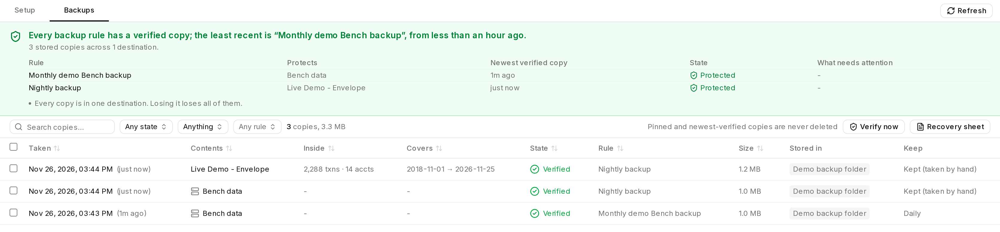
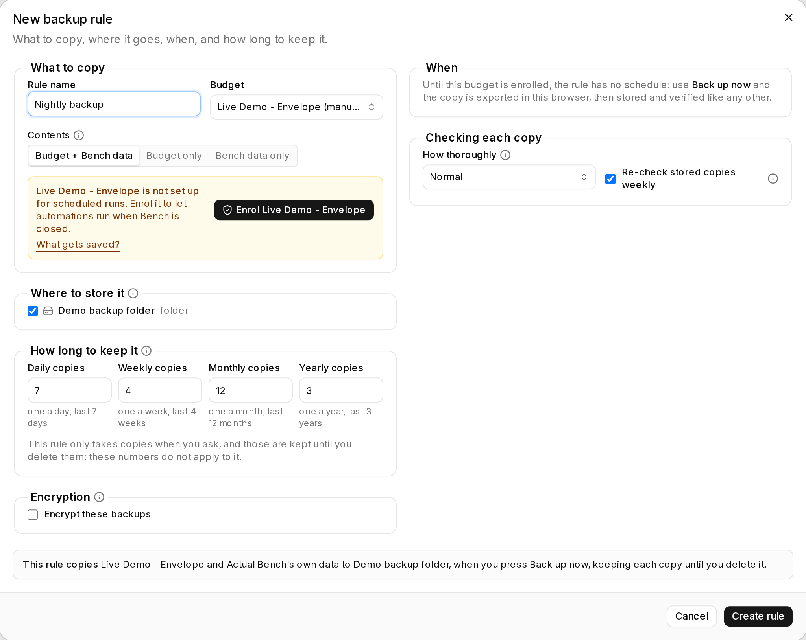

Backups takes copies of your budget, and of Actual Bench's own data, on a schedule you choose. Every
copy is opened and checked before it is trusted, old copies are thinned out sensibly, and your last
good copy is never deleted.

Open it from **Sync & Automations → Backups**. It never changes your budget. It writes backup files
to the destinations you set up, and keeps a record of each copy in Bench.

*Whether you could restore right now, what each rule protects, and every stored copy with what is
inside it.*

## Set up your first backup

1. On **Setup**, add a **destination**: a folder on the server, or an S3-compatible bucket.
2. Add a **backup rule**: what to copy, from which budget, to which destinations, and when.
3. Wait for the first run, or select **Back up now**.
4. Open the **Backups** tab to see the copy and whether it verified.

The summary at the top shows the newest copies and anything that needs attention. With several
rules, its headline is about the one that is worst off, so one healthy rule can never hide a budget
whose backups have stopped.

## Destinations

- **A folder on this server:** any absolute path the server can write to, such as a mounted volume,
  a NAS share or a second disk. Bench creates it if it does not exist.
- **An S3-compatible bucket:** AWS, MinIO, Backblaze B2, Cloudflare R2, Wasabi, Garage and others.
  Access keys are encrypted with Bench's vault key.

Bench checks a folder as you type: whether it exists, can be written to, is nearly full, or sits on
the same disk as Bench's own data (a warning, since that is a fine setup but not off-site). A folder
that fails the checks is not saved. Once saved, **Test** writes a real file, reads it back and
deletes it. A bucket that refuses deletes is a warning: backups still work, only retention cannot
clear old copies.

**Scan** finds copies already in a destination that Bench has no record of. Copies of a budget go
under `actual-budget/<budget name>/`, and Bench's own data under `actual-bench/`.

## Backup rules

*One rule answers four questions: what, from which budget, where, and when.*

- **What:** the budget, Actual Bench's own data, or both. Bench's data is everything it keeps apart
  from your budget: sync flows, reconciliation sessions, cards, plans, assets, loans, automations,
  saved queries and payee-cleanup decisions.
- **Which budget:** any budget you have connected or saved. A scheduled rule runs with your browser
  closed, so its budget needs to be [enrolled](../automations/#unattended-access); the rule offers
  to enrol it on the spot.
- **When:** daily, weekly, monthly, every so many hours, or a cron expression. The picker says back
  when the next runs land.
- **How long to keep it:** the newest copy of each of the last so many days, weeks, months and
  years. *7 daily* means one a day for the last 7 days. The dialog sums it up in words, with the age
  of the oldest copy.
- **Encryption:** off by default, because a copy that lands on a volume you control mainly gains a
  way to lose it. Turn it on when copies go somewhere you don't control. **No one, including Bench,
  can open an encrypted backup without its passphrase.** You type it twice.

Before you save, the rule is said back in one sentence: *This rule copies Household and Actual
Bench's own data to NAS volume, daily at 02:00, keeping up to 26 copies reaching back about 3 years.*

### Budgets that cannot be scheduled yet

A Direct budget that is not enrolled can still be backed up, as a **manual rule**: **Back up now**
exports the budget in your browser and hands it to Bench, which stores and verifies it like any
other copy. Copies taken by hand are kept until you delete them. To schedule it later, enrol the
budget and edit the rule.

A rule's budget is fixed once it has made a copy, so different budgets' histories never mix.
Deleting a rule keeps the copies it took, and the passphrase that opens them.

## Verification

Every copy is checked before it counts as verified:

| Level | What it checks |
|---|---|
| Quick | It is a real archive with what an Actual export contains |
| Normal (the default) | It opens, passes SQLite's integrity check, and its contents are counted |
| Thorough | The full [Budget File Health](../budget-file-health/) check |

Bench also compares each copy with the last good one. A copy with far fewer transactions or accounts,
or under half the size, is marked **Needs review**, because a cut-short export is a valid file with
the wrong contents. If you really did delete those things, open the copy and choose **Accept this
change**.

A copy that fails is still stored, and clearly marked: a distrusted backup is better than none.

Once a week Bench re-opens the newest copy in each destination (decrypting it, where it holds the
passphrase) and re-reads older copies a few at a time, so every copy is checked again over a few
weeks. **Verify now** does the same on demand. If a folder's volume is not mounted, Bench notices and
says so, instead of writing into an empty folder.

## What is never deleted

Retention keeps a sensible spread of copies, within these rules:

1. A **pinned** or **protected** copy is never deleted.
2. Nothing newer than the minimum age is deleted.
3. The **newest verified copy always survives**.
4. A copy you took by hand is never expired for you.
5. A copy with no rule (its rule was deleted, or **Scan** found it) is never expired.

No combination of settings can empty a destination. **Retention** on a rule shows exactly what would
be removed, and why, before anything happens.

## Recovery points

Tick the option under the rules, and Bench takes a copy of your budget just before it saves a batch
of deletions or payee merges, so you have something from five minutes ago, not just last night. If
a recovery point cannot be taken, Bench asks before saving. Recovery points expire on their own.

## Getting a backup back

**Look inside** opens a copy and tells you what is in it: accounts, payees, transactions and their
date range. For a budget copy, two more tabs help you check it is the one you want:

- **Search inside** finds transactions, payees, categories or accounts as they were in the copy.
- **Compare with now** sets the copy beside today's budget: accounts added or removed, and each
  account's transactions and balance then and now. It needs the budget to be enrolled.

Neither changes anything. When you have the right copy, **Download** it and use Actual's **Import
file → Actual**, which creates a new budget from it and leaves the one you use untouched. Bench
does not import for you, so a restore is always a deliberate step.

Copies of Bench's own data are restored by whoever runs the server: see
[Upgrades & backups](../../administration/upgrading-and-backups/).

### If Bench itself is gone

Every copy is written with a small manifest beside it, describing what it is.

- **Find backups** rebuilds the list from those manifests: install Bench on a new machine, point it
  at the same bucket, and your backup history comes back.
- **Recovery sheet** is a printable page with the real paths, the commands to open a copy with
  standard tools, and the encrypted format. It holds no secrets.

A downloaded copy is exactly what Actual's own export produces, so it opens whether or not Bench
still exists.

## Related pages

- [Automations](../automations/) - run history, retries and failures for scheduled rules
- [Upgrades & backups](../../administration/upgrading-and-backups/) - backing up and restoring Bench itself
