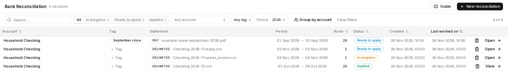
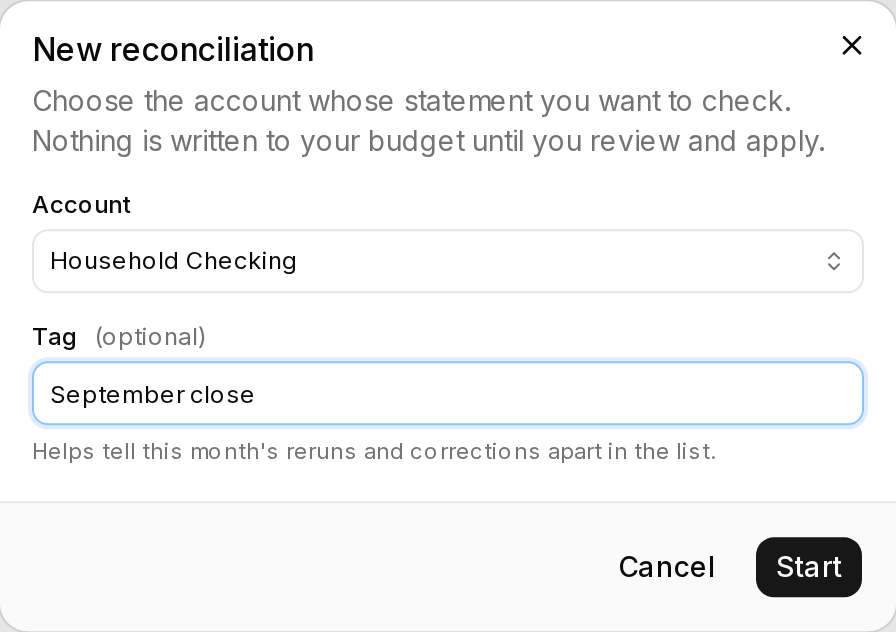
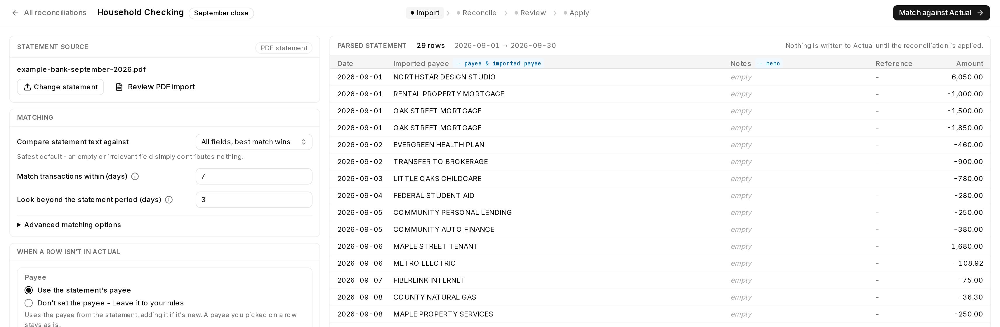
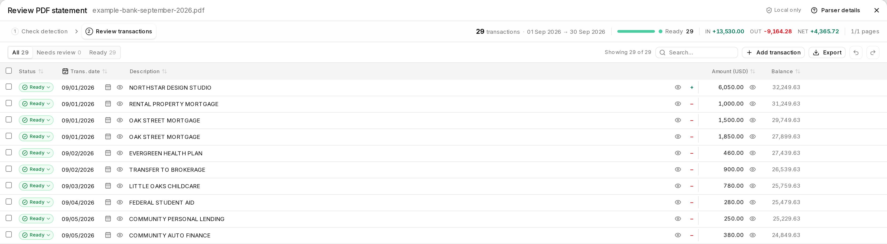
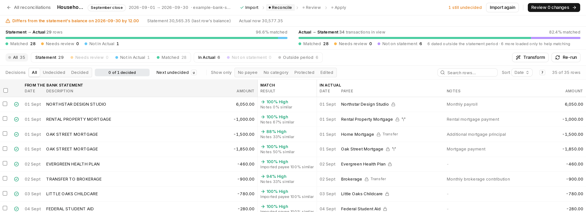
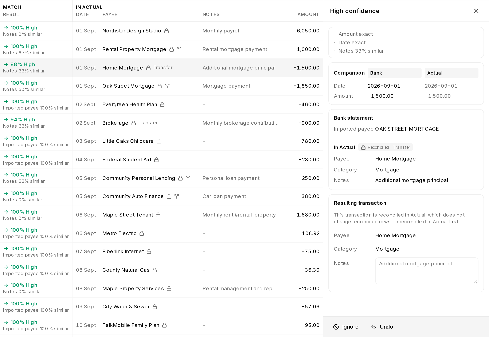
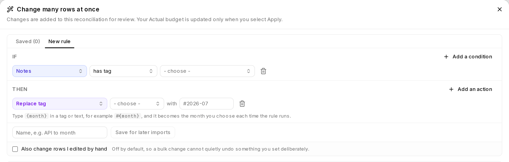
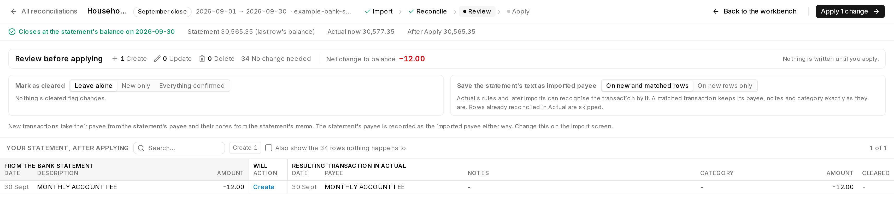

Bank Reconciliation lines a bank statement up against one account in Actual, row by row. It finds
the matches, shows you what is missing, duplicated or different, and applies the fixes you choose
in one reviewed step. Use it when you want to audit a month properly, catch up an account from a
downloaded statement, or check a PDF statement line by line.

Open it from **Financial Management → Bank Reconciliation**. Your decisions are kept in a session
you can come back to, and Actual changes only when you select **Apply**. It never changes a
transaction's category. The **Guide** button on the session list opens an illustrated walk-through in
the app.

## How it works

1. Start a session for one account.
2. Import the statement: CSV, TSV, OFX, QFX, QIF, or a PDF with selectable text.
3. Review the automatic matches and decide every difference.
4. Read the planned changes on **Review**.
5. Select **Apply**. Bench checks each affected transaction again just before it writes.

*Open a session to carry on where you left off. An applied session stays as a record of what was
decided and written.*

## Start a session

Select **New reconciliation**, choose the account, and optionally add a tag such as `July close`.
The tag labels the session only; it is not added to any transaction. The account cannot change once
the session starts.

**Credit cards.** For a card you have added in [Credit Cards](../credit-cards/), tick **Also enter
this card's bank statement figures**. You choose the statement and enter its figures (or **Skip**),
and after you apply, **Review statement** opens that statement in Credit Cards to finish checking it.

## Import a statement

Upload a file or paste a statement. The import screen shows the parsed rows before you go on.

- **CSV and TSV:** check the suggested column mapping. Map separate debit and credit columns if the
  bank has no single signed amount. Check the date format and sign before matching.
- **OFX, QFX and QIF** bring their own structure. You can use the memo when a payee is empty, or swap
  the two if your bank put them the wrong way round. OFX is recognised from its contents, even saved
  as `.txt`.

### How new transactions are created

For rows that are missing from Actual, choose:

- **Payee:** use the statement's payee (Bench finds or creates the Actual payee), or leave it for
  your Actual rules to set.
- **Notes:** keep the bank memo, the statement payee, both, or neither. For CSV, the mapped Notes
  column is used.

The bank's own description is kept as Actual's **imported payee**, so your tidy payee names and
categories are never replaced by bank text. Change these choices later in **Re-run → When a row
isn't in Actual**.

**Reconciliation profiles** remember the mapping, conventions and matching options for each account,
so next month's import is one click. Importing the same statement twice warns you and names the
earlier session; you can still go on.

### Import a PDF statement

Choose a PDF and Bench reads it in your browser. The PDF is never uploaded or stored, and a password
for it stays in memory only. Scanned, image-only PDFs cannot be read; use a CSV or OFX export
instead if your bank offers one.

The PDF workbench has two steps:

- **Check detection** shows the page with the transaction table and its columns drawn over it. Fix a
  column role, drag a boundary, include an area that was missed, or set the statement's period,
  currency and sign conventions. **What needs attention** lists every question in one place, each
  with a button that takes you to the answer.
- **Review transactions** lists every extracted row as **Ready**, **Review** or **Fix**. Edit a date,
  description or amount directly, flip a sign, merge or ignore rows, and select a field's eye icon to
  see where it came from on the page. **Add transaction** adds a row the statement is missing.

Select **Use transactions** once every row is ready. From there, a PDF is matched like any other
file.

*Check detection: the table Bench found, its columns drawn on the page, and every setting that decides how the rows are read.*

*Review transactions: every row as it will be matched. The eye icons show where each value came from on the page.*

**Statement layouts** save how to read a bank's table, so next month opens ready. Save one with
**Save layout**, give it a bank and layout name, and assign it to the account to have it used
automatically. Layouts are shared across budgets; **Manage** renames, reassigns or deletes them.

#### How the statement is read

The reader has no bank-specific templates. It reads each statement's own structure, and anything it
cannot settle from the statement stays in review for you rather than being guessed.

- **Columns and rows.** It finds the transaction table first, using its printed header, so balances
  and summaries elsewhere on the page are ignored. A date in the date column starts a transaction,
  and lines above it (a description, a fee or VAT line) stay with the transaction they belong to.
- **Dates.** It reads dates as printed (`15 Jun 19`, `15/06/2019`, `06JUL`), works out day/month
  order from the unambiguous ones, and fills missing years from the statement period. A date with no
  year on a statement with no readable period asks you for the period, once.
- **Money in and out.** Signs, brackets, trailing minus, `DR` and `CR`, separate debit and credit
  columns and section headings all decide direction. Direction is never guessed from the account
  type alone. When some amounts are marked and the rest are bare, **Amount direction** asks you to
  choose, and a saved layout remembers the answer.
- **Card and loan statements** print a minus for a payment that lowers what you owe. Until you
  confirm that in **Statement Interpretation**, those rows stay in review.
- **Numbers and currency.** US, European, Indian, Swiss, space-grouped, Arabic-digit and East Asian
  number formats are supported. A row printed in another currency is flagged, because it usually
  means the original amount was read instead of the amount charged.
- **Pages.** **Ignore first / last N pages** skips a cover page or terms at the back, however long
  next month's statement is. A page with no readable text is reported, and import waits until you
  confirm you checked it.

**Parser details** shows how this statement was read and where each setting came from. Copied
diagnostics contain counts and page numbers only, never statement text.

## Match and decide

Bench matches a statement row to a transaction automatically only when the **amounts are exactly
equal**. Dates and text decide how good a match is; they never create one by themselves. If no rows
match at all, the sign convention is probably reversed, and **Re-run inverted** is offered.

*28 of 29 rows matched on their own. The 12.00 the balance is out by is the bank's monthly fee, the
one row not in Actual.*

For each difference you can:

- accept the suggested match, or choose another candidate;
- say two rows are **Not the same transaction**;
- create a transaction that is missing from Actual;
- delete a duplicate from Actual;
- correct an amount to the statement's;
- keep an Actual transaction that is not on the statement; or
- leave it undecided. Apply leaves undecided rows alone.

Under **Re-run → Matching**, **Compare statement text against** says where your merchant text lives
in Actual: **Payee only**, **Imported payee**, **Notes**, or **All fields, best match wins**. [How
Matching Works](../reconciliation-matching/) explains scores, safeguards and every setting.

*Why a match was proposed, both sides side by side, and the decision beneath it.*

### When rows compete

When several statement rows could match the same transactions, open one and select **Resolve
group**. A grid puts the statement rows down the side and the Actual transactions across the top,
with the amount and date difference in each cell. Select a cell and **Use this match** to confirm a
pair; it drops out of the other rows. **Undo last pairing** steps back, and **None of these** leaves
a row undecided.

### When dates or amounts differ

- **Use statement date** on a matched pair stages the bank's date. A different date never changes
  Actual on its own.
- Accepting a match with a different amount stages the statement's amount on the existing
  transaction, keeping its payee, notes, category and links. To correct several, select them and
  choose **Use the statement amount**.
- **Possible pair** suggests a likely match whose amounts differ. It always needs your confirmation.

Reconciled transactions, split parents and either side of a transfer cannot be changed here. You
can still record the match, and Review shows the remaining difference.

Transactions just outside the statement's dates are loaded too, to help near the edges. They are kept
by default and don't count as work to do.

## Change many rows at once

**Transform** previews a payee change or note edits across many rows, with conditions on payee,
category or tag. Note actions add, remove, replace or move tags and text. It never overwrites a value
you edited by hand unless you choose to, and the preview says when rows already have the value or
are protected. **Change N rows** adds the changes to the session; nothing reaches Actual until
**Apply**.

**Saved transforms** keep a transform by name, for this budget, so you can run it on every month's
import. On the **Saved** tab, tick the ones to run: they run top to bottom, each on what the one
before left, with one combined preview. Type `{month}` in a tag or text, for example `#{month}`, and
it becomes the month you choose when it runs, which defaults to the statement's closing month.

## Check the closing balance

When the statement prints a closing balance, Bench compares it with the account's balance in Actual
on that date, now and after Apply. **Closes at the statement's balance** means the account will end
exactly where the bank says it does; otherwise it shows the difference. The check appears on the
workbench, on Review and on the result.

## Review

Select **Review** when you have decided the rows. If undecided rows remain, Bench reminds you that
an undecided statement row will not be added to your budget.

Review lists every create, update and delete, with the effect on the account balance. Two choices
are made here:

- **Mark as cleared:** leave transactions as they are, mark only new ones cleared, or mark every
  transaction the statement confirms.
- **Save the statement's text as imported payee:** on new rows only, or on matched rows as well.

| Field | New transaction | Matched transaction |
|---|---|---|
| Imported payee | The statement payee | Only if you chose to include matched rows |
| Payee | From the statement, or set by your Actual rules | Kept, unless you staged a change |
| Notes | As chosen at import | Kept, unless you staged a change |
| Category | Set only by your Actual rules | Kept |

## Apply

Select **Apply** once the plan looks right. Just before writing, Bench re-reads every affected
transaction. Rows that are still safe are written; anything that changed in Actual meanwhile is held
back and reported rather than overwritten. Afterwards it reads the account again to check the result.

- **Retry what failed** retries only unfinished work, and never creates the same transaction twice.
- If an Apply was interrupted (the tab closed, say), reopen the session and choose **Recover
  interrupted Apply**. It checks Actual to see what landed, without writing again.
- **Finish** closes a session once every row is decided and nothing is left to write.

An applied session is kept as a record and cannot be re-matched. To reconcile the account again,
start a new session. Avoid editing the same transactions in Actual while an Apply is running.

## Sessions and limits

The session list shows each reconciliation's account, tag, file, period, row count and progress, and
opens each one at the step it is on. Filter by year, account, tag or status.

Sessions are stored in Bench's database on your server, not in the budget, and include the imported
statement rows. Delete a session when you no longer need it; that never changes your budget.

- One account per session.
- Split transactions can be matched, but their lines cannot be edited here.
- Automatic matches need an exact amount; everything else is offered for review.

## Related pages

- [How Matching Works](../reconciliation-matching/) - scores, safeguards and settings
- [Credit Cards](../credit-cards/) - check card statements against the bank
- [Bank Sync](../bank-sync/) - run Actual's bank sync on a schedule
