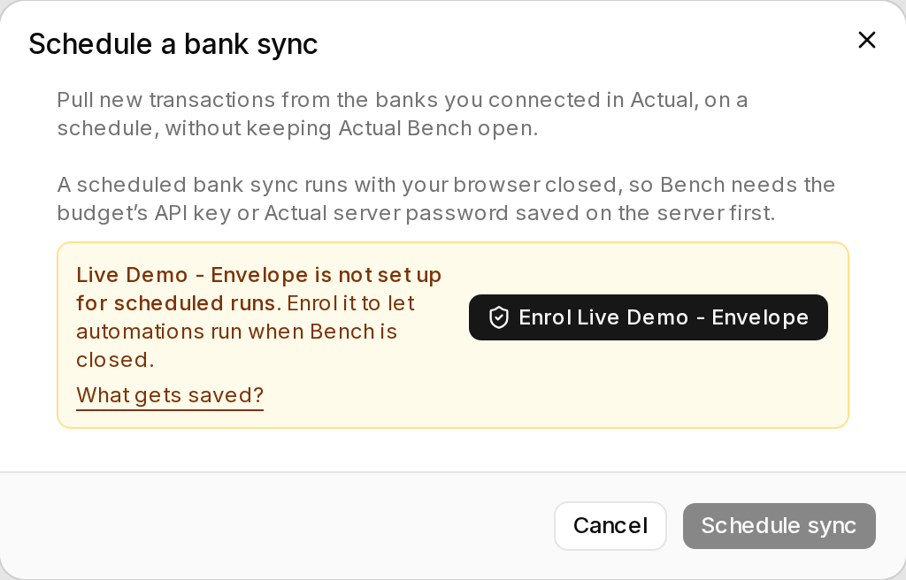

Your bank connections live in Actual. Bank Sync has Actual pull from them on a schedule you choose,
even with Bench closed, and reports what came back for each account. Bench never connects to your
bank or holds bank credentials itself.

For a one-off pull, select **Sync banks** on the [Accounts](../accounts/#sync-banks) page. To run it on
a schedule, create a bank sync automation.

*A scheduled sync runs with your browser closed, so the dialog first asks you to enrol the budget.*

## What you need

- Accounts linked to a bank in Actual, through SimpleFIN or GoCardless, for example.
- The budget [enrolled for unattended access](../automations/#unattended-access), so the server can
  open it with your browser closed.

## Schedule a bank sync

1. Open **Sync & Automations → Automations** and choose **New automation → Bank sync**.
2. Choose the budget, and enrol it if the dialog asks.
3. Check the list of accounts: those linked to a bank show when each last synced, and the rest are
   marked **not connected to a bank - skipped**.
4. Choose how often, and save. Every few hours suits most people; the shortest interval is 15
   minutes.

If no account is linked to a bank, Bench will not save the automation, because it would never
import anything.

## What a run reports

Each account syncs on its own, so one bank being down does not stop the others.

| Result | Means |
|---|---|
| **Synced** | Actual accepted the pull for this account |
| **Failed** | This account's bank link failed; the reason is on the run |
| **Skipped** | The account is closed, or not linked to a bank |

A run where only some accounts failed is **partial**, and does not count towards auto-pause: one
unreachable bank out of twelve is normal. A run where every account failed does count.

In Direct mode the run reports how many transactions came in. Over the HTTP API, the server only
confirms that the sync started, so the run is recorded as accepted without a count.

Full results are in [Run history](../automations/#run-history).

## Good to know

- A bank link that needs re-authorising is fixed in Actual. Bench reports the failure until it is.
- Bank Sync does not import downloaded statements. For those, use
  [Bank Reconciliation](../bank-reconciliation/).
