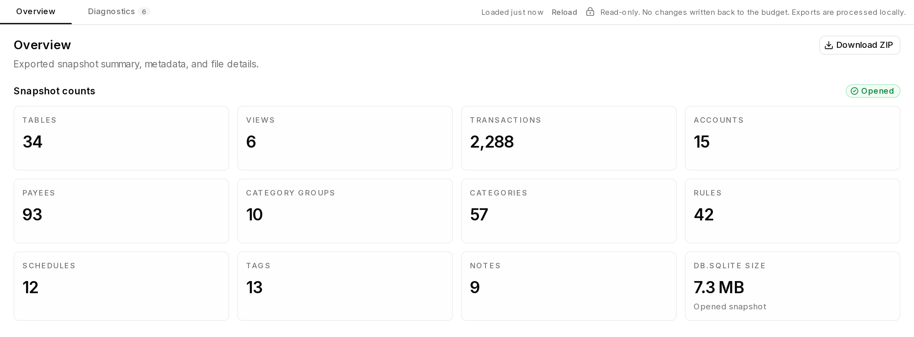

Budget File Health opens a fresh export of your budget file in your browser and checks it from the
inside: its structure, the links between its rows and SQLite's own health. Use it when something in
Actual looks wrong, before a big change, or when you are asked for details in a bug report.

Open it from **Analyze & Cleanup → Budget File Health**. It only reads, and everything happens in
your browser.

*What the snapshot contains: 2,288 transactions, 93 payees, 42 rules and a 7.3 MB database. The
metadata below it holds the ids and timestamps you need when reporting a problem.*

## When to use it

| Your question | Where to look |
|---|---|
| Is this exported file structurally healthy? | **Diagnostics** tab, below |
| What does the snapshot contain, and how large is it? | **Overview** tab, below |
| What rows and columns exist in a table? | [Data Browser](../data-browser/) |
| I need a reusable query against live saved data | [ActualQL Queries](../actualql/) |

:::caution[Snapshots contain your financial data]
A snapshot is your finances. The processing is local, but a ZIP or CSV you download is out of the
browser and yours to look after. Do not attach one to a bug report.
:::

## Load a budget snapshot

The first time you open this page, Bench downloads and opens the active budget's snapshot. After that
it is cached - you get a "loaded X ago" label and a **Reload** button - and shared with the
[Data Browser](../data-browser/). Load it once, and both tools open instantly.

Loading shows its stages as it goes, and offers a retry if one fails.

## Review snapshot metadata

**Overview** lists the export metadata, how many of each object the snapshot holds, the ZIP and SQLite
sizes, and where it came from. There is a button to download the ZIP.

## Run diagnostics

**Diagnostics** checks the schema, the relationships between rows, the metadata and SQLite's own
health, then groups what it finds by severity. From there you can:

- Run a full **SQLite integrity check**. It takes a while.
- **Export findings to CSV**.

Nothing here writes to your budget.

## Limits

- A very large snapshot is limited by your browser's memory.
- The full integrity check is slow on large files. That is SQLite, not the page.

## Troubleshooting

- **It will not open** - retry from the progress rail. On a large file, check browser memory.
- **The snapshot is stale** - press **Reload** for a fresh export.
- **A CSV looks wrong in a spreadsheet** - it is UTF-8, with formula protection. Open it as UTF-8.

## Related pages

- [Data Browser](../data-browser/) - the same snapshot, table by table
- [ActualQL Queries](../actualql/) - query live saved data instead of a snapshot
- [Work safely](../../getting-started/core-concepts/)
