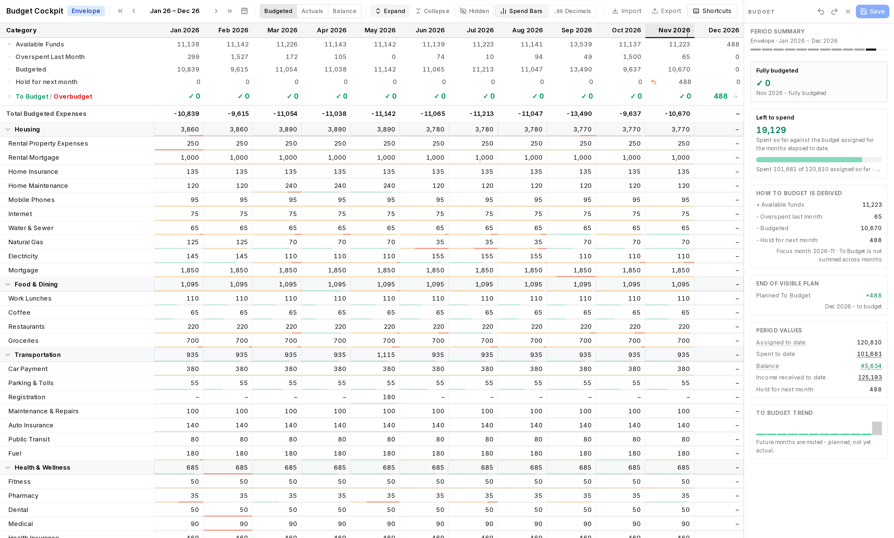
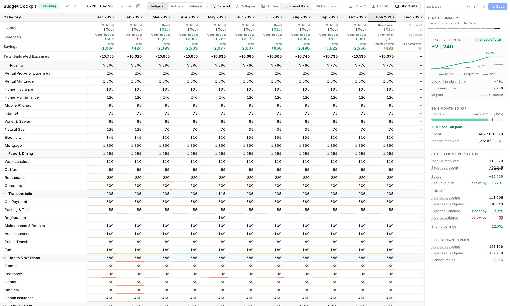
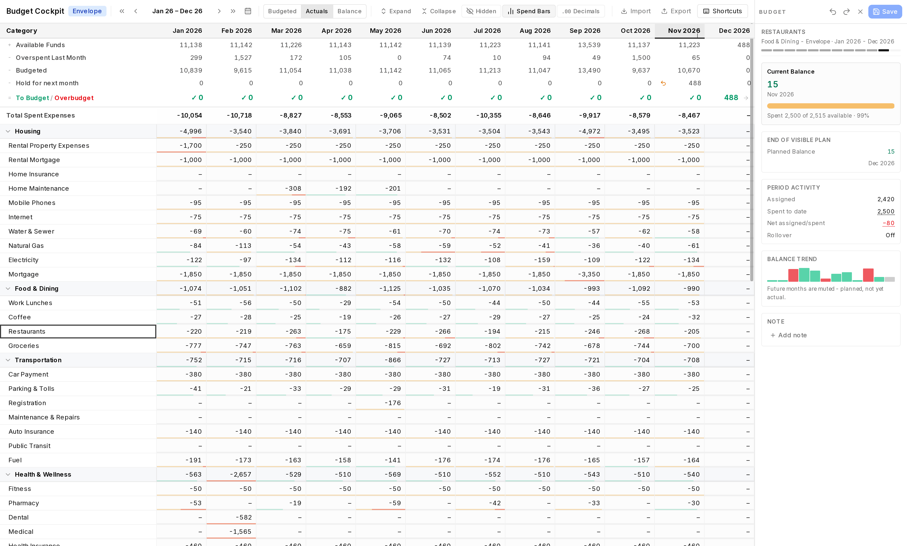
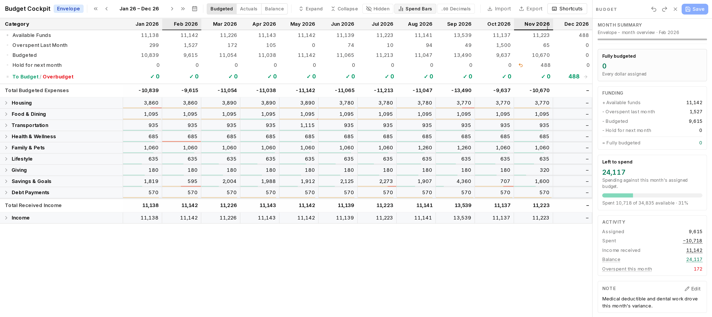
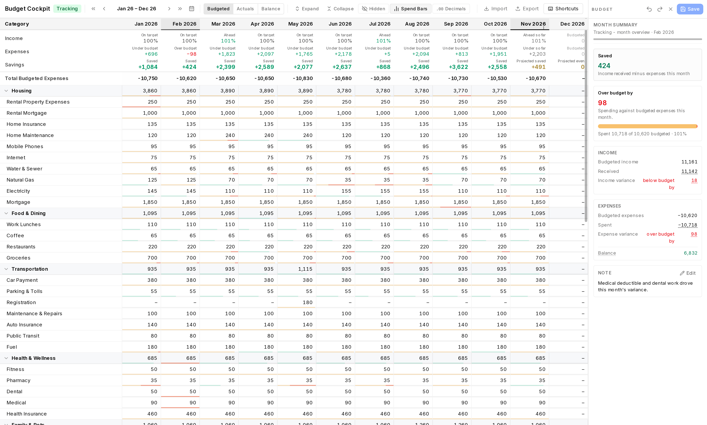
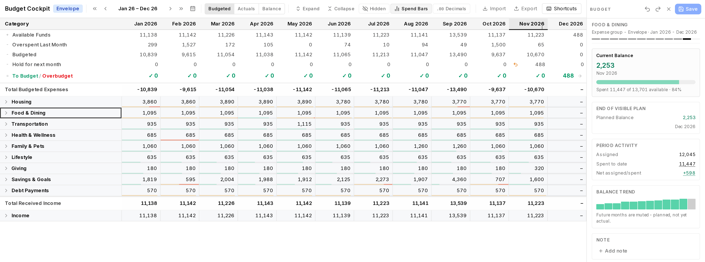
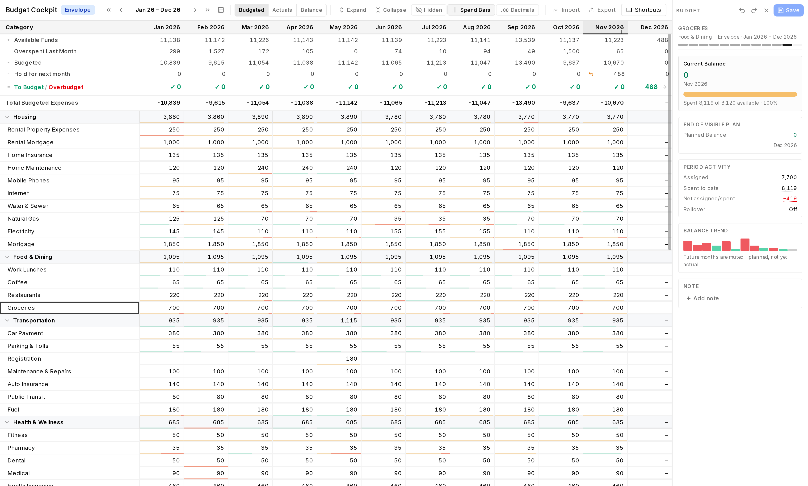
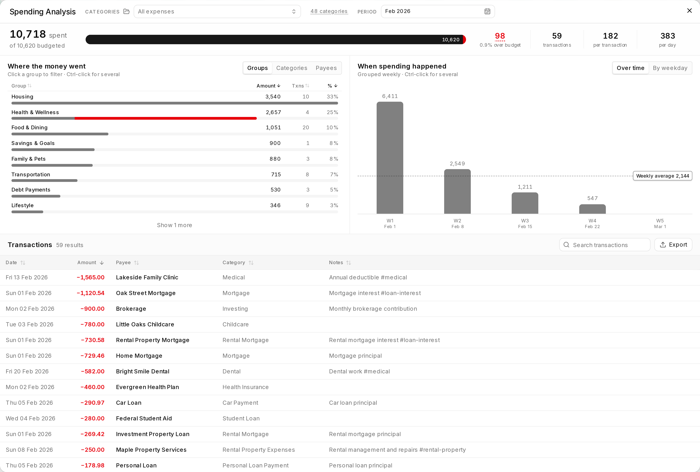
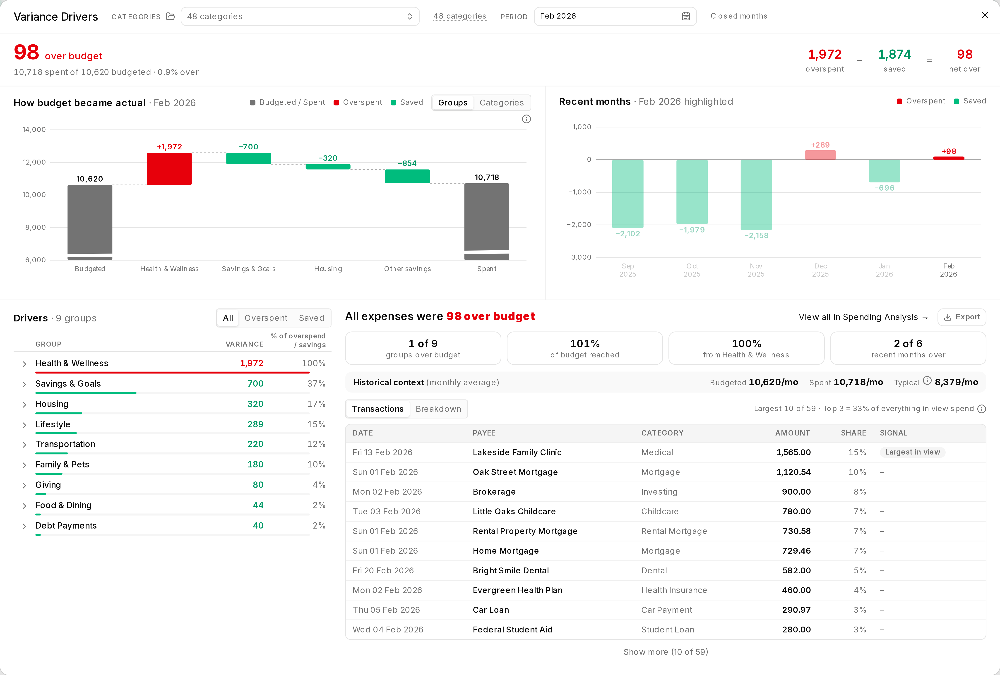
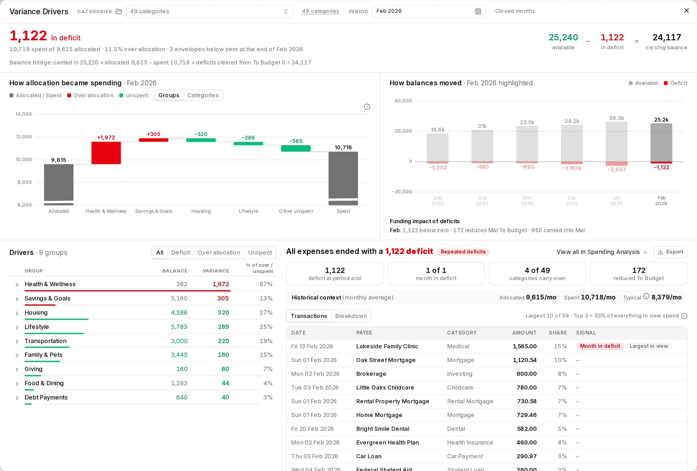

Budget Cockpit puts a whole year of your budget in one grid: one row per category, one column per
month. Switch every cell between **Budget**, **Actuals** and **Balance**, fill a year of amounts in
a few keystrokes, and click any figure to see what is behind it.

Open it from **Financial Management → Budget Cockpit**. Budget amounts, holds and transfers are
staged and go to Actual when you select **Save**. Notes and carryover save straight away.

*An Envelope budget, twelve months at once. With nothing selected, the panel on the right summarises
the whole period.*

## Plan a year in five steps

1. Check the **Envelope** or **Tracking** badge at the top left matches your budget.
2. Choose **Budget**, **Actuals** or **Balance** (or press `V`). Every cell follows.
3. Select a row, group or month header to see its story in the details panel.
4. Edit a cell, paste a range, or right-click for a bulk action such as "3-month average".
5. Read the draft, then **Save**.

## Envelope and Tracking

Actual has two ways of budgeting, and the page changes its labels and totals to match yours.

- **Envelope** gives real money to categories. What you have not given out yet is **To Budget**.
  Each category's **Balance** rolls forward, so an unspent envelope carries over and an overspent one
  comes out of next month. Income is received, not budgeted, so income rows are not editable.
- **Tracking** compares a plan with what happened. Its headline is **Savings**: income minus
  expenses, shown as **Projected Savings** while a month runs and **Saved** or **Overspent** once it
  closes.

*The same workspace on a Tracking budget leads with how each month is running against plan.*

## Read the grid

- **Budget** shows budgeted amounts, **Actuals** shows what was spent or received, and **Balance**
  shows the running balance.
- Group rows total their categories, even when collapsed.
- In the Budget view, a thin **spending bar** under each expense cell fills green as you spend,
  turns amber near the limit and red past it. **Spending Bars** in the toolbar turns them off.
- The current month is highlighted, with a marker showing how far through it you are: 80% spent on
  the 5th is different news from 80% on the 25th.
- The month header and category label of the focused cell light up, so you always know where you
  are.

*The **Actuals** view: what was actually spent, month by month.*

### The details panel

The panel on the right follows whatever you select, with a progress meter for the selection.

- A **month header** shows where the month's money came from and what it did.
- A **group** or **category** label shows its year: assigned, spent and how its balance moved.

*A month in an Envelope budget: where To Budget came from, then what the month did.*

*The same click on a Tracking budget: income and expenses against plan, with a variance for each.*

*A group across the year: assigned, spent, and how its balance moved.*

## Move around

- `‹` and `›` (or `[` and `]`) move the window a month; `«` and `»` move a year.
- Click the month range in the toolbar to jump to any month in the budget.
- The calendar button returns to the current month.
- `E` and `Shift+E` expand and collapse all groups; `Space` toggles one.
- `H` shows or hides hidden categories.

## Edit cells

- Select a cell and type, or press `Enter` or `F2`. You can type sums such as `1200/12`.
- `Enter` confirms and moves down; `Tab` confirms and moves right; `Escape` cancels. `Delete` sets the
  cell to zero.
- Staged edits show amber. Type the original value back and the edit disappears.
- `Shift+click`, drag, or `Shift+Arrow` select a range. Copy and paste work with Excel and Google
  Sheets.

### Fill shortcuts

| Keys | Fills each selected row with |
|---|---|
| `Ctrl/Cmd+Enter` | The first cell's value |
| `Ctrl/Cmd+D` / `Ctrl/Cmd+R` | The value above / to the left |
| `Alt+L` | Last month's value |
| `Alt+Y` | The same month last year |
| `Alt+A` / `Alt+Shift+A` / `Ctrl/Cmd+Alt+A` | The 3-, 6- or 12-month average |

Press `?` for every shortcut.

## Bulk actions

Right-click a cell, a group, or a month header. Acting on a group acts on all its categories, and a
month header acts on the whole month, which is the quickest way to plan one.

- **Copy from another month:** previous month, same month last year (optionally with a % uplift),
  or any month you pick.
- **Set a value:** zero, a fixed amount, or a % change.
- **Average past budgets** or **Average past actuals** over 3, 6 or 12 months.
- On a single cell in an Envelope budget: **Cover Overspending** or **Transfer to Another
  Category**. In a Tracking budget: turn rollover on or off from that month on.

Group, month and anything with a parameter shows a **preview** first: every category and month it
will change, current and new amounts, and the totals. The new amounts are editable, so if an average
lands on 97 and you wanted 100, type it. What you apply is what the table shows. Each action is one
undo step.

## Envelope extras

- **Hold for next month:** each To Budget cell shows what is held; the toggle stages a hold or
  clears it.
- **Cover Overspending** and **Transfer to Another Category** move money between categories. Both
  sides post together.

## See what is behind a figure

**Spent** and **Income received** in a month summary open **Spending Analysis**: every transaction
behind the figure, where the money went, and which week it left.

Click a **variance** figure to open **Variance Drivers**, which explains what pushed a month, group
or category off plan.

- **Tracking:** a waterfall from budgeted to spent, written as an equation such as *10,074 overspent
  − 3,648 saved = 6,426 net over*; the groups and categories that drove it; the months around it, so
  you can tell a one-off from a pattern; and the largest transactions.
- **Envelope:** the same dialog reads balances, because an overspend there is a funding question.
  It shows how much is in deficit, how each closing balance is made up, and tags each driver as
  *Deficit*, *Covered by balance* or *Available*.

Select a driver to narrow everything else to it. Export takes the drivers to CSV.

## Save

- The details panel shows an **N changes** badge; open it for the list by month.
- **Save** shows a summary first, then sends the changes. Both sides of a transfer post together or
  not at all.
- If some fail, **Retry Failed** sends only those. Undo and redo cover up to 50 steps.

**Notes** (on a category, group, cell or month) and **rollover** in a Tracking budget save as soon
as you confirm them, outside the draft. See
[Work safely](../../getting-started/core-concepts/#changes-that-save-immediately).

## Import and export

- **Export** chooses months, whether to include hidden categories, income and staged values, or a
  blank template. Files are UTF-8 CSV.
- **Import** sorts each row into exact, suggested or unmatched, shows before and after values, and
  stages the whole file as one undo step.

## Troubleshooting

- **Paste did nothing:** select a cell first. Paste fills from the top left of the selection.
- **A category is missing:** it is probably hidden. Press `H`.
- **Changes did not save:** failed cells stay staged in red. Select **Retry Failed**.
- **A note will not discard:** notes save as soon as you confirm them.
- **Scrolling is slow:** a very long category list makes the grid work hard. Collapse groups you are
  not using.

## Related pages

- [Categories](../categories/) - set up the categories you budget here
- [Financial Insights](../financial-insights/#my-budget) - your budget against what really happened, over any period
