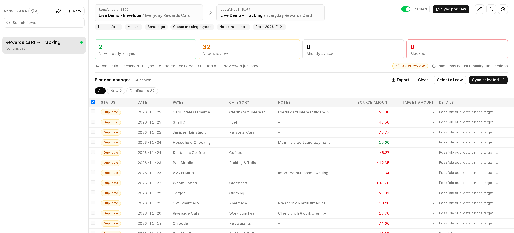
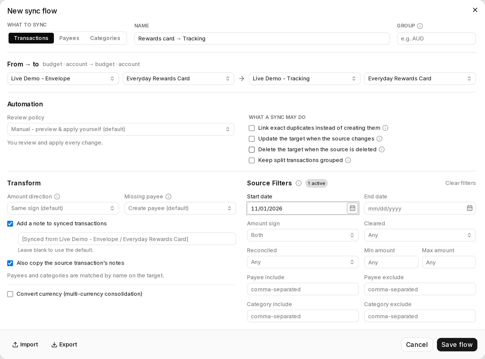

Cross Budget Sync copies transactions, payees or categories from one budget file to another: a
foreign-currency budget into your main one, a shared household budget into your own, or a business
account into a personal view. Each **flow** goes one way, previews every row before it writes, and
remembers what it already copied, so running it again never duplicates anything.

Open it from **Sync & Automations → Cross Budget Sync**. A preview never writes. Actual changes when
you select **Apply**, or on a schedule you opt in to, which applies only items it can prove are
safe. It is marked experimental while it is shaped by feedback.

*A preview sorts every row and writes nothing. Both demo budgets already hold this card's spending,
so most rows are flagged as possible duplicates instead of being copied twice.*

## Your first flow

1. Select **New flow** and choose **Transactions**, **Payees** or **Categories**.
2. Pick the source and target. For transactions, pick an account on each side.
3. Keep the default settings for the first run.
4. Select **Preview** and read how each row is classified.
5. Select the **New** rows and **Apply**.
6. Preview again: those rows now say **Already synced**.

Once that works, add updates, deletion review, currency conversion or a schedule.

*A flow is one direction, one pair of endpoints, and careful defaults: create only, same sign,
create missing payees, and a note so synced rows are easy to recognise.*

The source and target pickers list the budgets connected in this session and your saved budgets.
Choosing a saved budget connects it in the background, without changing the budget you are working
in. Any mix of Direct and HTTP API connections works.

## What a flow can copy

- **Transactions**, from one account to another. The two accounts can be in the same budget.
- **Payees**, budget to budget, matched by name. Missing ones are created.
- **Categories**, budget to budget, matched by name within their group. Missing categories are
  created under the matching group, or a **default group** you choose. If a category's group cannot
  be placed, it is **Blocked** for review, unless you turn on **create missing groups**.

Payee and category flows only ever create: they never rename, delete or hide anything.

## Transaction settings

**Filters** choose which transactions take part: a date range, cleared and reconciled status, money
in or out, an amount range, payees and categories to include or leave out, and text in the notes.
Transactions that a sync created are always left out, so two flows can never loop.

**Transforms** shape what is written:

- **Amount direction:** the same sign, or reversed.
- **Payee:** matched by name, creating missing payees by default.
- **Category:** matched by name. A transaction flow never creates categories; a missing one is left
  empty.
- **Notes marker:** a visible note such as `[Synced from Household / Checking]`, on by default.
- **Splits:** split lines become separate transactions by default, or stay one split with **Keep
  splits grouped on the target**.
- **Convert currency:** see [Exchange Rates](../fx-rates/).

## Preview

| Label | Means |
|---|---|
| **New** | Safe to create on the target |
| **Already synced** | Copied by an earlier run; skipped |
| **Duplicate** | Looks like something already on the target; held for review |
| **Source changed** | Changed in the source since it was copied |
| **Source deleted** | Deleted in the source since it was copied |
| **Deleted on target** | Someone deleted the copy in the target |
| **Marker match** / **Name match** | The target already carries this item |
| **Blocked** | Cannot be applied safely, for example a category with no group to go in |
| **FX pending** | Waiting for an exchange rate |

The preview shows source and target amounts side by side, with currencies and rates on a converting
flow.

## Apply

Select the rows you want and **Apply**. Only those rows are written. Each copy is recorded as soon
as it succeeds, so a failure part-way never loses the rows before it, and **Retry failed items**
retries only what failed.

A preview older than a day, or made before you changed the flow's settings, is refused: preview
again. If a copy is on the target but Bench lost its record of it, select its **Marker match** row
to reconnect them without creating a duplicate.

## Updates and deletions

Both are off until you turn them on.

- **Update mapped targets:** when a source transaction changes, its copy follows. Sync owns the
  amount, date, payee and notes. The category and cleared state belong to the target, so you can
  categorise copies there. A copy you edited by hand is never overwritten.
- **Delete when the source is removed:** a deleted source transaction appears under **Source
  deleted** for you to select. Deletes are never automatic and never in bulk.
- **Deleted on target:** a copy someone removed is reported. Recreate it, or choose **Stop
  syncing**.

## Transfers between the two budgets

A transfer inside the source budget is copied without a transfer payee, with the other side named in
its notes, so it cannot create a second transfer leg on the target.

To record money moving **between** the two budgets, enter it once, in the budget you sync from:

1. A **Payee** flow from your main budget brings each of its accounts across as a payee named
   `Transfer: <account>`.
2. In the other budget, record the movement with that payee.
3. The preview says **Creates a transfer to** that account. Sync writes a real transfer in the main
   budget, and Actual adds its other side.

Because sync created both sides, it keeps them together: a later correction updates both, and
deleting the source row removes both. If the other account already has a row that looks like the
other side (within three days and 5%), the transfer is not selected, so the money is never counted
twice. If you would rather record both sides yourself, link them from
[Currency position](../fx-rates/#currency-position).

## Review, history and groups

- **Review queue:** duplicates, changed and deleted sources, and blocked rows are never applied
  automatically. They wait for you.
- **Run history** shows each run's counts and every item. **Export** saves a run's audit as CSV.
- **Groups:** give flows the same **Group** name to list them together. **Run all** runs a group in
  order, payees and categories before transactions.
- The **bell** beside **Sync flows** counts flows whose latest run needs you.
- **Reverse flow** creates the mirror of a flow (switched off, for you to check), so two one-way
  flows make a two-way sync.
- Flow definitions export and import as JSON. They carry no credentials.

## Automation

Each flow has a review policy:

- **Manual** (the default): you preview and apply.
- **Auto-sync on a server schedule (unattended):** the server runs a safe-only sync on a schedule,
  with the app closed. Routine runs read the last two months; once a day a run reads the whole
  account and checks for deletions. Both budgets must be
  [enrolled for unattended access](../automations/#unattended-access).
- **Run safe sync now** runs the safe-only sync once, on demand.

Safe-only means only **New** rows (and marker repairs) are applied. Everything else stays in review.
**Exact-duplicate auto-map** (off by default) also links a target transaction with the same date,
amount, payee and category, without creating a new one.

After repeated failed runs, a flow **auto-pauses** and is badged, until you turn it back on. A flow
that still has the old **Auto-sync on a schedule (while the app is open)** policy no longer runs, and
says so: edit it and choose the server schedule.

## Your target's rules

Actual runs the target budget's rules when a transaction is created, so a copy can end up with a
different payee, category or notes than the preview showed. Bench shows this as a warning, not an
error.

## Troubleshooting

- **The preview is empty:** check the flow's filters and that the source has matching transactions.
- **A source or target cannot be chosen:** a flow cannot copy an account into itself, and payee and
  category flows need two budgets.
- **Duplicates appear:** handle them in the review queue.
- **A category is Blocked:** choose a default group, or turn on create missing groups.
- **A copy was not updated:** you edited it by hand in the target, so sync left it alone.
- **Automation is not running:** check the review policy, whether the flow is paused, and the vault
  in [App Health](../../administration/app-health/).

## Limits

- Rows you entered in **both** budgets are not linked automatically; link them one at a time from
  [Currency position](../fx-rates/#currency-position).
- Target deletes always go through review.
- Transaction flows never create categories; use a Category flow.
- Only exact duplicates can be auto-mapped.
- One budget file holds one currency; conversion happens between budgets.

## Related pages

- [Exchange Rates](../fx-rates/) - converting between currencies
- [Automations](../automations/) - schedules and run history
