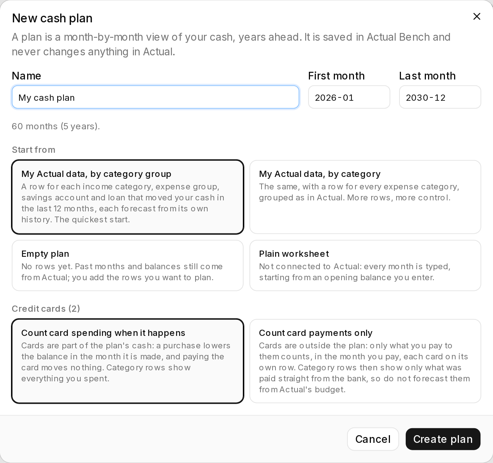
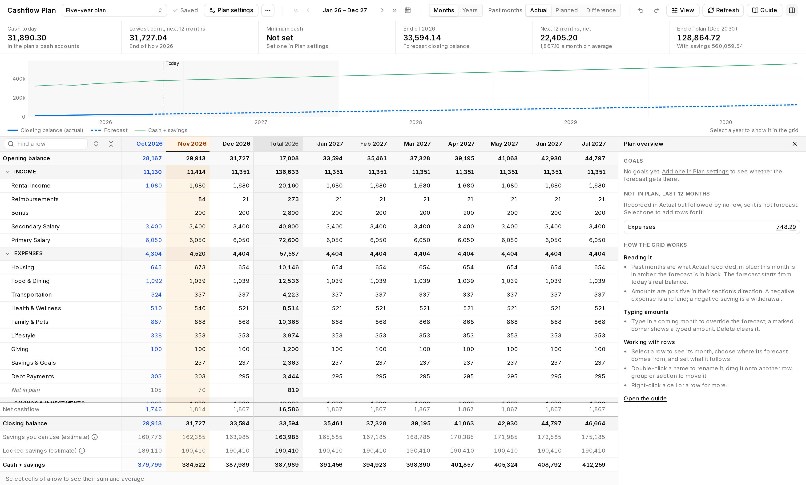
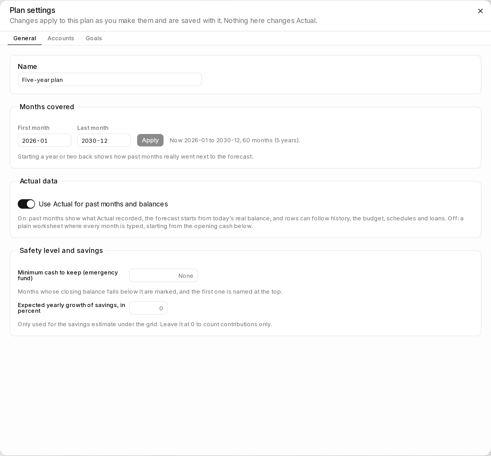

A cash plan answers the long-range questions: where will my cash stand at the end of each month for
the next few years, how low will it get and when, and will I reach what I am saving for? It is the
spreadsheet many people keep next to their budget, with the past already filled in from Actual and
the future forecast from your own history.

Open it from **Financial Management → Cashflow Planning**. It reads your accounts, transactions,
budget, schedules and tracked loans, and never changes Actual. Your plans are saved in Bench as you
work. It is marked experimental while it is shaped by feedback.

## Create a plan

*Name the plan, choose how far ahead it runs and where it starts from.*

Choose **Create your first plan** (or **New plan** in the **⋯** menu), name it, and choose its first and last month (6 months to 50 years). Starting in January of this year shows how the year really went next to the forecast.

| Start from | What you get |
| --- | --- |
| My Actual data, by category group | A row for each income category, expense group, savings account and loan that moved your cash in the last 12 months, each forecast from its own history. The quickest start. |
| My Actual data, by category | The same, with a row for every expense category, grouped as in Actual. |
| Empty plan | No rows. Past months and balances still come from Actual. |
| Plain worksheet | Not connected to Actual: every month is typed, from an opening balance you enter. |

If the budget has credit cards, the dialog also asks how to count them: **Count card spending when it happens** (cards are part of the plan's cash) or **Count card payments only** (cards are outside the plan and each gets a payments row). See [What counts as cash](#what-counts-as-cash).

You can keep several plans per budget (a careful one and an optimistic one, for example) and duplicate a plan to try a change.

## Read the grid

*Past months from Actual in blue, this month in amber, the forecast in black - and the chart above shows where it all leads.*

Each column is a month, followed by a total for each calendar year. **Years** shows one column per year. The header of a month says what it holds:

- **Actual:** what Actual recorded. These cells cannot be typed in.
- **This month:** what was recorded so far, plus what the plan still expects before the month ends.
- **Forecast:** the plan.

The opening balance of a month is the closing balance of the one before. Past closing balances are the real balances of the plan's cash accounts, so the forecast always starts from today's real balance.

Rows sit in four sections: **Income**, **Expenses**, **Savings & investments** and **Loans & debt**. Amounts are positive in their section's direction. A negative expense is a refund, a negative saving is a withdrawal back into cash, and a negative debt amount is new borrowing.

The figures at the top give the answers: cash today, the lowest point of the next 12 months, the first month below your minimum cash, the balance at the end of the year and of the plan, and the net of the next 12 months. The chart shows the balance over the whole plan; select a year in it to show that year in the grid.

## What counts as cash

A plan balances and forecasts its **cash** accounts. Unless you choose otherwise:

| Account | Counts as |
| --- | --- |
| Checking and Cash you can use now, Credit Card | Cash |
| Savings, Fixed Deposit, Investment, Retirement (locked or not), Other Asset you can use now | Savings |
| Loan, Property, Vehicle, Other Fixed Asset, locked Checking or Cash, other assets and liabilities, accounts left out of reports | Outside the plan |
| No class | Cash when on budget, outside when off budget |

Access comes from the **Accessible** column on the Accounts page. When some savings are locked, the pinned savings line splits into **Savings you can use (estimate)** and **Locked savings (estimate)**, and the details panel and goals can count cash, cash and the savings you can use, or cash and all savings. The panel remembers its choice for each plan.

Credit cards are cash by default, so a card purchase lowers the balance when it is made and paying the card moves nothing. If you would rather follow the bank balance only, set the card to **Outside the plan** in **Plan settings → Accounts**: card purchases then leave the plan, and each card payment shows as money leaving cash.

Classes are set on the **Accounts** page. Cashflow Planning does not require every account to have one.

## Rows follow Actual

Adding a row (the **+** beside a section or group, or Insert) asks what it follows. Select a row to open its details: the selected month, where coming months come from, what the row follows, and notes. To rename a row, double-click its name; to move it, drag its name onto another row, a group or a section. Under **Follows in Actual**, choose what the row follows:

- **Categories**, or a whole **category group** (every category currently in it).
- **Accounts**: for an account outside cash, the transfers between cash and it (a savings account, a loan); for a cash account, its uncategorized entries (interest, for example). You can count money in only or money out only.

Every recorded movement is placed once. A transfer follows the row of its account first, then the row of its category. A category or account can be followed by one row; a second row that follows it is marked.

Money that arrives in cash from a loan account is borrowing, not a negative repayment. A row that follows a loan counts either its **Repayments** or the **Money borrowed**; borrowed money that no row follows appears under Income as Not in plan. A plan built from Actual adds a "borrowed" row under Income for each loan that paid money in during the last 12 months.

What no row follows is shown as **Not in plan** in its section. It still counts, so each past month adds up to the real change in cash, but it is not forecast. Select it to see what it is made of and add a row for any part.

## Forecast

Each row chooses where its coming months come from:

| Source | Use it for |
| --- | --- |
| Repeating amounts and typed cells | Amounts you know: a salary each month, rent each quarter, a fee each year. Each repeating amount has a start, an optional end and an optional yearly change. |
| Average of recent months | Day-to-day spending. The average of the row's last 3, 6, 12 or 24 complete months, with an optional yearly change. |
| Actual's budget | What you budgeted for the followed categories. Months after the last budgeted one repeat it. **Paid** can delay it by one or two months, for a credit card paid after its statement: a month then shows what the cards recorded for those categories the month before (the larger of that and the budget while the month is in progress), and the budget for months still to come. |
| Actual schedules | The upcoming dates and amounts of the schedules you choose. |
| Loan schedule | The repayments the Loans page projects for a tracked loan, until it is paid off. **Whole repayment** (the default) forecasts each whole instalment, and counts the interest and fee lines of repayments already recorded as splits in this row instead of their category's. **Principal only** counts what lowers the loan and leaves the interest with its category's row. |

A typed amount in a coming month always wins over the row's source and is marked in the corner of the cell. Delete it to follow the source again.

:::note
If a row uses Actual's budget and one of its categories pays into an account that another row follows (a mortgage category and a row for the mortgage account), that money is forecast in both rows. Use the loan schedule or the average for one of them.
:::

## A transaction in the wrong month

Rent you planned for the end of May may leave the account on 1 June. To count it in May:

- add a `#2026-05` tag to the transaction's note in Actual. It then counts in May in every plan; or
- open the transactions behind the figure (right-click the cell, or click an amount in the details panel) and change **Counted in** to the month before or after, for one transaction or for several you select. This is saved in the plan and does not change Actual. The list sorts by any column, can be grouped by month, category, payee or account, and its footer says whether it adds up to the figure you opened it from.

The real balances do not change, so a **Moved between months** line appears under the sections and puts the amount back in the month the money really moved. Moved cells carry a small marker.

## Type and edit

- Arrow keys move (Left from the first month reaches the row label), Shift or dragging extends the selection, Enter or typing starts editing, Delete clears typed amounts. Ctrl+Enter types one amount into every selected cell.
- Copy and paste work with spreadsheets, so you can bring in figures from an existing sheet.
- Ctrl+R and Ctrl+D fill the selection to the right and down; dragging the small square at the corner of the selection fills to the right. The right-click menu fills a month's amount to the end of the year or of the plan.
- Space or Enter on a label collapses and expands a section or group.
- F2 or a double-click renames a row or group, Insert adds a row below, and Alt+Up/Down or dragging a row's name moves it (drop it on a group or section heading to put it there).
- The bar under the grid adds up the selected cells of rows (sum, average, smallest, largest and how many); click a figure to copy it. Ctrl+Z and Ctrl+Y undo and redo changes to the open plan. The **Guide** button in the plan bar opens an in-app guide to reading and working in a plan, and `?` opens it at the shortcuts.
- **Past months**, beside Months and Years in the plan bar (plans that use Actual), chooses whether past months show actual, planned or the difference. **View** holds the balance chart, decimals, and whether a Total column follows each year of months (the Years view always shows them). The calendar button beside the plan name brings the current month back into view. Use the arrows or the month picker next to the plan name to move through the years, and the search box above the row names filters rows.

Net cashflow and the closing balance stay in view under the grid while you scroll.

## Minimum cash, goals and savings

*Plan settings: set the minimum cash to keep, and the plan marks every month whose closing balance falls below it. Goals have their own tab.*

In **Plan settings**:

- **Minimum cash to keep** marks every month whose closing balance falls below it and names the first one at the top.
- **Goals** are an amount of cash, or cash plus savings, to reach by a month. The plan shows whether the forecast gets there and how much more a month it would take.
- **Expected yearly growth of savings** is used for the savings estimate under the grid: the balance of your savings accounts, then what the plan puts aside each month. Market changes are not forecast.

## Saving

Every edit is saved a moment later; the header shows **Saved**, **Saving…** or **Not saved** with a Retry. If the same plan was changed in another tab or on another device, Bench asks which version to keep instead of overwriting it. Use **Export plan (JSON)** for a copy you keep yourself, and **Export figures (CSV)** to take the numbers elsewhere.

## Limits

- Calendar months only, in the budget's single currency.
- Actual does not expose skipped future occurrences of a schedule, so a skip shows only once the schedule's next date moves.
- A loan has a schedule only when it is tracked in Loans and agrees with its Actual account; otherwise its row can follow its own history.
- Savings are an estimate from contributions and the growth you set, not a market forecast.
