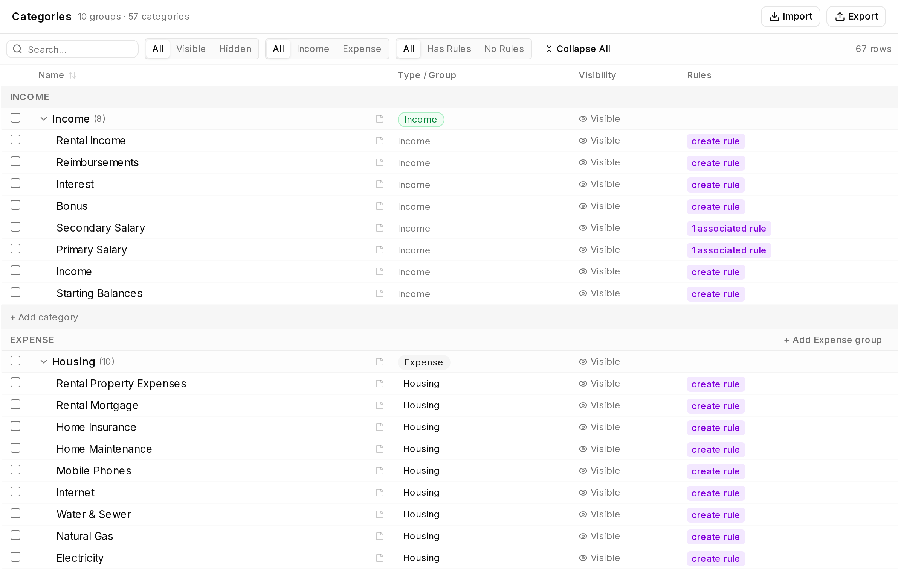

Use Categories to create and manage category groups and categories, import or export the hierarchy,
hide categories, and review deletion impact.

Open it from **Budget Setup → Categories** (`/categories`).

**Budget impact:** Category changes remain staged for review until you **Save**. Category and group notes save immediately.

*Ten groups and fifty-two categories in one view, income and expense separated, with visibility and
rule references on every row.*

It shares the [editing model](../../getting-started/editing-and-saving/) every Budget Setup page
uses.

## What you get beyond Actual Budget

- **The whole hierarchy as one CSV** - seed a budget's structure from a spreadsheet in a single pass,
  or take a copy.
- **Group deletion counts the cascade** - how many child categories, how many transactions across all
  of them, warned about before anything stages.
- **See which rules reference a category** and jump straight to them.
- **Notes on category groups**, not just categories.

## Groups and categories

- Create category **groups** (income or expense type) and categories within them.
- Rename groups and categories inline; collapse or expand group rows (or all groups at once).
- Moving a category between groups opens an editor when you ask for it. Rendering fifty dropdowns up
  front would make a big table crawl.
- To move several at once, select the expense categories and choose **Move to group…**.

:::note[Income category constraints]
Income categories belong to the one income group and stay there. Only expense categories move.
:::

## Hide, show, and delete

- Toggle visibility (hidden / visible) per category or per whole group.
- Deleting a **category** confirms with its transaction count and rule references. Deleting a **group**
  adds the child count and every child's transactions, plus a cascade warning. Bulk delete works out
  what is already implied and totals it once.
- When saved categories go, the dialog offers **Move transactions and budget amounts to** another
  category on the same side, as Actual does. Leave it empty and their transactions become
  uncategorized. Bulk delete offers it when everything selected is income, or everything is expense.
- Save moves categories before it deletes groups, so a category you moved out of a group is never
  deleted along with it.

## Filter and sort

Filter by name, type (income / expense / all), and visibility (visible / hidden / all). Sort by name.

## Notes

Each category and group row has a note button. Read, add, edit, or clear notes inline - they **save
immediately**, independent of staged category edits.

## Import and export

Export or import the full group hierarchy as CSV (staged before saving). CSV columns:

- `type` (`group` or `category`, required), `name` (required), `group`, `is_income`, `hidden`.
- **Group rows must appear before** the categories that reference them.

## Common problems

- **"Can't move an income category"** - income categories are locked to the income group.
- **A group delete warns loudly** - it cascades to child categories; read the aggregated impact first.
- **Imported categories landed ungrouped** - check that each group row appears above its categories in
  the CSV.

## Related pages

- [Editing, review and save](../../getting-started/editing-and-saving/) - the shared editing model
- [Budget](../budget-management/) - budget the categories you create here
- [Rules](../rules/) - how rules reference categories
