Financial Insights turns your Actual accounts and transactions into the full picture: your net
worth over time, where your money came from and went, how long your cash would last, what your
investments, home and loans are doing, and a household P&L and balance sheet. Every figure uses the
same rules, so numbers on one chart always agree with another, and any underlined figure opens the
transactions behind it.

Open it from **Financial Management → Financial Insights**. It only reads your budget and never
changes anything in Actual. It is marked experimental while it is shaped by feedback. The **Guide**
button at the top of the page explains every card in the app, and opens at the tab you are on.

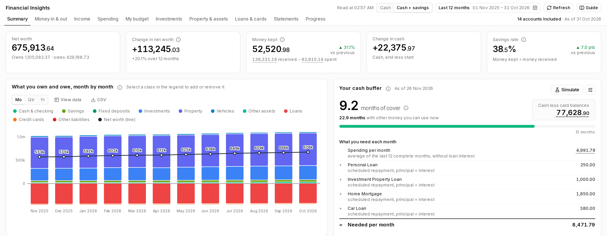

*The headline figures, what you own and owe month by month, and how many months your cash would last.*

## Before your first figures

Bench has to know what each account is before it can tell cash from savings, or an investment from a
loan. Until then the page lists the accounts that need attention, with the reason and an
**Open Accounts** button. You need two things:

- every account has a **class**, its own or its group's, and
- every account sits where its class belongs: a credit card on budget; a fixed deposit, investment,
  pension, property, vehicle or loan off budget.

Both are set on [Accounts](../accounts/). An off-budget account you don't want counted can be left
out of reports instead. A closed account with no transactions and a zero balance needs nothing. When
you come back the page checks again; **Check again** re-reads without leaving.

## Choose what to look at

The period control in the header applies to every tab.

| Period | Covers |
|---|---|
| This month, This year | From the start to today, marked **partial** |
| Last month, Last 6 months, Last 12 months, Last year, Last 2 years | Complete months only, so averages compare like with like |
| All available | From your first transaction to today |
| Custom range | Any run of months up to the current one |

Nothing dated after today is counted. Balances are taken at the end of each month, and the current
month runs to today.

The **Cash / Cash + savings** switch beside it decides what "cash" means. **Cash** is the checking
and cash accounts you can use now. **Cash + savings**, the default, adds savings and fixed deposits
you can use now. Locked money is never cash. The choice is remembered for each budget.

## The tabs

| Tab | Answers | Shown when |
|---|---|---|
| [Summary](#summary) | What am I worth, did it grow, and how long would my cash last? | Always |
| [Money in & out](#money-in--out) | Where did my cash go, step by step? | Always |
| [Income](#income) | Where did my money come from? | Always |
| [Spending](#spending) | Where did my money go? | Always |
| [My budget](#my-budget) | Did I stay on my plan? | Once Bench can read your budget mode |
| [Investments](#investments) | What have my investments built up? | You have an investment or retirement account |
| [Property & assets](#property--assets) | What are my home and car worth, and what is mine? | You have a property, vehicle or other fixed asset |
| [Loans & cards](#loans--cards) | What do I owe, and what is it costing me? | You have a loan, card or other liability |
| [Statements](#statements) | My household's cash flow statement, P&L and balance sheet | Always |
| [Progress](#the-progress-tab) | Something to share, with no amounts on it | Always |

## Summary

- **Net worth, Change in net worth, Money kept, Change in cash** and **Savings rate** across the top.
  Money kept and the savings rate also compare with the same length of time just before the period.
- **What you own and owe, month by month** stacks assets above zero and debts below, with net worth
  as a line. Select a class in the legend to hide it, so cash and investments stay readable beside a
  large property. The net worth line always shows the true total.
- **Where your money came from and went** shows two lists that add up to the same total: money in
  (received, borrowed, taken from savings) and what you did with it (spent, paid off loans, invested,
  saved). **Other** holds whatever those do not explain, and is never forced to zero.
- **What changed your net worth** is a waterfall from the start of the period to the end. When the
  steps add up exactly, it says **Reconciled**; when they don't, a dashed **Unexplained** bar shows the
  difference.
- **What you own and owe, start and end** compares balances by class. Open a class for its accounts.

Every timeline has **Mo**, **Qtr** and **Yr** buttons. They pick a sensible default for the period's
length, and your own choice sticks for that period.

Three measures that are easy to mix up: **money kept** is income minus spending; **change in cash**
is how your cash balance moved after saving, investing and paying down debt; **change in net worth**
is everything you own minus everything you owe, end against start.

### Your cash buffer

The cash buffer says how many months your cash would cover, as of today: your cash, less what you
owe on credit cards, divided by what a typical month needs. A typical month is your average spending
over the last 12 complete months, plus each loan repayment.

- A loan you track in [Loans](../assets-debt/) counts its scheduled repayment. If its schedule no
  longer agrees with Actual, the buffer says **Unavailable** and names the loan, rather than guess.
- A loan you don't track uses the average of what you paid into it recently (at least three months
  of history).
- Hover the cash figure to see the accounts behind it. If you also have investments or other money
  set to **Available now**, the (i) shows a second figure that counts them too.
- The sliders button sets your **goal** (3, 6, 12 or any number of months) and how a typical month
  is worked out: over 3, 6 or 12 months, as an average or a median.

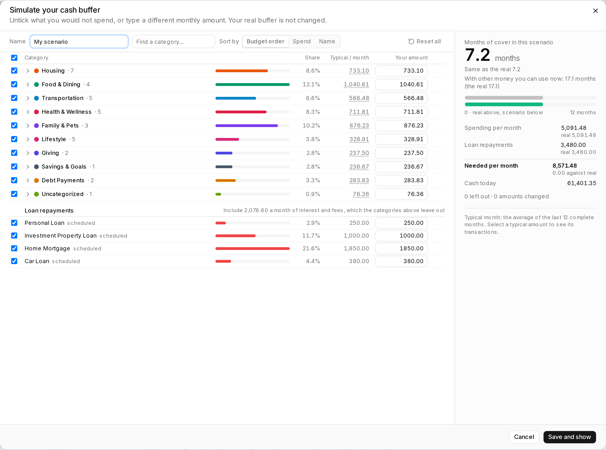

**Simulate** asks "what if?" It lists your spending by group and category, and each loan, with the
typical amount beside a field for your own. Leave out what you would stop spending, change what
something costs, or set a whole group's total, and watch the months of cover change beside the real
figure. Save it as a named **scenario** to come back to; a scenario is always marked **Simulated**,
and never changes Actual or the real figure.

## Money in & out

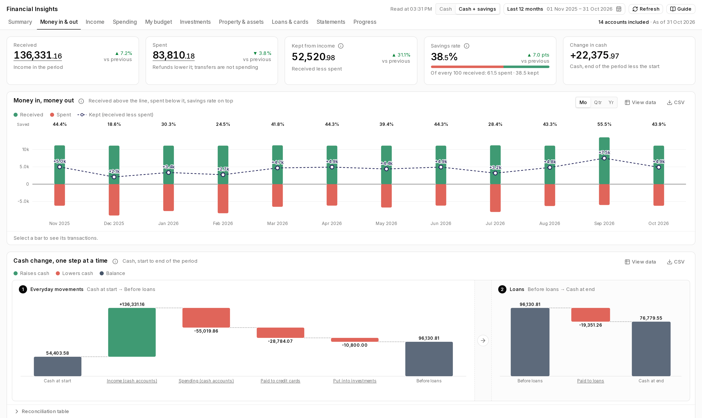

*Money in above the line, money out below it, and every step between cash at the start and cash at the end.*

- **Received, Spent, Kept from income, Savings rate** and **Change in cash**, each compared with the
  period before.
- **Money in, money out** draws what you received above zero, what you spent below, and what you kept
  as a line, with the savings rate over each month.
- **Cash change, one step at a time** walks from your cash at the start to your cash at the end.
  Open **Reconciliation table** for every step. Anything left unexplained stays visible as
  **Unattributed**.
- **In transit** lists transfers whose other side is missing, dated outside the period, or recorded
  with a different amount, and says which.
- **Investments**, **Paid to loans** and **Loan repayments** show money into and out of investments,
  and each loan's principal, interest and fees.
- **Other movements** lists entries that are neither plain income nor spending, such as activity
  inside an investment account.

## Income

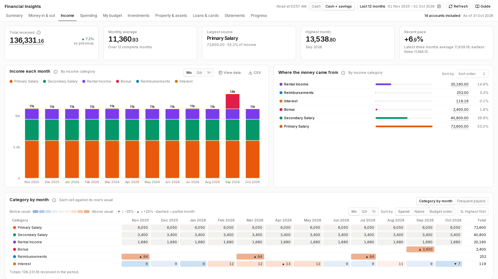

*Where the money came from, month by month, with each cell shaded against its row's usual amount.*

Income here is money that actually arrived, not the income you budgeted. It matches **Received** on
Money in & out. Transfers between your own accounts are not income.

- **Total received, Monthly average, Largest source, Highest month** and **Recent pace** (the latest
  three months against the earliest three, once there are six).
- **Income each month** by category, and **Where the money came from** with each category's share.
- **Category by month** shades each cell against that row's usual amount. **Frequent payers** ranks
  who paid you most.

## Spending

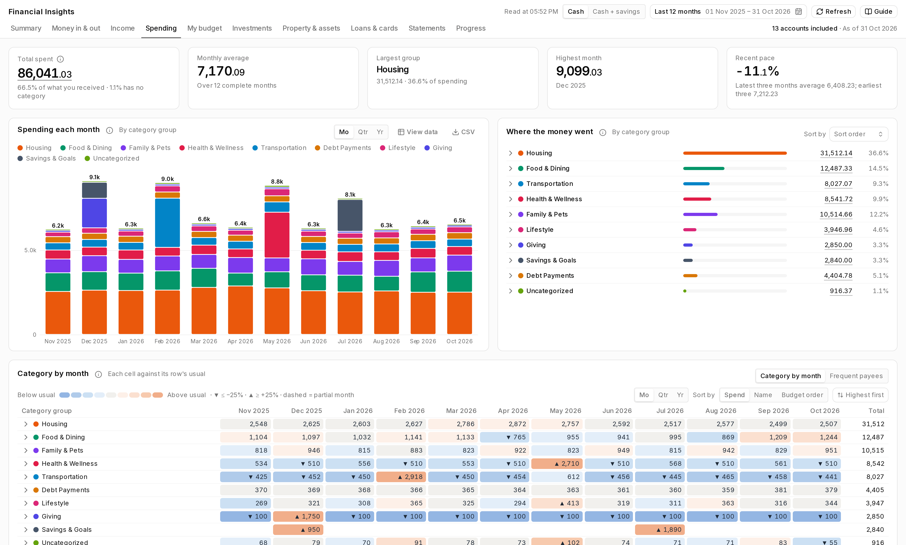

*Spending by group and by month; a cell well above or below its usual amount is marked so it stands out.*

- **Total spent, Monthly average, Largest group, Highest month** and **Recent pace**. Averages use
  complete months only.
- **Spending each month** by category group. The ten largest groups have their own colours, the same
  on every card of the tab.
- **Where the money went** lists every group in Actual's order; expand a group for its categories.
- **Category by month** is a heatmap: cooler is below that row's usual amount, warmer is above, and
  ▼ or ▲ marks a month 25% or more away from it. Neither colour means good or bad.
- **Frequent payees** ranks where you spent most.

## My budget

*Your budget against what really happened, with a reconciliation that explains why it differs from the Spending tab.*

My budget answers "did I stay on my plan?" from the budget you keep in Actual. It follows your
budget's own mode, Tracking or Envelope, and its figures match Budget Cockpit for the same month.

- **Five tiles.** Tracking: expenses budgeted and spent, expense and income variance, and months
  over budget. Envelope: budgeted, spent, overspending not covered, months needing adjustment and the
  ending balance. The tiles count completed months only.
- **Reconciliation to Spending** explains, line by line, why Actual's spending figure differs from
  the Spending tab's (see [why My budget can differ](#why-my-budget-can-differ)).
- **Budgeted vs spent, month by month**: a pale block for the plan and a bar for what was spent,
  green while it stays inside, red once it goes over.
- **Where the budget was missed** (Tracking) or **Where funds ran short** (Envelope) ranks the
  categories that went over most often. Tracking also shows **unplanned spending**: spending in
  categories with no plan.
- **Category by month** marks each cell against its plan. Tracking: ▼ under, = on, ▲ over, ○
  unplanned. Envelope: **covered**, **↷ carried** or **! uncovered**.
- **Budgeted vs spent by group** lists every group against its budget, with the variance.

Bench reads one budget month for each month of the period, so a long period such as All available
takes a little longer to open.

## Investments

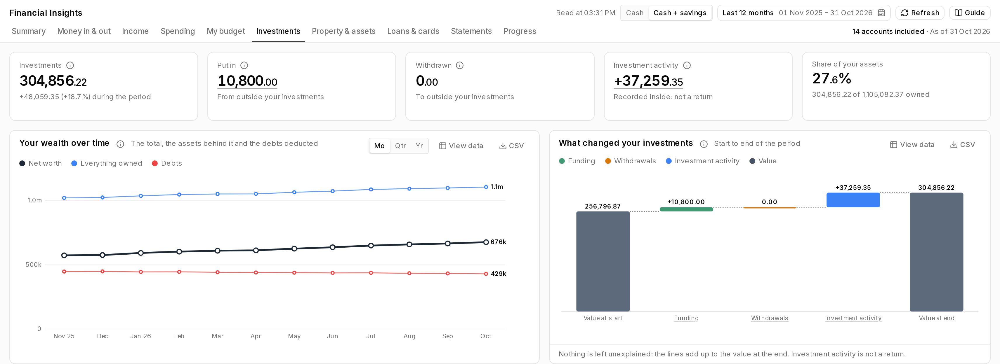

*What you put in, what you took out, and what happened inside your investments, adding up to the value at the end.*

Investments answers "what have my investments built up?" Five tiles show the portfolio value, what
you put in, what you withdrew, the activity recorded inside the accounts, and the portfolio's share
of everything you own. Your wealth over time draws net worth as the strongest line; a month you
borrowed is marked ◆, because assets and debts rising together is not wealth.

Bench never calculates a percentage return. It shows what went in, what came out, what was recorded
inside, and what is left unexplained.

## Property & assets

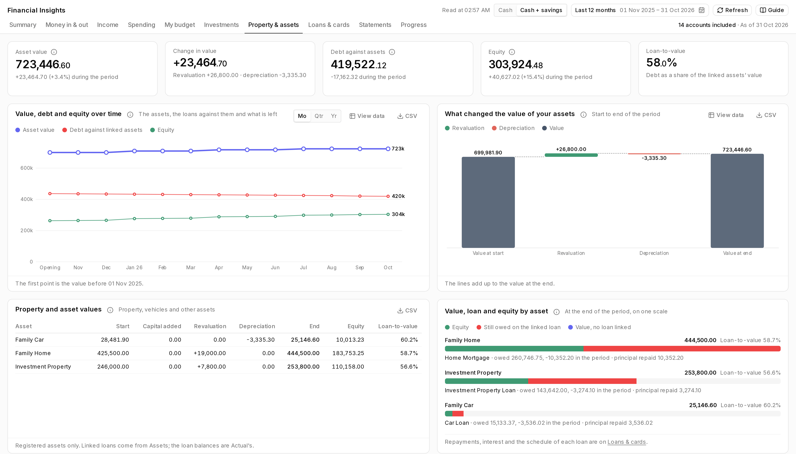

*Each property and vehicle with the loan against it, the equity you hold and its loan-to-value.*

- **Asset value**, **Change in value**, **Debt against assets**, **Equity** and **Loan-to-value**.
  The last three need a loan linked to the asset in [Assets](../asset-registry/); until then they
  say **Not linked**.
- **Value, debt and equity over time**, from the value history you keep in Assets.
- **What changed the value of your assets**: capital added, revaluation, depreciation and sales.
- **Value, loan and equity by asset**, one bar each, and a table with a CSV.

A value Bench cannot read says so; nothing is estimated.

## Loans & cards

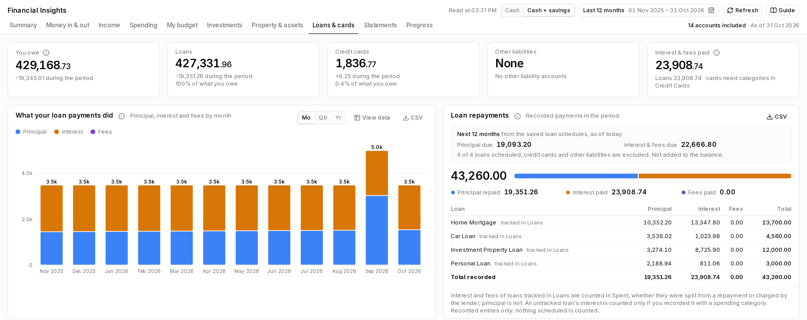

*What your loan payments did each month - principal, interest and fees - and what each loan is due to cost over the next year.*

- **You owe**, then **Loans**, **Credit cards** and **Other liabilities**, each with its change and
  share, and **Interest & fees paid**.
- **What your loan payments did** splits each month's payments into principal, interest and fees.
- **Loan repayments** shows each loan's recorded principal, interest and fees, and what is due over
  the next 12 months from your saved loan schedules.
- **What you owe on credit cards** and **Interest & fees on credit cards**, using the interest and fee
  categories you set in [Credit Cards](../credit-cards/).
- **What you owe, account by account** lists every debt with its start and end balance. A tracked loan
  adds **Next 12 months** and **Later**.

Interest and fees are identified for loans tracked in [Loans](../assets-debt/). For other loans the
page says "not identified" rather than guess.

## Statements

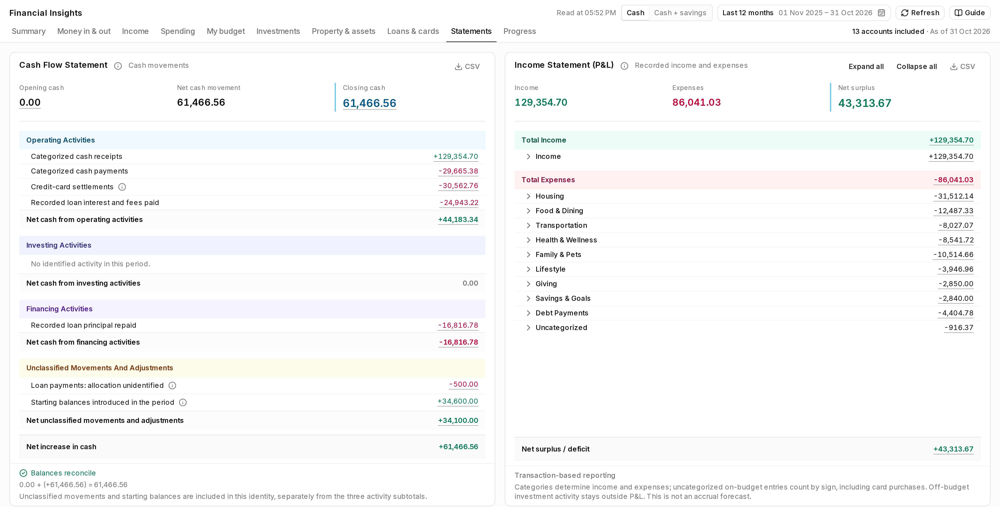

*A household cash flow statement and P&L side by side; the cash flow statement marks when its balances reconcile.*

Statements sets out your household the way an accountant would, for the chosen period:

- **Cash Flow Statement:** opening cash, then operating, investing and financing activities, then
  closing cash. **Balances reconcile** means opening cash plus every movement equals closing cash.
- **Income Statement (P&L):** income and expenses by group, ending in a net surplus or deficit.
  Groups start collapsed; **Expand all** opens them.
- **Balance Sheet:** what you own and owe at the end of the period, by class and account group, with
  net worth. It matches the Summary tab exactly.
- **From P&L surplus to cash movement** explains the gap between the two statements, and
  **Classification exceptions** lists anything whose purpose could not be identified, with a reason.

Every underlined amount opens its transactions, and each card has its own CSV.

What goes in each section of the cash flow statement

Opening and closing cash are the Checking, Cash, Savings and Fixed Deposit accounts you can use now,
on or off budget, whatever the header switch shows.

| Section | Movements |
|---|---|
| Operating | Categorized cash receipts and payments, uncategorized on-budget receipts and payments, card settlements, and identified loan interest and fees |
| Investing | Money into and out of investment and retirement accounts, locked savings and deposits, and fixed assets, including sale proceeds and selling costs |
| Financing | Borrowing received, and principal repaid (from recorded splits, or for a loan whose lender charges interest separately, the payments less what was charged) |
| Unclassified movements and adjustments | Uncategorized off-budget cash entries, unsplit loan payments, transfers with an unknown purpose, starting balances, and transfers whose other side is missing |

Bench never uses a calculated schedule to fill in an amount the transactions do not record, and
never invents a balancing entry. Unexplained differences stay visible.

| Account class | How the statements treat it |
|---|---|
| Checking, Cash, Savings, Fixed Deposit | Cash when you can use it now; transfers to a locked one are investing. Off budget, uncategorized money into Savings or a Fixed Deposit is income. |
| Investment, Retirement | Funding and withdrawals are investing; activity inside stays out of P&L |
| Property, Vehicle | Purchases and capital are investing; rent and running costs with a category enter P&L; value changes stay out |
| Other Asset | Transfers to fixed assets are investing; others need an identified purpose |
| Credit Card | Purchases enter P&L once; settlements are operating |
| Loan | Borrowing and principal are financing; interest the lender charges on a tracked loan is an expense |
| Other Liability | Transfers need review, because the class alone does not say what they are |
| Left out of reports | Excluded |

## The Progress tab

Progress is for sharing. A net worth line climbing past zero or a card balance falling to nothing is
worth posting, but most people don't want to show how much money they have. **Nothing on this tab
shows an amount**: no figures, currency, axis values, or account, payee, loan or asset names. It
shows percentages, months, counts, dates and chart shapes, and agrees with the other tabs.

| Card | What it shows |
|---|---|
| Net worth journey | Your net worth line with only zero marked, and when you crossed it |
| Asset composition | What you own split into cash, investments, property and other, at the start and end |
| Debt payoff progress | How what you owe fell since its peak, for cards, loans or all debt, and when it was paid off |
| Savings rate | Each month's savings rate, your best month and your run of months above 0% |
| Savings consistency | One square per month: saved, short, or no income |
| Cash buffer | Months of cover on a 0 to 12 scale |
| Cash buffer journey | Months of cover at the end of each of the last 24 months, against your goal |
| Property value & LTV | Each property's value shape and loan-to-value, named only by its kind |

A card that does not apply is hidden, and one that cannot be worked out says why instead of showing 0%.

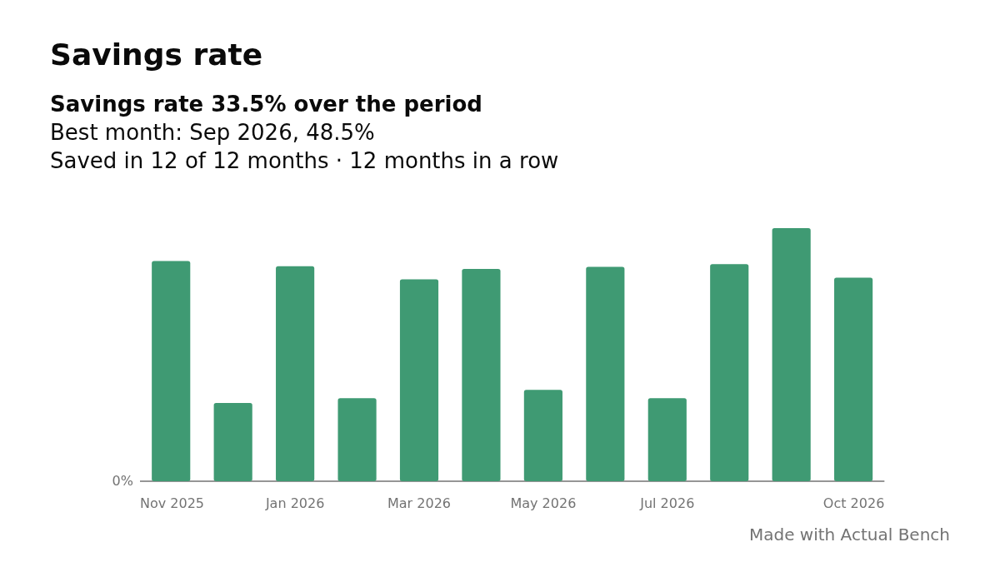

### Share a card

- **Copy image** and **Download PNG** on each card save exactly what the card shows, 1200 × 675
  pixels, in the app's current theme. **Copy all images** copies every card as one sheet.
- **Show dates** off replaces month names with Month 1, Month 2…, so the picture carries no dates.
- **Show text** off leaves each card as its title and picture.

Pictures are drawn in your browser, carry no hidden data, and are never uploaded.

## See the transactions behind a number

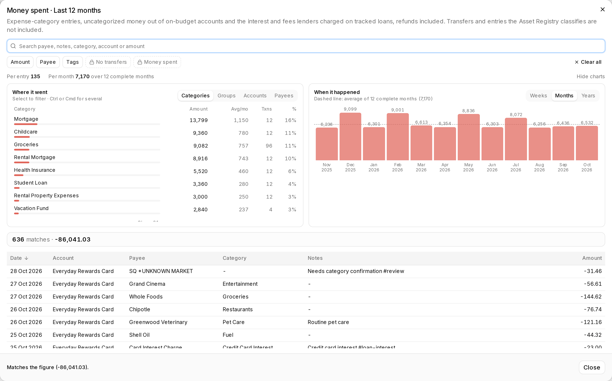

*Select an underlined figure to see the transactions behind it; the footer confirms they match the figure.*

Underlined figures, bars, chart segments, waterfall steps and heatmap cells open the real
transactions behind them. The footer checks the list against the figure you clicked: **Matches the
figure**, or by how much it differs. For money received and spent, charts above the list show where
it went and when; select a bar to narrow the list. Nothing here can be edited.

## Charts and exports

Every chart has a **CSV** button with its exact figures, and **View data** to show them as a table.
A small **(i)** beside a title explains the chart. Colours mean the same thing on every tab, and are
never the only signal: values, signs and symbols say the same. A partial month is drawn lighter,
marked with an asterisk, and not compared with full months.

Bench reads your transactions when you open the page and when you select **Refresh**.

## How the numbers are worked out

You don't need this section to use the page. It is here for when a figure surprises you.

### What counts as income and spending

Each entry is read in this order:

1. A **transfer** between your accounts is never income or spending.
2. An entry that [Assets](../asset-registry/) classifies, such as a revaluation or a sale, has its
   own line.
3. An entry with a **category** follows it: income in an income category, spending otherwise. A
   refund in an expense category lowers spending.
4. An entry with **no category** in an on-budget account counts by its sign, and is shown as
   uncategorized so nothing is hidden.
5. With no category in an off-budget account:
   - in an investment or retirement account it is **investment activity**, which changes net worth
     but is not income or spending;
   - money into an off-budget **Savings** or **Fixed Deposit** account (interest, in practice) is
     income;
   - in a loan account it is an **other entry in a loan account**, unless it is interest or a fee the
     lender charged on a loan you track in Loans, which is spending;
   - anywhere else it is an **unidentified movement**.
6. An account left out of reports is left out completely. Money moved between it and an included
   account appears as **Transfers with excluded accounts**.

Also:

- A **card purchase** counts once, when you buy. Paying the card later is not spending again.
- Paying **loan principal**, investing and moving money between your accounts are not spending.
  **Borrowing** is not income. Interest and fees are spending.
- **Opening balances** are never income.
- A transfer with only one side recorded, or whose other side falls outside the period, is shown as
  **in transit**, and the balances stay right.

### Common movements

| Movement | How it is reported |
|---|---|
| Checking → investment | Cash falls, investment funding rises; not spending |
| Investment → checking | A withdrawal into cash; not income |
| Checking → loan | **Paid to loans**: cash and what you owe both fall |
| Checking → credit card | A card payment; the purchases were already counted |
| Checking → property | Money put into an asset; not spending |

### Why My budget can differ

When you move money from an on-budget account to an off-budget one, Actual asks for a category, and
counts it as spending in your budget. Financial Insights does not count transfers as spending, even
with a category. So moving 500 from checking to an off-budget investment uses 500 of a budget
category in Actual, but adds nothing to **Spent** here. The reconciliation on My budget lists each
difference like this, with links to the transactions.

### When Money kept needs review

Money kept and the savings rate carry a warning when [Assets](../asset-registry/) classifies an
entry as money put into an asset, but no transfer is recorded behind it: the same money may also be
counted as spending. Record the purchase as a transfer in Actual, or change the classification. If
the Asset Registry cannot be read at all, they show **Needs review** instead of a number. Income,
spending, net worth and balances are shown either way.
