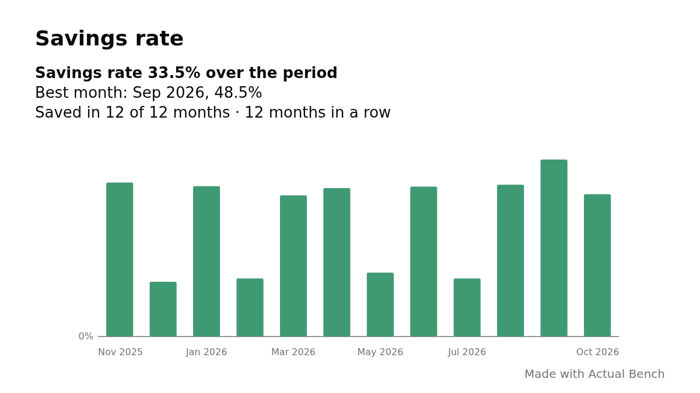

Open **Financial Management → Financial Insights** after connecting your Actual budget. It is an experimental, read-only page: Bench reads your accounts and transactions through Direct or HTTP API and never writes to Actual.

Financial Insights answers one question at a time, using the same definitions everywhere, so the numbers on one chart always agree with the numbers on another. It starts with a **Summary** tab, then **Money in & out**, **Income** and **Spending**, which are always there; the other tabs appear when there is something to show: My budget once Bench can read your budget mode, Investments when you have an investment or retirement account, Property & assets when you have a property, vehicle or fixed other-asset account, and Loans & cards when you have a loan, credit card or other liability account.

**Progress** is always offered too, last, with cards you can share as pictures without showing any amount.

**Statements** is always offered too: cash flow beside P&L, using the existing income and spending rules. Uncategorized on-budget receipts and payments count by sign, including card purchases; recorded activity inside off-budget investments is shown separately.

The **Guide** button at the top of the page opens a guide inside Bench: what every tab and card tells you, how each figure is worked out, with pictures of the charts, why this page is more than a report of transactions, and a glossary. **How things are counted** starts with common movements and explains why My budget can differ, with account-specific examples and classification rules available to expand. The Guide opens at the section for the tab you are on.

## How things are counted

Actual's on-budget or off-budget placement says whether an account participates in the budget. Bench's **Class** says what the account represents, and its **Financial Reporting** label says how it is shown in the report. Investment, Retirement, Property, Vehicle and Loan accounts must be off budget, and Credit Card accounts must be on budget so their purchases count as spending. Cash and Bank accounts count as cash equivalents even off budget; a Bank marked **Fixed / restricted deposit** still counts toward net worth but not cash or the cash buffer. These choices are stored by Bench and do not change Actual.

| Movement | How it is reported |
| --- | --- |
| Checking (on or off budget) → investment (off budget) | Cash falls and investment funding rises. The transfer itself is not spending and does not change net worth. |
| Investment (off budget) → checking (on or off budget) | A portfolio withdrawal and money into cash, not income. |
| Investment (off budget) → investment (off budget) | A move between portfolio accounts, which cancels in the portfolio total when both sides are in the period. |
| Checking (on or off budget) → loan (off budget) | **Paid to loans**: cash and the amount owed fall. It is principal, plus any interest the lender charged to the loan account (principal is what was paid in less what the lender charged). Borrowing in the other direction is not income. Interest and fees of a loan tracked in Loans are spending, whether split from the repayment or charged by the lender. A transfer into a loan from another loan, a card or another liability repays nothing and is not counted as principal. |
| Checking (on or off budget) → credit card (on budget) | Card settlement, not spending again. A categorized purchase is counted when recorded. |
| Checking (on or off budget) → property (off budget) | A transfer into an asset, not spending. Assets can help explain a purchase, improvement, value change or sale. |

The checking examples assume a Bank account counted as cash, not one marked fixed / restricted.

The Investments tab counts transfers between the portfolio and **any account outside it** as funding or withdrawals; Money in & out shows the part exchanged with cash accounts. Transfers between investments are separate from investment activity: each account's movement is included in **Other**, and the two sides cancel in the total when they fall in the period. An uncategorized non-transfer entry inside an off-budget investment or retirement account is investment activity, not a calculated return. An uncategorized entry in another off-budget account is an unidentified movement unless Assets classifies it; on budget, uncategorized money in or out is counted by its sign. Categorized non-transfer entries follow their income or expense category. Opening balances are not income, and excluded accounts stay out, with transfers to or from them shown separately.

Money kept is received less spent; cash change also reflects transfers, and net worth is included assets less liabilities. Assets can link the records of a purchase that is not a transfer, but separate unlinked entries may look like spending and a value change; Money kept can need review. When transfer sides do not match or fall in different periods, the report may show them as in transit. Unexplained differences stay visible.

**Why My budget can differ:** When a transfer involves an off-budget account, Actual requires a category on its on-budget side and it can count the transfer as budget spending. Financial Insights excludes transfers from its **Spending** calculation, even when they have a category. For example, moving 500 from checking to an off-budget investment account can use 500 of a budget category, but adds nothing to Financial Insights’ **Spent**. The reconciliation in My budget shows the difference.

## Before any number appears

Every account must be understood first. Financial Insights shows no figure until:

- every account has an **account class** (its own, or its group's), and
- every account sits in a placement its class accepts (a credit card on budget; a house, car, investment, pension or loan off budget). No Financial Reporting choice is required, and an off-budget account can be left out with **Include in Financial Insights** instead.

Both are set in the [Accounts](/user-guide/accounts/) table, in the **Class** and **Financial Reporting** columns. The page lists the accounts that need attention, with the reason (for a credit card kept off budget it says to choose another class or leave the account out of Financial Insights), and has an **Open Accounts** button. When you come back it checks again by itself, and **Check again** re-reads without leaving the page. If a new unclassified account appears later, the page locks again and removes its figures. A closed account with no transactions and a zero balance needs nothing.

A budget with no transactions up to today shows **There is nothing to show yet**, not a page of zeros.

## Choose a period

The period control applies to everything on the page.

| Period | What it covers |
| --- | --- |
| This month, This year | From the start to today. They are marked **partial**. |
| Last month, Last 6 months, Last 12 months, Last 2 years, Last year | Complete months only, so averages and charts compare like with like. |
| All available | From your first transaction to today (from your first starting balance when there are no transactions yet). |
| Custom range | Any run of months, up to the current one. |

A period never holds more than 200 years (2,400 months); if your history or a custom range is longer, the period starts 200 years back and its label shows the range it really covers. Nothing dated after today is counted, including later this month. Balances are measured at the end of each month, and the current month runs to today.

## The Summary tab

- **Net worth, change in net worth, money kept, change in cash and savings rate** across the top. Under money kept, the received and spent amounts that make it up open their transactions. When Assets classifies entries as capital put into an asset without a recorded transfer, money kept and the savings rate are still shown, with a warning and the amount that may be counted twice. Money kept and the savings rate also show how they moved against the stretch of the same length just before the period, when your budget has data that far back.
- **What you own and owe, month by month** stacks your assets above zero and your liabilities below, with net worth as a line. **Mo**, **Qtr** and **Yr** buttons show the balance at the end of each month, quarter or year; the chart opens in months for a period up to 18 months, in quarters up to five years and in years beyond that, and your own choice replaces it for that period. Every card with these buttons does the same: change the period and each card that you have not set by hand opens by its new length. Select a class in the legend (Cash & bank, Fixed / restricted deposits, Investments, Property, Vehicles, Other assets, Loans, Credit cards, Other liabilities) to take it out of the picture or put it back, so cash and investments are easier to read when property is large. It is only a filtered view: the net worth line is always the true total.
- **Your cash buffer** shows the months of cover large, with cash & bank less card balances beside it and the monthly need laid out as a sum: spending per month, plus each loan, equals needed per month. It is always *as of today*, whatever period you picked. The monthly need is your average spending over the last 12 complete months (all available complete months when there are three to eleven; "Insufficient history" below three) plus each loan you owe, in full:
  - Hover or select **Cash & bank today** to see open cash accounts and their balances, including zero and negative balances. Closed accounts are not listed; if they have a nonzero combined balance, it appears as a single subtotal so the list adds up to the figure. Fixed / restricted deposits and investments are excluded. It also works when a scenario is shown, because scenarios use the same cash balance.
  - A loan **tracked in [Loans](/user-guide/assets-debt/)** whose schedule agrees with its loan account in Actual counts its scheduled repayment, principal and interest together. Only the interest and fee entries Loans recorded are taken out of your spending so they are not counted twice.
  - If a tracked loan's schedule does not agree with Actual, the buffer says **Unavailable** and names the loan. Nothing is estimated in its place.
  - A loan that is not tracked uses its recorded repayments: the average (or the median, when you chose the median) of the transfers recorded into its account over the same last complete months as your typical month, and it needs at least three complete months. That is what was paid in, which can include interest the lender charged.
  - Accounts you mark **Accessible money** (an Investment, or an Other Asset that is not a fixed asset) do not change the main figure, the goal or scenarios, which stay cash-based. When any is marked, the (i) beside the months of cover also gives **With accessible investments: N months**, counting their positive balances too, and lists the accounts and balances. A scenario shows the same second figure in its dialog.
  - Cash is cash & bank less what you owe on credit cards, because card purchases are in your spending and the balance is already committed. A card in credit is ignored. When the cards owe more than the cash, the buffer says **Unavailable**.
  - The 0–12 month scale is only a scale, not a recommended target. Investments and fixed / restricted deposits are not cash.
  - **Simulate** lets you ask "what if": it opens a dialog listing your spending by category group and category, each with a checkbox, the typical amount per month that your real buffer uses and a field for your own amount. Leave out what you would not spend, change what something costs, or set a whole group's total (its categories keep their shares). Each loan's repayment can be left out or changed the same way. The months of cover and the need per month update as you work, beside the real figure, and a reset arrow puts a row, a group or everything back. The interest and fees of tracked loans are counted in each loan's repayment, so they are shown as a line that counts while the loan is included; leaving a loan out leaves out its interest and fees too.
  - Save a simulation as a **scenario** with a name. You can keep several; a selector on the card switches between **Actual** and any scenario, and a scenario is always marked as **Simulated** with its difference from the actual. What it came to when it was saved is kept too, so the card can tell you how it has moved since. Scenarios are kept by Bench for this budget and never change Actual or the real buffer. A category that no longer exists is ignored.
  - The dialog shows each group and category with a bar in the group's colour from the Spending tab (the typical amount faintly behind, your amount in front) and its share of the monthly need. Sort it by budget order (the default), spend or name, and select a typical amount to see the transactions behind it without leaving the dialog.
  - The sliders button on the card sets your **goal** (the months of cover you aim for: 3, 6, 12 or any whole number from 1 to 120) and how a **typical month** is worked out: over the last 3, 6 or 12 complete months, as the average or the median. The median of each category ignores a month that was unusually high or low. The card then shows your goal on the bar and how far you are from it, in months and in cash. These settings apply to the real buffer and every scenario.
- **Where your money came from and went** shows two lists that add up to the same total. **Money in** starts with what you **received** and adds anything else that gave you money to use: **Borrowed**, **More owed on credit cards**, or money **taken from** your cash, investments or deposits. **Money out** is what you did with it: **Spent**, **Paid off loans (principal)**, **Put into investments**, **Moved to deposits, assets & other liabilities**, **Paid down credit cards** or **Added to cash & bank**. **Other** is whatever those do not explain (income or spending in other accounts, unidentified entries, debt paid from investments, transfers whose two sides fall in different periods); it is shown whenever it is not zero and never forced to zero. Nothing is negative: the side a line is on says which way the money moved. Paying off loan principal is money out but not spending, because it lowers what you owe; for the same reason **Money kept** includes it, and the (i) on the Money kept tile explains this: loan interest and fees that Bench can identify (categorized, or charged on a loan tracked in Loans) are spending and are already in Spent; uncategorized charges on other loans are listed as other entries in loan accounts. Received, Spent, Paid off loans and Borrowed open their transactions; the other lines are changes in balances, so they have none to list. Every line has an (i) saying what it means, and the card has a CSV.
- **What changed your net worth** is a waterfall of the change from the balance *before the first day of the period* to the end of it. The steps are what Bench can identify: money kept, other entries in loan accounts, unidentified movements, changes in value and asset sales from Assets, opening balances, transfers with excluded accounts and money in transit. When they add up exactly to the change you see a **Reconciled** mark; when they do not, a dashed **Unexplained** bar shows the difference, and it is never forced to zero. Above the waterfall, a strip shows net worth at the start, the change with its percentage, and net worth at the end; the bars do not start at zero, so the drivers stay readable. Bench does not invent investment returns: an entry with no category in an investment or retirement account is investment activity, shown as its own step.
- **What you own and owe, start and end** compares the balances before the period with the balances at its end, by class. Total owned, Total owed and Net worth rows sit under the classes. Each class opens, with the chevron beside it, into its accounts, largest first, each with its treatment; accounts with no balance at the start or the end are left out and counted. Vehicles and other assets are separate classes, and so are credit cards and other liabilities.
- **How the three measures differ:** *money kept* is income minus spending; *change in cash* is how your cash & bank balance moved (after investments, card payments and loans); *change in net worth* is everything you own minus everything you owe, end minus start.

## The Money in & out tab

- **Received, Spent, Kept from income, Savings rate** and **Change in cash**. Under Savings rate, a slim bar shows how much of every 100 received was spent and how much kept (left out when there was no income, or while Money kept needs review). Received, Spent and Kept from income also show how they moved against the stretch of the same length just before the period (whole months only, the running month left out of both; shown only when your budget has data that far back), in green for the better direction and red for the other.
- **Money in, money out** (with the same Mo, Qtr and Yr buttons; a quarter or year adds up its months and one the period only partly covers is marked *) puts what you received above the zero line, what you spent below it, and what you kept (received less spent) as a dashed line with a marker for each month. The **savings rate** (kept ÷ received) is written above each month, quarter or year; it is left out where nothing was received or Money kept needs review. Nothing is stacked, so nothing is counted twice.
- **Cash change, one step at a time** is a waterfall from your cash at the start to your cash at the end. Income and spending in your cash accounts are two steps (**Income (cash accounts)** and **Spending (cash accounts)**), each opening its own transactions. Everyday movements and loans are separate panels with their own scale, so a large borrowing cannot hide the rest. Open **Reconciliation table** under the chart for every step. Whatever the steps do not explain stays visible as **Unattributed**; it is never forced to zero. Steps that have transactions open them.
- **In transit** opens the exact transfers behind it and says why each is there, from what is recorded: no other side recorded, the other side dated outside the period, or both sides recorded with different amounts. Bench never guesses a cause such as a currency difference, and never changes the transactions.
- **Investments** shows money put into and withdrawn from investments each month, and **Paid to loans** shows what left your cash accounts for loans (principal plus any interest the lender charged), each on its own scale and each with its own Mo, Qtr and Yr buttons. Borrowing is listed under the loans chart rather than drawn, so it cannot flatten the repayments.
- **Loan repayments** lists each loan's recorded principal, interest and fees. Total loan payments lead the card, with a bar splitting principal from interest and fees. Principal is what was paid into the loan less what the lender charged: a repayment, not an expense. Interest and fees of loans tracked in [Loans](/user-guide/assets-debt/) are expenses counted in Spent, whether they were split from a repayment or charged by the lender; other loans say "not identified" and their total is a minimum, and their interest is counted in Spent only if you recorded it with a spending category. When more was paid into loan accounts than left your cash accounts, or money was moved in from other loans, cards or liabilities (which repays nothing), the card says so.
- **Other movements** lists entries that are not plain income or spending, each with a link. An entry with no category in an **investment or retirement account** is **investment activity**: a price change, dividend, interest or fee recorded there. It changes your net worth, is not income or spending, and Bench calculates no return from it. An entry with no category in a loan account that is not a transfer is an **other entry in a loan account** (see below for a loan tracked in Loans). An entry with no category in any other off-budget account is an unidentified movement.

## The Income tab

Income is the other half of Spending: where the money that came in came from. It is **money received**, what actually arrived in your accounts, not the income you budgeted, and it uses the same definition as **Received** on Money in & out, so the two totals are always equal. Transfers between your accounts are not income, and entries the Asset Registry has since classified (a sale, a change in value) are left out. Money in with no category in an on-budget account is listed as **Uncategorized**. Money in with no category in an off-budget Cash or Bank account you set to **Uncategorized entries are income** (interest, for example) is also received, listed as **Interest & income in off-budget accounts**; money out of such an account stays an unidentified movement.

- **Total received, Monthly average, Largest source, Highest month and Recent pace.** Total received shows its change against the stretch before and how much of it has no category; Largest source shows its share of income. The average uses complete months only and says how many; Recent pace compares the latest three complete months with the earliest three and appears only with at least six.
- **Income each month** stacks the month by income category (income is listed by category, not by the group Actual keeps it in), with **Mo**, **Qtr** and **Yr** buttons that open by the length of the period, like every other timeline. Select a segment to see that group's transactions for the month, quarter or year.
- **Where the money came from** lists each income category with what it brought in and its share of all income. Select a total to see its transactions. Sort the list by Actual order (the default), income or name.
- **Category by month** and **Frequent payers** share one place. Category by month is the same heatmap as on Spending, with the categories listed directly, each cell shaded against that row's own average, with the same buttons; Frequent payers ranks who paid you most, with the number of entries and the average. Entries with no payer are shown below the ranking.

When no money was received in the period, the tab says so instead of drawing empty charts.

## The Spending tab

- **Total spent, Monthly average, Largest group, Highest month and Recent pace.** Total spent shows its change against the stretch before, what it is of what you received and how much of it has no category; Largest group shows its share of spending. The average uses complete months only and says how many; the current month is shown but not counted. Recent pace compares the latest three complete months with the earliest three, and appears only with at least six.
- **Spending each month** stacks the month by category group. The ten largest groups in the period have a colour of their own and every other group is "Other groups"; the colours are the same everywhere on the tab. A partial month is drawn lighter with a dashed outline. **Mo**, **Qtr** and **Yr** buttons regroup it into calendar quarters or years; a quarter or year the period only partly covers (or that includes the month still running) is marked * and drawn lighter, and selecting a bar opens the transactions of the whole quarter or year.
- **Where the money went** lists all groups in Actual order by default; sort by spending or name instead. Select a group's total to see every transaction in that group; expand a group for its categories, each also a link.
- **Category by month** and **Frequent payees** share one place (Category by month also has Mo, Qtr and Yr buttons: the title and columns follow, a cell is compared with the average of whole quarters or years, and a partial one is not compared); a switch above them chooses which to show. Category by month is a heatmap of category groups that expand into their categories. Each cell is shaded against that row's own average over the complete months: cooler is below its usual, warmer is above, and neither means good or bad. A ▼ or ▲ marks a month 25% or more below or above, and the partial month is outlined and not shaded. Cells show whole amounts; the tooltip and the list behind each cell have the exact figure.
- **Frequent payees** by amount, with the number of entries and the average. Entries with no payee are shown below the ranking, with how many of them are parts of split transactions.

## The My budget tab

My budget answers "did I stay on my plan?" from the plan you already keep in Actual. It appears after Spending once Bench knows whether your budget is **Tracking** or **Envelope** (it reads Actual's own setting, so there is no switch) and Actual has returned a month. Every plan and spent figure is Actual's own, so it matches Budget Cockpit for the same month and category.

- **Hidden categories.** Actual's Tracking totals leave out hidden categories and the categories of hidden groups, and so do the tiles, the chart and their links, so they match Actual. The Spending tab and the category by month grid include them (a note says so), and the reconciliation shows them as their own part with a link, at the Spending tab's figure for them.
- **Five tiles,** named as in Budget Cockpit's side panel, except the Envelope tile for what was not covered. In a Tracking budget: Expenses budgeted, Expenses spent, Expense variance and Income variance (signed, green when under budget or above it, red when over or below) and Months over budget (with the share of months). In an Envelope budget: Budgeted, Expenses spent, Overspent, not covered (what Actual deducted from the next month, added up), Months needing adjustment and Ending balance, the sum of category balances at the end of the period, not a bank balance. The tiles add up the completed months only; the current month is shown in the chart and table but never counted.
- **Reconciliation to Spending.** Actual's spending and the Spending tab's differ on purpose. Actual counts categorized transfers (for example to an off-budget account) and entries the Asset Registry has since classified; the Spending tab counts entries with no category and categorized entries in off-budget accounts. The box beside the explanation lists the Spending tab's figure, each adjustment and Actual's figure for the same months, lists each of these parts with a link to its transactions, and shows whatever they do not explain as **Other**, never forced to zero, with the categories it sits in as links to their transactions. Every tab treats a category as income when its group is an income group, as Actual's budget does.
- **Budgeted vs spent, month by month**. **Mo**, **Qtr** and **Yr** buttons regroup it into calendar quarters or years, adding up the months that are in your budget; a quarter or year the period only partly covers is marked * and drawn lighter. Each month has a pale block for what was budgeted (assigned, in an Envelope budget) and a bar in front of it for what was spent: green while the bar stays inside the block, red once it rises above it (in an Envelope budget, red only when the overspending was not covered by earlier money), with the amount spent above the bar. A row under the month names says how far each month was under (**+**, green) or over (**−**, red) its budget; the partial month is drawn lighter and grey, and not compared. A month Actual does not have, or that could not be read, is a gap, never zero. Select a bar to see that month's transactions.
- **Where the budget was missed** (Tracking, lower on the page) ranks categories, or with the **Groups** switch category groups, by how far they went over their saved plan across the completed months, with "over in N of M months" and the longest run of months in a row. **Where funds ran short** (Envelope) ranks categories or groups by the months they were left uncovered. A group is over in a month when its categories together spent more than their plans together. In Tracking, a line above the ranking shows the **unplanned spending** (the amount, its share of spending and the number of categories) and **Show only unplanned** filters the list to them. Select a total to see its transactions.
- **Category by month.** The same grid as on Spending (with the same Mo, Qtr and Yr buttons: a quarter or year adds up what was spent and budgeted and is judged like a month; in an Envelope budget it shows the worst state of its months with the last month's balance), with groups that expand into categories. In Tracking each cell is the amount spent, shaded by how it compares with that category's plan for the month: ▼ under, = on, ▲ over, ○ unplanned spending. In Envelope each cell is **covered** (the balance is at or above zero, so earlier money paid for it), **↷ carried** (negative, but the category carries its overspending into the next month) or **! uncovered** (negative and not carried, so Actual takes it from next month). Colour says where spending sits against the plan, not whether that is good or bad; the symbols say the same in words. Select an amount to see its transactions.
- **Budgeted vs spent by group** (**Assigned vs spent by group** in Envelope) sits beside the monthly chart and lists every category group, each opening into its categories, with one row for each: its name, a single line against its budget, then the amount budgeted, the amount spent, the variance (budgeted less spent: **+** under, **−** over, in green or red) and its share of all the spending shown. The line uses the monthly chart's colours: green is spending within the budget, pale is budget not spent and red is spending beyond it. Spending with no budget saved is all red. Sort groups and their categories by Actual order (the default), spending or name. Select a total to see its transactions.
- In Tracking, **Budgeted vs actual surplus** (one compact table whose rows carry paired bars) sets planned income less planned spending beside what was received less what was spent. The budgeted bar is slate; the actual bar is green when the result is on or better than budgeted (income above, spending under, surplus above) and red when it is worse, and the Variance figure takes the same colour. It is a comparison of two sets of months, not a forecast. Under it, **Unplanned spending by month** splits each month's category spending into categories with a plan and categories with none saved.
- **Unplanned spending.** Actual returns 0 both for a category with no saved plan and for a plan of 0, so spending against a plan of 0 is shown as unplanned spending (○) and counts as over plan, for the whole amount spent.
- **Months and limits.** Bench reads one budget month per month of the period when you open the tab, a few at a time, through the same cache as Budget Cockpit, and shows how far along it is. The server still passes them to Actual one at a time. It reads every month of the period you chose, so a long period such as All available takes longer to open. Hidden categories with a plan or spending are included, although Actual's Tracking totals leave hidden categories out.

## The Investments tab

The tab opens with five tiles about the portfolio (**Investments**, **Put in**, **Withdrawn**, **Investment activity** and **Share of your assets**), then the cards: the two timelines (your wealth over time and the portfolio by month) on the left, and the bridge and the account table on the right. In your wealth over time (which has the same Mo, Qtr and Yr buttons), net worth is the strongest line; a month in which you borrowed is marked with a ◆ and explained, because assets and debts rise together and that is not an increase in wealth; and the last point is labelled **Today** because today's balance is valid, only not a month-end one.

Investments answers "what have my investments built up, and what did they add?" It appears after My budget once you have an Investment or Retirement account. Property, vehicles and other assets have their own tab. It never shows a percentage or annualised return: it shows what went in, what came out, what was recorded inside, and what is left unexplained.

## The Property & assets tab

Property & assets answers "what are my property and other fixed assets worth, what is owed against them, and what is left?" It appears after Investments once you have a property, vehicle or fixed other-asset account.

- **Five tiles.** **Asset value** is the balance of your fixed asset accounts in Actual, with its change in the period, and **Change in value** is the registry's revaluation plus depreciation. Once a loan is linked to an asset in [Assets](/user-guide/asset-registry/), **Debt against assets**, **Equity** (the value of the linked assets less their loans) and **Loan-to-value** have figures. Without a link they say **Not linked**; when an input is missing they say **Unavailable**, never zero.
- **Value, debt and equity over time** draws the value of your registered assets at each month end, from the Asset Registry's value history (the same as the Assets page), with the balances of the linked loans in Actual and the equity that is left. The line starts at the value before the period began. Debt and equity cover only the assets that have a loan linked.
- **What changed the value of your assets** is a waterfall of the registry's own bridge: capital added, revaluation, depreciation, disposal and other, from the value at the start to the value at the end. Accounts that need review are not in it and are named under it.
- **Value, loan and equity by asset** draws one bar per asset on a shared scale, split into the equity and what is still owed on its linked loan, with loan-to-value. Under each asset, each linked loan shows what is owed, how that changed in the period and the principal repaid, with a link to the Loans & cards tab. An asset with no loan linked is drawn as value only; one that is not in the registry says **Needs review**.
- **Property and asset values** is the table behind it, beside the value, loan and equity bars, with a CSV; columns nothing uses are left out of the table: start, capital added, revaluation, depreciation, disposal, other, end, equity and loan-to-value.

Nothing here is written to Actual or to the registry, and nothing is estimated: a value Bench cannot read says so.

## The Loans & cards tab

- **Five tiles, the same for everyone.** **You owe** (loans, cards and other liabilities at the end of the period, the same figure as Total liabilities on the Summary tab, with its change) and one tile each for **Loans**, **Credit cards** and **Other liabilities**, with the balance, its change in the period and its share of what you owe. A group you do not have says **None**. The fifth, **Interest & fees paid**, adds up what your tracked loans cost and what your cards were charged where the interest and fee categories are set in Credit Cards; it says when loans are not tracked and so are left out.
- **What you owe, account by account** is the last card on the page and starts collapsed (select its title to open it); it lists every loan, credit card and other liability in three groups that you can collapse and expand, with what was owed at the start and the end of the period and the change. A legend shows how what you owe splits across the groups, and the **Share** column gives each account's part of it. A **View credit cards** link beside the Credit cards heading opens the [Credit Cards](/user-guide/credit-cards/) workspace. For a loan the table adds the principal repaid in the period (select it to see the transactions), **Next 12 months** and **Later** (what is owed today after them). Only a loan tracked in [Loans](/user-guide/assets-debt/) whose schedule agrees with its account in Actual has these two; a loan that is not tracked says **Not scheduled**, and one whose schedule does not agree says **Review in Loans** with the reason. Credit cards and other liabilities have no schedule here. An account with no balance and no activity in the period is not listed.

If you have a loan, two more cards follow:

- **What your loan payments did** stacks principal, interest and fees for each month (every month-by-month chart on this tab has Mo, Qtr and Yr buttons, opening by the length of the period: a quarter or year adds up payments, charges and fees, shows a card balance as it stood at its end, and marks one the period only partly covers with *), with a partial month marked. Interest and fees come only from loans tracked in Loans, and the chart names the loans where they are not identified. Select a segment to see its transactions.
- **Loan repayments** is the same card as on Money in & out: each loan's recorded principal, interest and fees. It also has **Next 12 months, from the saved loan schedules**: the principal and the interest and fees due, as of today, for tracked loans only, with how many loans are scheduled. Credit cards and other liabilities are excluded, it is a schedule at today's recorded rate rather than a forecast, and it is not added to the balance.

If you have a credit card, two more cards follow:

- **What you owe on credit cards** stacks what you owe on each card at every month end, with the five largest cards in their own colours and the rest as "Other cards", and the total as a line. It uses the same balances as the table.
- **Interest & fees on credit cards** stacks, for each month, the interest and fees charged to your cards: the entries in a card's account with the interest or fee category set for that card in [Credit Cards](/user-guide/credit-cards/). A card with neither category set is named as not identified, because its interest and fees cannot be told from other purchases, and none is guessed. If the card settings cannot be read the card says so. They are spending, already counted in Spending. Select a bar to see its transactions.

Property equity and loan-to-value are on [Property & assets](#the-property--assets-tab). An unmatched one-sided transfer to a loan or card shows under **In transit** on the Summary tab, with the reason it is there.

## The Statements tab

The cash flow and income statements use the existing global reporting period in both Tracking and Envelope budgets, including recorded activity through today in a partial month. Plans, category assignments, holds and carryover are outside these statements. The global toolbar shows the period; the statements do not repeat it in another banner.

### Read the statements

Each cash-flow section contains its heading, indented lines and subtotal; income and expense totals appear in their section headers. Cash Flow has **Operating activities**, **Investing activities**, **Financing activities**, and, when needed, **Unclassified movements and adjustments**. P&L has **Income** and **Expenses**, ending with net surplus or deficit. Final net totals appear in gray at the bottom of their cards.

Income and expense category groups start collapsed, in Actual's budget order. The compact rows follow the group table in My budget: select a chevron or group name to expand its indented categories; select an underlined amount to open the transactions behind a group or category. Use **Expand all** or **Collapse all** on the P&L card to change every category group at once. Hidden categories remain included and labelled. Refunds reduce expenses; income reversals reduce income.

### Cash Flow Statement

Opening cash is the balance before the first day of the period; closing cash is the balance at its end. Cash and Bank cash-equivalent accounts form these balances, on or off budget, including closed-account history. Bank accounts marked **Fixed / restricted deposit** are excluded.

| Section | Movements |
| --- | --- |
| Operating | Categorized cash receipts and payments, uncategorized on-budget cash receipts and payments by sign, ordinary card settlements, separately identified loan interest and fees paid, including what the lender charged to a tracked loan's account and the payments covered. |
| Investing | Cash funding and withdrawals involving Investment and Retirement accounts, fixed / restricted deposits, fixed-asset transfers, registry-linked asset sale proceeds and selling costs. |
| Financing | Borrowing received from Loan accounts, principal identified in recorded payment splits, and, for a loan whose lender charges interest and fees as their own entries, the payments less what the lender charged. |
| Unclassified movements and adjustments | Uncategorized off-budget cash entries (except money in for accounts set to count it as income), unsplit loan payments with unidentified allocation, other transfers whose purpose is unknown, starting balances introduced in the period, and cash-to-cash transfer sides without a matching recorded counterpart in the period, even when unrelated entries net to zero. |

For a loan tracked in Loans whose lender charges interest and fees as their own entries, those charges are recorded expenses in the P&L, in a Loans group. Where payments to the loan were made from your cash accounts in the period, the charged amount is shown as interest and fees paid and the rest of the payments as principal; the Cash Flow Statement opens the principal line from the loan accounts (what was paid in less what was charged). Interest and fees are shown as paid only up to what was paid to the loan: when the lender charged more than was paid, all of the payments are interest and fees, there is no principal line, and the rest of the charge is an expense with no cash movement. Charges with no payment in the period are expenses with no cash movement, and the bridge shows them under income and expenses in other noncash accounts. An unsplit loan payment of any other loan can contain interest; a calculated schedule or proposed split is never used to supply missing statement amounts. An account class alone does not distinguish borrowing from payables, or lending from another asset movement. Card receipts are not automatically called borrowing or refunds. Ordinary settlements are operating payments without allocating them to particular purchases, advances or financed assets.

**Balances reconcile** means opening cash plus movements and adjustments equals closing cash. Balances can reconcile while some purposes are unidentified; those entries stay in **Classification exceptions**. Unexplained differences remain visible; Refresh re-reads balances and statement evidence rather than inventing a balancing transaction.

### Income Statement (P&L)

P&L follows recorded categories and the existing Insights treatment of uncategorized entries. On-budget non-transfer money in counts as **Uncategorized income** and money out counts as **Uncategorized expenses**. This includes an uncategorized on-budget card purchase: it is an expense when recorded. Its later repayment is a transfer and never a second expense. Transfers, principal, starting balances, registry-classified capital, value changes and linked sales are excluded. An unlinked asset acquisition or unavailable asset evidence makes the result **Needs review**, with provisional category totals still visible.

Recorded categorized charges count when posted, including in noncash accounts; future schedules and estimated accruals never count. Uncategorized entries in other off-budget accounts and entries with unavailable categories remain in **Classification exceptions**, because their income/expense purpose cannot be established.

### Balance Sheet

The Balance Sheet shows included account balances as of the end of the selected period, grouped by account class, with the same classes, names and order as **What you own and owe** on the Summary tab, so each class total and net worth match it exactly. Each class starts open, showing Actual account groups and a No Group section for ungrouped accounts. Account groups start collapsed; select one to reveal its accounts and Financial Reporting labels. Select a class to collapse or reopen it. The Balance Sheet card’s **Expand all** opens every class and account group; **Collapse all** hides the accounts.

Net worth is calculated as total assets less total liabilities. Because it is a calculated residual, the balance sheet equation is an identity, not an independent reconciliation or retained earnings. Negative asset balances and credit balances on liabilities remain signed. Current account classifications apply to historical dates, and accounts left out of Financial Insights are omitted. The card has its own CSV export.

### Investment activity

Uncategorized non-transfer entries in off-budget **Investment** or **Retirement** accounts appear in a neutral **Investment activity** card with their own transaction drill-down and CSV. They can represent recorded gains, losses, dividends, interest or fees. They are ordinary investment activity, not classification exceptions, and Bench does not assume that they are realized profit. They change investment balances, outside both P&L and available-cash movement. Transfers between cash and investments continue to appear in investing cash flow.

### Explain, inspect and export

**From P&L surplus to cash movement** bridges surplus to cash movement using card purchases versus settlements, income/expenses in other noncash accounts, investing, financing and unresolved cash movements. If P&L needs review, the bridge explicitly uses the provisional result.

**Classification exceptions** lists amounts, entry counts and reasons, even when entries net to zero. Cash exceptions also appear in the cash statement; they are the same entries, not additional movements. Underlined figures open exact recorded transactions, including split children, with the usual total check. Balances and unexplained residuals have explanations rather than fabricated lists.

Current saved account classifications also apply to historical periods. Select **Opening cash** or **Closing cash** in the Cash Flow Statement to see opening and closing balances grouped by account class and Actual account group. Account groups start collapsed; expand them individually or use **Expand all**, and export the breakdown as CSV. Individual cards offer CSV exports with the period and reporting basis. Investment activity sits below classification exceptions, alongside the bridge.

| Account class | Statement treatment |
| --- | --- |
| Cash | Cash balance; categorized receipts/payments and uncategorized on-budget receipts/payments are operating. |
| Bank | Cash balance unless fixed / restricted; fixed-deposit transfers are investing. |
| Vehicle | Cash purchases / capital and transfers received are investing. Value changes stay out of P&L. |
| Property | Cash purchases / capital and transfers received are investing. Categorized rents and costs enter P&L. |
| Investment | Cash funding and withdrawals are investing. Uncategorized internal activity stays outside P&L. |
| Retirement | Cash funding and withdrawals are investing. Uncategorized internal activity stays outside P&L. |
| Other asset | Fixed-asset cash transfers are investing. Other transfers need an identified purpose. |
| Credit card | Purchases enter P&L once, including uncategorized on-budget payments. Ordinary settlements are operating; cash receipts need a purpose. |
| Loan | Borrowing is financing. Recorded split principal is financing. For a tracked loan whose lender charges interest and fees as their own entries, the charges are expenses and the rest of the payments is principal; any other unsplit payment's composition needs review. |
| Other liability | Its class does not identify borrowing versus payables; transfers need review. |
| Left out of Financial Insights | Activity excluded. Its cash counterpart is a scope exception. |

## The Progress tab

Progress is for sharing. People post a net worth line climbing past zero or a credit card balance falling to nothing, and most do not want to show how much money they have. The cards on this tab show the shape and the achievement, and **nothing on the tab shows a money amount**: no figure, no currency symbol or code, no axis values or hover values, and no account, payee, loan or asset name. That holds for the tab, its hints, and the saved image. It shows only percentages, months, counts, dates and chart shapes with the zero line marked, and it uses the page's period like the other tabs.

The tab is always offered. A card that does not apply is not shown, and one that cannot be worked out says why instead of showing 0%. Each figure is worked out by the same rules as on the tab it comes from, so a card agrees with Summary, Loans & cards and Property & assets. To see the amounts behind a card, open that tab.

| Card | What it shows |
| --- | --- |
| Net worth journey | A line through the period with only the zero line marked, shaded above and below it. It says when you crossed zero, or how far net worth is up or down. A change of more than ten times is written as "more than 10×", so a very small starting point never gives its size away. Needs two months of data. |
| Asset composition | Two bars, Start and the end of the period, each 100% of what you own split into Cash & deposits (fixed or restricted deposits included), Investments, Property and Other. Only shares are shown, never amounts. Needs something owned at both points. |
| Debt payoff progress | How what you owe fell, for **Credit cards**, **Loans** or **All debt**, with the highest month marked. It says how much was paid off since that peak once the balance has fallen three months in a row, how many months in a row it fell, and when it was paid off. For loans only, it can say when you will be debt-free, but only when every loan you still owe is tracked in Loans and has a payoff date. A card in credit counts as nothing owed. |
| Savings rate | Bars for each month above and below 0%. The rate for the period is the savings rate on Summary. A month with no income is left blank. It names your best month and your run of months in a row above 0%. |
| Savings consistency | In how many of the complete months of the period you spent less than you received (a savings rate above 0%), as one square for each month, up to the last 120 months (a long history wraps onto several lines of smaller squares, each labelled with the month it starts at): a tick for a month saved, a dash for a month short, an empty outline for a month with no income. Needs two months with income. |
| Cash buffer | A bar from 0 to 12 months with marks at 3 and 6 months: how long your cash could cover your spending, as of today. A lighter second fill counts investments you can reach when you have set them. |
| Cash buffer journey | Months of cover at the end of each of the last 24 months, with your goal as a dashed line. Every month is the cash buffer on Summary worked out as of that month (its balances over the typical month before it, with the same loan schedules), so the last point is the figure on Summary. A month that cannot be worked out is a gap. Needs three months of cover. |
| Property value & LTV | One card for each property or other fixed asset you track (vehicles are not drawn), named only by its kind. The value is a shaded shape scaled to its own highest month, so no amount is shown. Where a loan is linked it adds the loan-to-value by month with a dashed line at 80%, its latest figure written at the end of the line (these marks stay with Show text off), and how much of the asset you own; an asset with no loan shows its value alone. No card appears without such an asset. |

### Share a card

Each card has **Copy image** and **Download PNG** at its top right. The picture shows exactly what the card shows, with the switches at the top right of the tab, and is drawn in the theme the app is in, light or dark.

- **Show dates** is a switch at the top right of the tab, on by default. Turned off, month names become Month 1, Month 2… counted from the first month of the period, and dated lines become relative, such as "Crossed zero after 14 months". It applies to the whole tab, its page header (the period dates and the as-of and read-at lines) and every picture, so a screenshot and the picture match.
- **Show text** is a switch beside it, on by default. Turned off, the cards lose their lines of words, such as "Net worth up by more than 10×" or "You own 38.6%", and the percentage marks on the charts, on the tab and in every picture. The loan-to-value of a property is the exception: its marks always stay. Each card is then its title and its picture. A card that cannot be worked out still says why.
- Every picture carries the Actual Bench icon at its top left, with the card title beside it. It is always there and cannot be turned off.
- **Copy all images** is a button at the top right of the tab. The clipboard holds a single image, so it copies every card as one sheet, two cards to a row, with the same switches and theme as the cards themselves. It is not shown where the browser cannot copy images.
- **Copy image** puts a PNG on your clipboard (only where your browser allows it; the button is not shown elsewhere). **Download PNG** saves `financial-insights-progress-<card>.png`.

The picture is 1200 × 675 pixels and is drawn in your browser. It contains only what you see on the card: no metadata and no hidden text. Nothing is uploaded, and nothing is written to Actual or to Bench.

## See the transactions behind a number

Underlined figures, bars, stacked segments, waterfall steps and heatmap cells open a read-only list of the real transactions behind them, with the usual search and sort. A segment or cell opens exactly that group or category in exactly that month. The footer compares what is listed with the figure you clicked: **Matches the figure**, or **Differs from the figure by …** if they do not add up. Once you narrow the list with a filter it says so instead of comparing. Balances and unattributed amounts have no list. Nothing in the list can be changed.

For money received and spent, the list has **charts** above it: where the money came from or went (categories, groups for spending, accounts and payees) and when (by week, month or year (weeks by default when the list covers a single month), with the average). The charts total the same entries as the list, also when you use tags or a search. The timeline runs over every month of the period, including empty ones; negative amounts hang below zero; the current month is hatched and marked partial, and averages (they say how many complete months they cover) leave it out. Select a row or a bar to narrow the list and the other chart, and Ctrl or Cmd-click to select several; the selection appears as chips you can remove. **Hide charts** gives the list the whole dialog.

## What counts as spending

Each entry is read in this order, whatever kind of account it is in:

1. A **transfer** is never income or spending.
2. An entry the **Asset Registry** classifies, such as a revaluation or the proceeds of a sale, has its own line.
3. An entry with a **category** follows its category: income in an income category, spending otherwise. The sign does not decide it, so a refund in an expense category lowers spending, and an expense from an Other Asset account is spending.
4. An entry with **no category** in an **on-budget** account counts by its sign, and is counted separately so nothing is hidden.
5. An uncategorized non-transfer entry in an **off-budget** investment or retirement account is **investment activity**. In a loan account it is an **other entry in a loan account**, unless Assets classifies it; when the lender charged it as interest or a fee on a loan tracked in Loans, it is spending instead, counted in Spent. In another off-budget account it is an **unidentified movement**, unless Assets classifies it. The exception is an off-budget **Cash or Bank** account with **Uncategorized entries are income** turned on: its uncategorized money in (not money out) counts as income, in Received, Statements and the Income tab, and the rest stays unidentified. These movements change net worth and are not income or spending. Actual does not assign categories to off-budget entries.
6. An off-budget account (or group) you switch off with **Include in Financial Insights** is left out completely: its balance, entries and transfers do not count. The status line shows how many accounts are included and excluded. Money moved between an included and an excluded account changes your net worth, so it appears on its own line, **Transfers with excluded accounts**, and is not income, spending or in transit.

Also:

- A **card purchase** counts once, in the month you buy. Paying the card later is not spending.
- **Moving money** into investments, between your own accounts, or to pay loan principal is not spending. **Borrowing** is not income. **Interest and fees** recorded in expense categories are spending. Interest and fees the lender charges to the account of a loan tracked in Loans are spending too; for a loan that is not tracked, such an entry shows as an **other entry in a loan account**, which is neither income nor spending. **Opening balances** are never income.
- A transfer with only one side recorded up to today, or whose other side falls outside the period, is shown as **in transit** where it matters, and the balances stay right.

## When Money kept needs review

Money kept and the savings rate carry a warning, with the entries listed, when Bench is unsure of them:

- [Assets](/user-guide/asset-registry/) classifies an entry as money put into an asset (an acquisition or added capital), but no transfer is recorded behind it. The same money may also be counted as spending. Money kept is still shown, with the amount that may be counted twice. Record the purchase as a transfer in Actual, or change the classification.

They say **Needs review** and show no number when:

- The Asset Registry cannot be read, or an asset account holds too many entries to read.

Ordinary movements in asset accounts, such as receivables, deposits or pass-through accounts, never trigger it. When no entries need attention the list is not shown. Income, spending, net worth and balances still show either way.

## Charts

Every chart has a **CSV** button that exports its exact figures, with the period and as-of date, and a quiet **View data** button that opens the same figures as a table under the chart; a month that has no data is unavailable, never zero. A small **(i)** beside a title explains the chart in full, with a few words of grey text beside the title. Colours are the same on every tab: green for money received and for increases, coral red for spending and decreases, a dark dashed line for money kept, and one colour for each account class (cash & bank, fixed / restricted deposits, investments, property, vehicles, other assets, loans, credit cards, other liabilities). The ten largest category groups each have their own colour on the Spending tab. Colour is never the only signal; values, signs and glyphs say the same. Hover a bar or step for its value, the change against the previous complete month, its share of the total and the number of entries. A partial month is marked with an asterisk, drawn lighter with a dashed outline, and not compared with full months.

## Fresh figures

Bench reads your transactions each time you open the page and when you press **Refresh**, which first pulls the latest budget from the server. Charts reuse that read. Statements additionally reads detailed evidence when opened for a reporting period, then reuses it until Refresh. A failed evidence read never appears as a partial statement.
