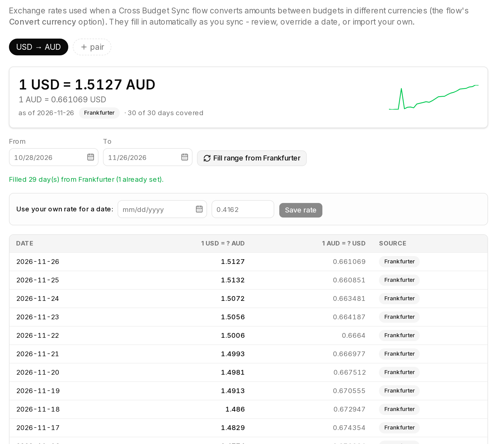

If you keep a budget in another currency, a converting [Cross Budget Sync](../budget-sync/) flow
can copy it into your main budget at the right rate for each day. Exchange Rates holds those rates:
one per day, fetched for you, with gaps shown and your own rate wherever you need it.

Open it from **Sync & Automations → Exchange Rates**. Changing a rate is saved in Bench. Transactions
you already synced keep the rate they were copied with, unless you choose to update them through a
reviewed sync.

*Both directions of the rate, how much of the range is covered, and where each day's rate came
from.*

## Set up a foreign-currency budget

The quickest way is **Add currency** on the Cross Budget Sync page. Choose your main and foreign
budgets and their currencies, then confirm the account pairs (matched by name). Bench creates the
payee and category flows plus one converting transaction flow per account, grouped under the
currency. Every flow starts manual, so nothing runs until you have previewed it.

To convert in a flow you built yourself:

1. Turn on **Convert currency** in the transaction flow and choose the two currencies.
2. Open **Exchange Rates** and check the coverage for that pair and date range.
3. Fill any gaps (see below).
4. Preview the flow, and check each row's original amount, rate and converted amount before **Apply**.

## Where rates come from

Rates are fetched automatically from [Frankfurter](https://frankfurter.dev), which is free and needs
no API key. For each transaction Bench uses the rate for its exact date, or the latest earlier rate
up to 10 days back (for weekends and holidays). If no rate can be found, the row waits as **FX
pending** instead of taking an older one.

- **Fill range from Frankfurter** backfills every missing day in the range, and says how many it
  added.
- **Set your rate** enters a rate for a date by hand. It takes priority for that date.
- **Import** reads a CSV of rates for a pair.

Each day in the coverage list is labelled with its source: **Frankfurter**, **Uploaded**,
**Manual** or **Derived**.

## How a flow converts

- **Rate:** **Daily** uses each transaction's own date, **Monthly average** the mean of its month,
  and **Fixed** one rate you enter, which suits pegged currencies.
- **Bank fee %** is added to the rate on spending and taken off on money received, to get closer to
  what your bank charges.
- **The amount your bank charged:** in a preview, type the real amount into a new row's target
  amount. The row keeps the rate that amount implies.

## Rates are locked once used

Each converted transaction keeps a record of the exact rate and amounts it was copied with, plus a
short note on the transaction. Changing a rate later never rewrites those on its own. When you set a
rate that affects synced transactions, an **impact preview** shows their old and new amounts. To
apply it, turn on **Update synced transactions when the rate changes** in the flow, and the change
goes through a normal previewed sync.

## Currency position

Open **Currency position** from a converting flow's header. It shows the foreign balance, what your
main budget holds for it, what it is worth at today's rate, and the unrealised difference. It also
warns about unsynced rows, rows deleted on either side, and rows converted with an earlier date's
rate.

- **Revalue to today's rate** adds one transaction, in a category you choose, so the synced balance
  matches today's value. You confirm it first; an account can be revalued once a day.
- **Transfers to link** lists synced transfers, and synced rows without a category, that have a
  likely other side in your main budget. **Link** turns the pair into a real Actual transfer at the
  real rate, so reports stop counting it as spending and income.
- **Conversions** lists every synced row's original amount, rate, rate date, source and converted
  amount, with filters and a CSV.
- **Send categories back** copies categories you set in the main budget to the matching rows in the
  foreign budget. It only fills empty categories, and asks first.

## Troubleshooting

- **FX pending in a preview:** no rate was found for that date. Fill the range, set your rate or
  import one, or preview again if the provider was briefly unavailable.
- **A future-dated transaction stays pending:** it depends on the rate mode. **Daily** waits for a
  transaction dated two or more days ahead; one dated tomorrow uses the latest stored rate on or
  before its date. **Monthly average** waits for any future-dated transaction, and for one whose
  month is missing a day's rate so far. **Fixed** applies its rate to every date, so future
  transactions convert.
- **The converted amount is slightly off:** only the final amount is rounded. Set the bank fee, or
  type the amount your bank charged.
- **The pair is the wrong way round:** check the source and target currencies on the flow.

## Limits

- One Actual budget holds one currency; conversion happens between budgets.
- Revaluation posts one adjustment per account. It is not full realised and unrealised gain
  accounting.
- Rates depend on the provider, and on what you have filled or imported.

## Related pages

- [Cross Budget Sync](../budget-sync/) - the flows these rates convert
