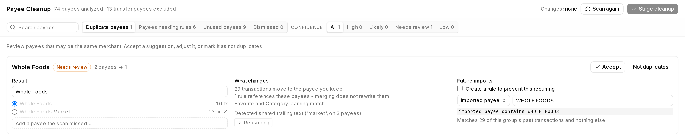
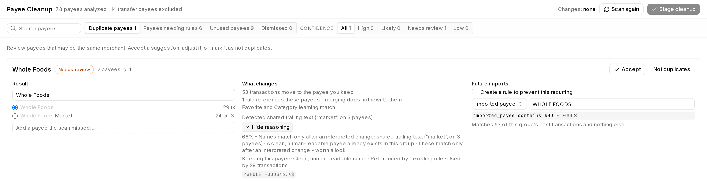
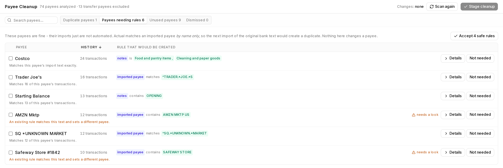
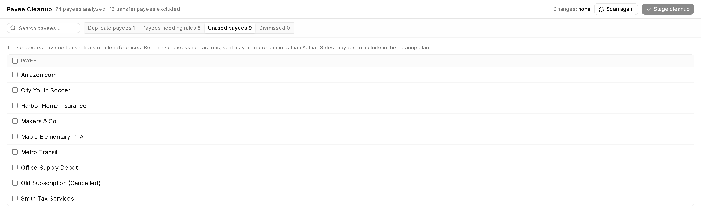

Bank imports leave a trail of near-identical payees: `AMAZON MKTPLACE 1234`, `Amazon.com*AB12`,
`AMZN Mktp`. Payee Cleanup finds them for you, merges them into one, and adds the rules that stop
new duplicates appearing. It has three tabs, each usable on its own:

- **Duplicate payees:** payees that are probably the same merchant, ready to merge or rename.
- **Payees needing rules:** payees whose bank text will not find them automatically next time, with
  a rule that fixes it.
- **Unused payees:** payees with no transactions and no rules, ready to delete.

Open it from **Analyze & Cleanup → Payee Cleanup**. Scanning, accepting and dismissing never change
Actual. **Stage cleanup** adds what you accepted to the **Changes** panel, and it reaches Actual
when you select **Save**.

## Before you start

Payee Cleanup works with regular payees. Transfer payees are managed by Actual and are excluded.

The feature can stage payee merges, payee renames, payee rules, and unused-payee deletions. It does
not change Favorite or Category-learning settings. When payees differ, choose the payee whose
settings you want to keep.

## The workflow

1. Scan your payees.
2. Review duplicate-payee suggestions, then accept, correct, or dismiss them.
3. Review rule suggestions for payees that need import automation.
4. Review unused payees and mark any you want to delete.
5. Select **Stage cleanup** to add your accepted work to Changes.
6. Review the staged changes, then use **Save** to write them to Actual.

## Duplicate payees

*One suggestion: the payee you keep, what merging changes, and a rule for future imports.*

Banks can create several payees for one merchant when their text includes details that change from
transaction to transaction, such as dates, card endings, store locations, or reference numbers.

Cleanup looks for two kinds of evidence:

- **Structural details:** recognizable information such as dates, card numbers, references, and
  locations.
- **Repeated boilerplate:** text repeated around many otherwise unrelated payees in your data.

Repeated boilerplate is a clue, not proof. Suggestions that use it stay in **Needs review**.

### Review a suggestion

*Reasoning explains why the payees were grouped and which name is kept.*

Each suggestion shows the payee that would remain, the proposed final name, affected transactions,
rule references, and any difference in Favorite or Category-learning settings. Schedule-managed payees
are already represented by their linked rules, so Cleanup counts each rule reference once. Open
**Reasoning** when you want to see why Cleanup grouped the payees.

You can:

- accept the suggestion;
- choose a different payee to keep;
- change the final name;
- add or remove payees from the group; or
- choose **Not duplicates**.

**Not duplicates** hides the suggestion for this budget. Restore it later from **Dismissed**.
Use **Undo my changes** to restore the suggestion's original survivor, final name, group members,
and optional rule choice.

Suggestions are grouped as **High**, **Likely**, **Needs review**, or **Low** confidence. Low-confidence
suggestions are hidden by default; show them only when you want to investigate weaker matches.

**Accept safe** accepts only suggestions with clear structural evidence, matching payee settings,
loaded transaction counts, and no rule conflict. It does not write to Actual.

### What a merge changes

When you save staged changes, Actual performs the merge. Transactions follow the payee you keep.
Existing rules are not rewritten, but continue to resolve through Actual's payee mapping after the
merge.

A duplicate-payee suggestion can include an optional rule for future imports. You choose whether to
stage that rule; it is not required to merge the payees.

Renaming or merging a payee can let the original bank text create another duplicate on a future
import. Cleanup proposes a rule only when the surviving name or an existing rule will not already
handle that text.

Before staging, Cleanup re-reads the affected payees. If a payee changed since the scan, or the
combined plan is invalid, Cleanup stops and explains what you need to correct or scan again.

If two accepted groups would result in the same final payee name, Cleanup asks you to combine them
rather than creating duplicate names.

## Payees needing rules

*The rule each payee needs, how many past transactions it matches, and a warning where an existing rule would conflict.*

A payee can be correct and still need a rule. Actual resolves an import automatically when its
imported payee exactly equals an existing payee name. When a bank sends different text, a rule can
set the correct payee automatically.

A payee needs recorded import text from at least two transactions before Cleanup can suggest a
reliable rule.

The **Payees needing rules** tab identifies payees whose import text does not already resolve by name or by
an existing rule, and for which Cleanup can suggest a sufficiently specific rule. This is independent
of duplicate cleanup: a payee can appear here even when it has no duplicate.

### Review a rule suggestion

Cleanup can match against **Imported payee** or **Notes**, depending on where the bank text appears.
It proposes an exact match when the text is stable, or a pattern when the text varies around a
reliable merchant name.

Cleanup tests each proposal against your recorded import history. It shows how many transactions for
the target payee it matches and warns when it would also match transactions that belong to another
payee.

You can change the source field and condition. Cleanup reruns the check when you edit them.

When an existing rule covers only part of the payee's history, Cleanup shows it so you can decide
whether to edit that rule or stage the proposal. If an existing exact-match rule can be extended
safely, Cleanup adds the missing bank text to it instead of creating another rule.

Use **Accept safe rules** for proposals with no identified conflict, or select rules one at a time.
**Not needed** dismisses a rule suggestion and can be undone from **Dismissed**.

Cleanup does not suggest a rule when the payee name already handles the imports, an existing rule
handles them, or it cannot find a specific enough condition.

### Check the whole budget

The initial scan uses a limited amount of import history so the page stays responsive. Use **Check the
whole budget** when you need stronger evidence for a rule.

The result shows:

- how much of the target payee's history the rule matches;
- other payees whose transactions the rule would also match; and
- transactions with no payee that the rule would newly resolve.

If the result is only a sample, Cleanup says so. It does not present a partial result as proof that a
rule is safe.

## Unused payees

*Payees nothing uses any more, ready to select for removal.*

The **Unused payees** tab identifies regular payees with no transactions and no rule references.

Tick the payees you want to delete, or use the checkbox in the **Payee** header to choose every one
shown.

Cleanup is deliberately cautious: a payee that a rule sets or checks is not shown as unused. Before
staging, Cleanup checks the payee again so a new transaction or rule reference prevents deletion.

## Stage and save

When you are ready, select **Stage cleanup**. Accepted merges, renames, rules, and selected unused
payee deletions appear in Changes.

Review them, then select **Save**. Payee changes are saved before the rules that depend on them.

## Limits

- Transfer payees are excluded.
- The surviving payee keeps its own Favorite and Category-learning settings.
- Saved payee locations cannot be read or moved through Actual's API.
- Some bank text cannot be reduced to a reliable merchant name. Cleanup may group it for review, but
  it does not treat that as proof that the payees should be merged.
