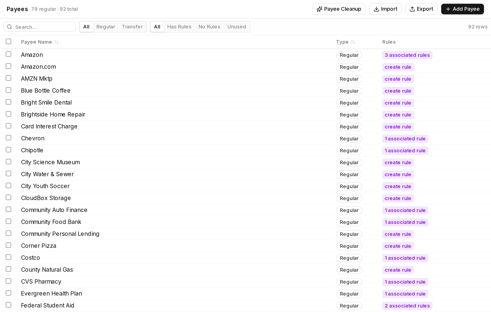
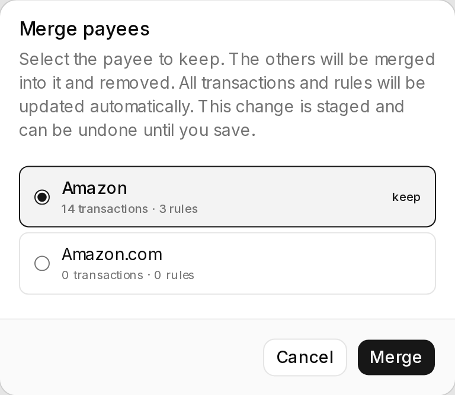

Payees lists every payee with the rules that use it, so you can rename, merge and delete in bulk
without breaking anything. To have duplicates found for you, use
[Payee Cleanup](../payee-cleanup/).

Open it from **Budget Setup → Payees**. Changes are staged and go to Actual when you select
**Save**. It uses the shared [editing model](../../getting-started/editing-and-saving/).

*Three rows for one shop is what a few years of bank imports looks like. The rule column shows which
payees something already depends on.*

## Merge duplicate payees

1. Tick two or more payees. **The first one you tick is the one that survives**, not the top row.
2. Choose **Merge**. The dialog shows which name is kept and what moves with it.
3. Review the merge in **Changes**, then **Save**. `Ctrl+Z` undoes it before you save.

Transactions and rules move to the surviving payee.

## Create, rename and delete

- Create and rename payees inline, or import them from CSV (one `name` column).
- Every delete shows the transaction and rule counts first. Deleting a payee that has transactions
  offers **Merge into another payee instead**, which keeps those transactions on a payee you choose.
- **Unused** filters to payees with no transactions and no rules. Select them all and delete to tidy
  up.

## Transfer payees

Actual creates a transfer payee for every account. They are listed under their own type, and their
checkbox is disabled, because Actual manages them.

## Common problems

- **The merge kept the wrong name:** the survivor is the first payee you ticked. Clear the selection
  and tick them again in the order you mean.
- **A payee cannot be selected:** it is a transfer payee.

## Related pages

- [Payee Cleanup](../payee-cleanup/) - find duplicates and add rules that stop them coming back
- [Rules](../rules/) - rules that use these payees
