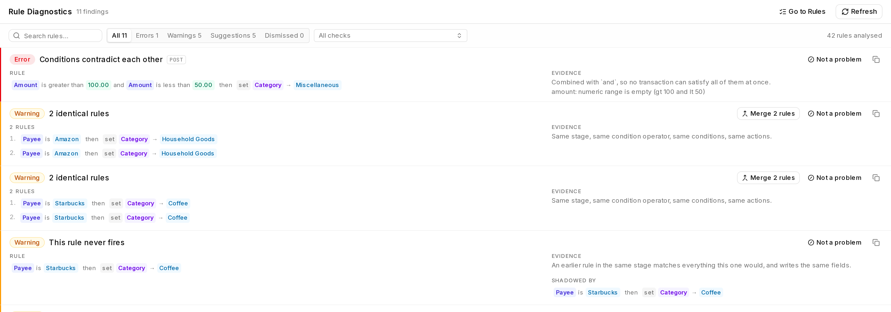
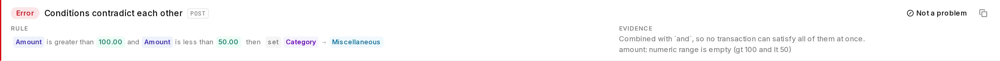
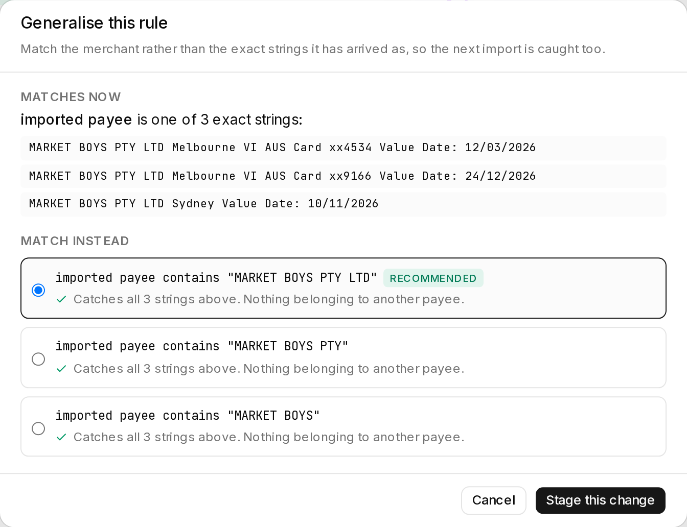
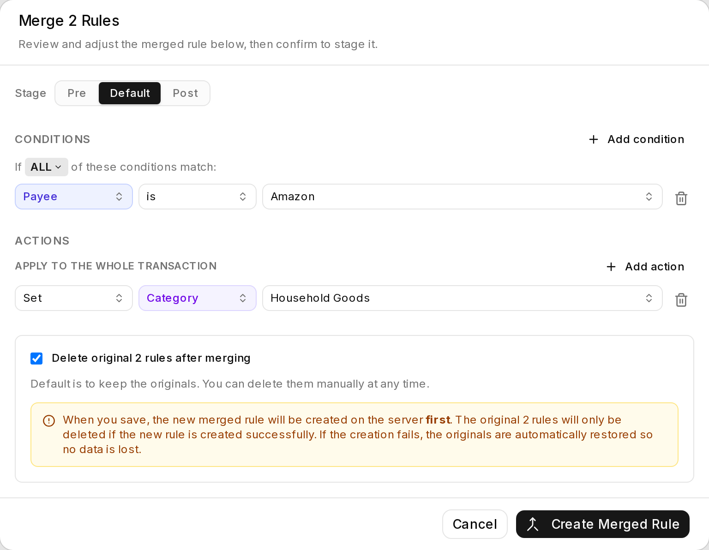
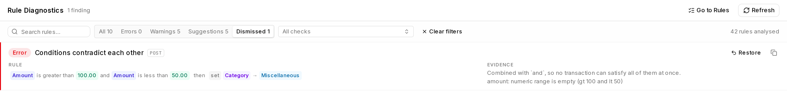

Rule Diagnostics reads your whole rule set at once and finds the problems that are hard to see one
rule at a time: rules pointing at deleted payees, rules that can never run because another rule gets
there first, duplicates, and rules that match a bank's exact text and will fail on the next import.
Each finding explains itself in a sentence, and offers a fix where one exists.

Open it from **Analyze & Cleanup → Rule Diagnostics**, or **Diagnostics** on the Rules toolbar. It
includes rules you have staged but not saved. It never changes a rule itself: every fix you start is
a normal staged edit that reaches Actual when you select **Save**.



*Every finding says what is wrong, shows the rule it is about, and offers a fix where one exists:
Merge for duplicates, Generalise for a rule matching whole import strings.*

## Read the report

Findings are listed with the most worthwhile first: what is broken, then what one fix gains you most.
Filter by **Errors**, **Warnings**, **Suggestions** or **Dismissed**.



*The title is the problem, the left is the rule it concerns, and the right is how the check knows.
What you can do about it sits in the header.*

## What it checks

- Rules naming a payee, category, account or category group that no longer exists.
- Actions that do nothing.
- Conditions that contradict each other, so the rule can never match.
- Rules that never run because an earlier rule in the same stage always matches first.
- Very broad matches, such as `contains` with a very short value.
- Rules matching whole import strings instead of the merchant (see below).
- Duplicate rules, and families of near-identical ones.
- Field and operator combinations Actual does not support.

Rules that belong to schedules are only checked for missing references, since the rest cannot be
changed from here.

## Rules that will stop matching

When you rename a payee in Actual and let it "apply that rename in the future", Actual writes a rule
that matches the **exact bank text** of that one transaction. Each later rename of the same merchant
adds another exact string ([Actual's documentation](https://actualbudget.org/docs/budgeting/rules/#automatic-rules)):

```
imported payee is one of
  MARKET BOYS PTY LTD Melbourne VI AUS Card xx4534 Value Date: 12/03/2024
  MARKET BOYS PTY LTD Melbourne VI AUS Card xx9166 Value Date: 24/12/2024
  MARKET BOYS PTY LTD Sydney Value Date: 10/11/2025
→ set payee to Market Boys
```

The card number and date change every time, so next month's text is never on the list, and a
duplicate payee appears. **Generalise** finds the part the strings share and proposes
`imported payee contains "MARKET BOYS PTY LTD"` instead, which catches every future variant.



*What it matches now, and what it could match instead, each tested against your own import history.*

A wider rule can only match more, so every option is tested against your import history first. The
dialog says what each would newly catch: text already going to this payee, text belonging to no
payee, or text belonging to **another payee**, named with examples. An option that would take
another payee's transactions is never preselected, and needs an explicit confirmation.

A rule you wrote yourself in the same shape is reported too, because it will fail for the same
reason.

## Fix a finding

- **Click a rule** to edit it right here, over the report, so the finding stays in view.
- **Generalise** opens the rewrite above.
- **Merge** opens the [merge dialog](../rules/#merge-rules) already filled in with every duplicate.
  The merged rule is created before the originals are removed.



If you change rules while the report is open, a **stale results** banner appears. Select **Refresh**
to run it again.

## Not a problem

Some findings are deliberate: two near-identical rules you want, or a broad match you meant. **Not a
problem** moves the finding to **Dismissed**, where **Restore** brings it back.



A dismissal is saved in Bench straight away (it never touches your budget), separately for each
budget. It survives editing or merging the rules involved.

## Troubleshooting

- **A missing reference:** the payee, category or account was deleted. Open the rule and choose
  another.
- **Results look stale:** select **Refresh**.
- **A very large stage was not fully compared:** a notice tells you. Comparisons are capped so the
  page stays responsive.

## Related pages

- [Rules](../rules/) - build, edit and merge rules
- [Payee Cleanup](../payee-cleanup/) - rules that stop duplicate payees
