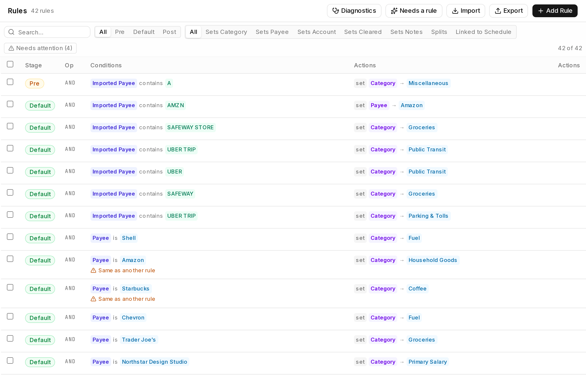

Rules shows your whole rule set as readable sentences, with every payee, category and account named
rather than shown as an id. Build rules with a guided editor, split transactions across categories,
compute values with templates and formulas, and edit fifty rules at once in a spreadsheet.

Open it from **Budget Setup → Rules**. Changes are staged and go to Actual when you select **Save**.
To audit the rule set for problems, use [Rule Diagnostics](../rule-diagnostics/).

*The whole rule set, with every reference resolved to the payee, category or account it names.*

## How a rule works

A rule has **conditions** (when it applies) and **actions** (what it does). Actual runs rules as a
transaction arrives, not over transactions you already have. A rule needs at least one condition: a
rule with none never matches.

Every rule sits in one of three **stages**, run in order: `pre`, `default`, `post`. A common pattern
is to clean up imported text in `pre`, categorise in `default`, and catch what is left in `post`.

## Create a rule

1. Select **Add Rule**. A new rule starts with a `Payee is` condition and an empty action.
2. Set the condition's field, operator and value. Add more, and choose **AND** (all must match) or
   **OR** (any can match).
3. Add actions, such as **set category**.
4. Select **Add Rule** to stage it, then **Save**.

The editor only offers fields and operators Actual accepts, so a rule you build here is one Actual
will run. It waits until you edit a row or save before marking anything missing.

### Conditions

- **Fields:** imported payee, payee, account, category, category group, date, notes, amount,
  **amount (inflow)**, **amount (outflow)**, cleared.
- **Text:** `is`, `is not`, `contains`, `does not contain`, `is one of`, `is not one of`, `matches`
  (a regular expression), and on notes, **`has all tags`** and **`has any tag`**.
- **Dates:** `is`, `is approx.`, `is after`, `is after or equals`, `is before`, `is before or equals`.
- **Amounts:** `is`, `is approx.`, `is between` and the four comparisons. **amount (outflow)**
  compares money going out as a positive number, so "amount (outflow) is greater than 100" reads the
  way you would say it.

Payees, categories and accounts appear as blue chips; typed text is green.

### Templates and formulas

On most **set** actions you can compute the value instead of typing it:

- `{}` switches the action to a **Handlebars template**, for example
  `{{regex imported_payee 'SQ \*' ''}}`.
- `ƒ` switches it to an **Excel-style formula**, starting with `=`, for example
  `=IF(ISBLANK(notes), imported_payee, notes)`.

An action is a template or a formula, not both. Payee, category and account actions hold a choice
rather than text, so they have neither.

## Split a transaction across categories

A split rule turns one transaction into several lines, each with its own category: half a
warehouse shop to groceries and half to household, say.

1. In the editor, choose **Add split**.
2. In its **Allocate** row, choose how much it takes: **a fixed amount**, **a fixed percent of the
   remainder**, **based on a formula**, or **an equal portion of the remainder**.
3. Add its actions, usually **set category**.
4. **Add split** again for each further line.

Actual works out fixed amounts and formulas first, then percentages of what is left, then equal
shares of the rest, with any rounding on the last split. Amount, account, date and cleared belong to
the whole transaction, so they appear only under **Apply to the whole transaction**.

## Find and tidy rules

- **Search knows names:** type "Groceries" and it finds rules that use that category.
- **Filter** by stage, payee, category, **Splits**, or **Linked to Schedule**.
- **Needs attention** appears with a count when rules name something that was deleted, duplicate
  another rule exactly, or have no conditions. Open a rule to fix a deleted reference: it shows as a
  "[deleted payee]" chip you can remove or replace.
- **Duplicate** copies a rule in one click.
- Arriving from a rule count on Payees, Categories or Accounts filters the list for you.

## Merge rules

1. Select the rules to combine and choose **Merge**.
2. Check the merged rule. **Delete originals** is ticked for exact duplicates and unticked for near
   ones.
3. Confirm to stage it.

Split rules cannot be merged, because combining two would produce a rule nobody wrote.

## Rules that belong to schedules

Every schedule keeps a rule behind it, with a calendar badge here. These are read-only on this page;
change them from [Schedules](../schedules/).

## Import and export

The CSV has one row per condition or action, grouped by `rule_id`. The main columns are `rule_id`,
`stage`, `conditions_op`, `row_type` (`condition` or `action`), `field`, `op`, `value`,
`split_index` and `options`.

- Separate several `is one of` values with `|`.
- `split_index` is blank for the whole transaction, and `1`, `2`, … for each split.
- `options` holds extra settings as `key=value;key=value`, such as the allocation `method` or
  `outflow=true`.
- Formulas export with a leading `'` so your spreadsheet does not evaluate them. It is removed again
  on import.

If a row uses an operator the importer does not recognise, that whole rule is skipped and the
summary names the operator.

## Examples

- **Categorise by payee:** `Payee is "Fresh Market"` → `set category "Groceries"`.
- **Clean up imported text:** in `pre`, a template on payee name:
  `{{regex imported_payee 'SQ \*' ''}}`.
- **Only large payments out:** `amount (outflow) is greater than 500.00` →
  `set category "Large Purchases"`.
- **Tagged notes:** `notes has any tag "#reimburse"` → `set category "Owed to me"`.
- **Split a warehouse shop:** `Payee is "Costco"`, then **Split 1** at 60% of the remainder to
  `Groceries` and **Split 2** taking an equal portion of the remainder to `Household`.

## Troubleshooting

- **A rule never fires:** check it has at least one condition, then its stage, and whether an
  earlier rule already changed the field it tests.
- **AND/OR confusion:** AND needs every condition to match; OR needs one.
- **A split will not save:** each split needs one **Allocate** row, and a percentage between 0 and
  100.
- **A formula will not save:** it must start with `=`.
- **A rule is read-only:** it belongs to a schedule.

## Related pages

- [Rule Diagnostics](../rule-diagnostics/) - find broken, overlapping and duplicate rules
- [Schedules](../schedules/)
- [Payee Cleanup](../payee-cleanup/) - rules that stop duplicate payees
