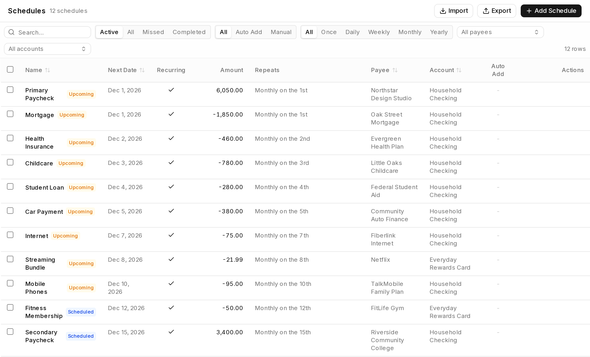

Schedules lists your recurring bills and income with the next date, amount and recurrence in plain
English, so you can set up a dozen at once and spot the ones that were missed.

Open it from **Budget Setup → Schedules**. Changes are staged and go to Actual when you select
**Save**. It uses the shared [editing model](../../getting-started/editing-and-saving/).

*What is due next across all your schedules, with the amount and account of each.*

## Create a schedule

1. Select **Add Schedule** to open the drawer.
2. Give it a name (optional), a date or recurrence, and an amount.
3. Choose a payee and account, if you like.
4. Save it to the draft, then select **Save** on the page.

A schedule can use a payee or account you created in the same draft.

### Amount

- **Exact** (`is`), **Approximate** (`is approx.`), or **Range** (`is between`, with a low and high
  amount).

### Recurrence

- **Daily**, **weekly**, **monthly** or **yearly**, every so many periods.
- Monthly schedules can fall on a day of the month (including the last day) or a position such as
  "2nd Friday".
- **Weekend adjustment** moves a date that lands on a weekend to the Friday before or the Monday
  after.
- **End** never, after a number of occurrences, or on a date.

The **Repeats** column reads it back, such as `Every 2 weeks on Wednesday`.

### Auto-add and the schedule's rule

- **Auto-add** lets Actual post the transaction when it falls due.
- Every schedule has a rule behind it, which Actual manages. **Edit as Rule** opens it. On the
  [Rules](../rules/) page these rules are read-only.

## Edit, delete and filter

- Deleting shows the schedule's rule, its auto-add setting and how many transactions it has first.
- Filter by name, payee, account, frequency and auto-add.
- Actual needs schedule names to be unique. A duplicate is flagged beside its name. **Duplicate**
  names the copy "Name (copy)".

## CSV

Schedules import and export as CSV. Imported schedules start active.

## Common problems

- **The rule is read-only:** it belongs to the schedule. Use **Edit as Rule**.
- **The recurrence summary looks wrong:** it is read from the start date. Check the day or weekday
  and the interval.

## Related pages

- [Rules](../rules/) - the rules behind schedules
- [Cashflow Planning](../cashflow-planning/) - forecast from your schedules
