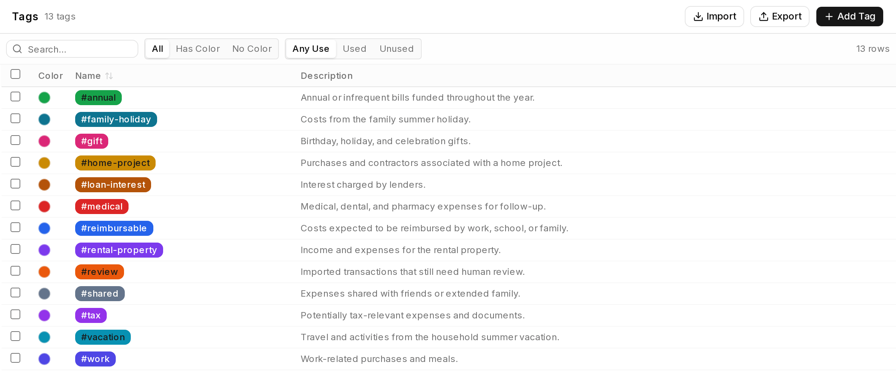

Tags lists the tags you use in transaction notes, with a colour and a description for each, so
everyone in the household knows what `#reimburse` is for.

Open it from **Budget Setup → Tags**. Tags need Actual Budget 26.3.0 or later. Changes are staged and
go to Actual when you select **Save**. It uses the shared
[editing model](../../getting-started/editing-and-saving/).

*The description sits beside the colour, rather than in someone's head.*

## Create and edit tags

1. Add a tag and give it a **name**.
2. Click the swatch to give it a **colour**, if you like.
3. Add a **description**.

Edit any field inline: `Enter` confirms, `Escape` cancels. Tag names cannot contain spaces or `#`,
because a note could never match them.

## Find what is used

- Filter by name, description, or whether a tag has a colour.
- **Used** and **Unused** show whether any transaction's notes carry the tag. Bench reads tags the
  way Actual does: `#name`, ending at a space or the next `#`.
- **Info** on a row shows which rules use the tag. It does not count transactions, because tags live
  in note text; use the **Used** filter for that.

## CSV

Columns: `name` (required), `color` (optional hex, such as `#FF5733`), `description` (optional).

## Common problems

- **No Tags page:** your Actual Server is older than 26.3.0.
- **A colour or description did not stick:** inline edits confirm on `Enter`, and the page still
  needs **Save**.

## Related pages

- [Rules](../rules/) - rules can match `has any tag` and `has all tags`
